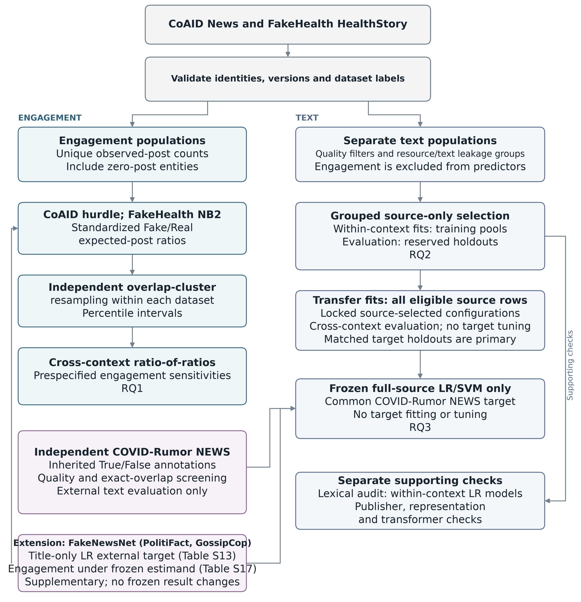
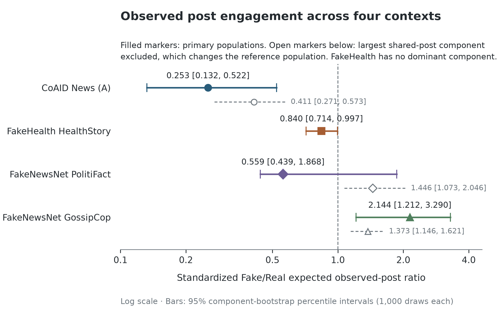
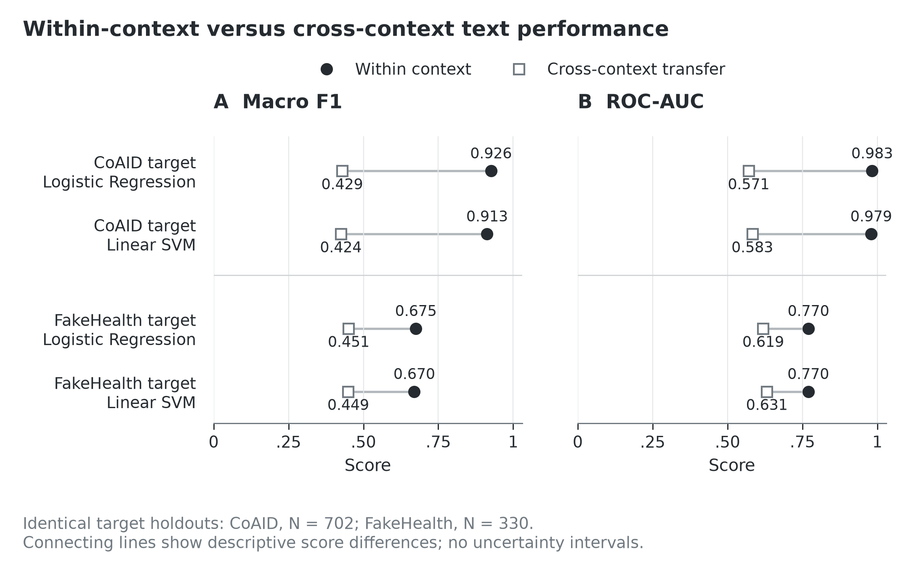
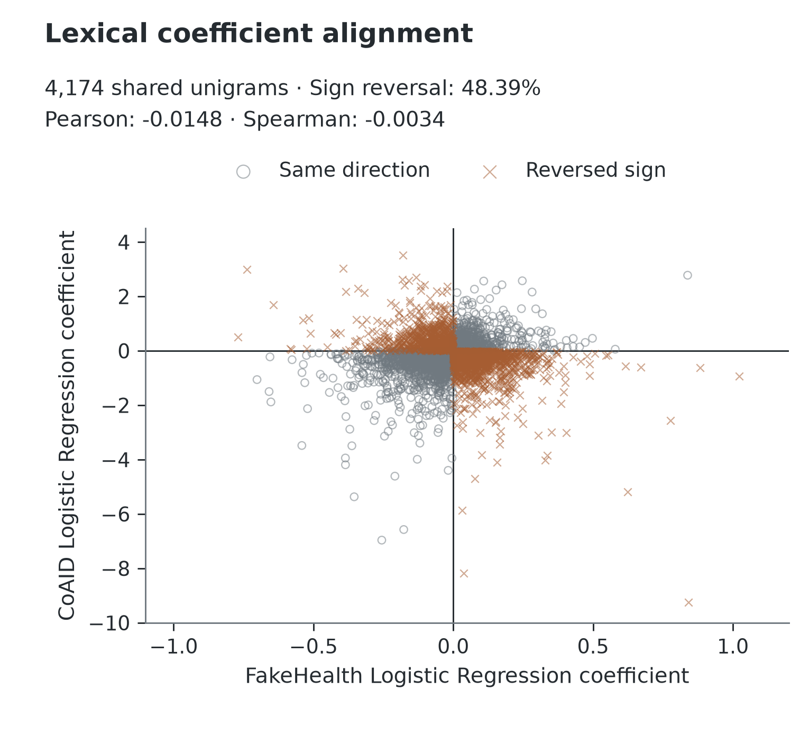
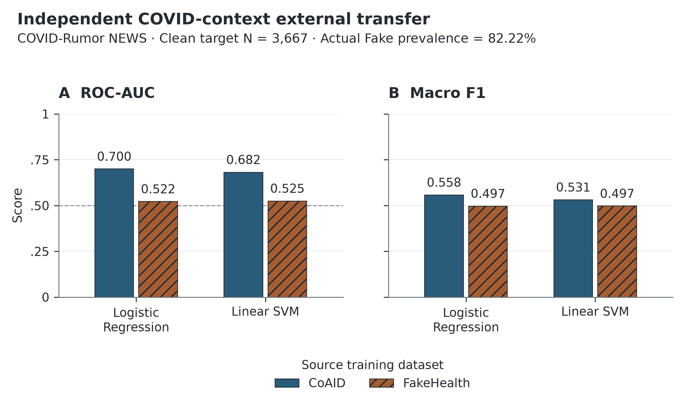

# Fake–Real gaps in observed spread and detectability differ between health misinformation datasets built in different ways: a comparison of CoAID and FakeHealth

## Abstract

Health misinformation datasets don't reach a common ground about what misinformation is. FakeHealth labels mainstream health news by expert-rated reporting quality, while CoAID compares fact-checked COVID-19 claims with material from health agencies and health information publishers. We compared model-standardized Fake/Real ratios of observed social media posts, including items with no observed posts, between the CoAID News and FakeHealth HealthStory subsets, and evaluated leakage-controlled text classifiers within, across and beyond the two datasets. Fake items drew fewer observed posts than Real items in both datasets, but the ratio was 0.253 in CoAID and 0.840 in FakeHealth (ratio-of-ratios 0.301; 95% interval 0.154–0.645). The CoAID gap lay entirely in whether an item was posted at all and was concentrated among Fake items with no identifiable publisher, which points to limited findability as well as limited spread. In two FakeNewsNet collections outside health, Fake items drew more observed posts in GossipCop (ratio 2.144), and PolitiFact's interval included parity. Text showed a parallel split: Fake and Real were highly separable within CoAID (macro F1 0.926) and modestly within FakeHealth (0.675), transfer was poor in both directions, and word–label associations were uncorrelated across datasets. Fake items were shorter in both datasets, and length alone ranked transferred items and independent COVID rumors better than the word-based models. The distance between Fake and Real items, in language and in observed engagement, differed between datasets that define and source misinformation differently; these are comparisons between dataset contexts, not estimates of a pandemic effect. Engagement studies and detection benchmarks should report how labels, sources and collection were defined, check for source–label entanglement, shared-post dependence and simple length baselines, and test beyond a single dataset.

## 1. Introduction

### 1.1 Why the definition of misinformation matters

Health misinformation can affect health intentions. In a randomized exposure experiment, COVID-19 vaccine misinformation reduced the share of respondents who said they would definitely accept vaccination by 6.2 percentage points in the UK and 6.4 points in the USA, relative to factual information ([Loomba et al., 2021](#ref-loomba)). Research on health misinformation follows two lines: measuring how it circulates on social media and building classifiers to detect it. Both of them depend on labeled datasets, and the datasets do not have a common definition of misinformation.

In FakeHealth, a story is labeled Fake when expert reviewers rate its reporting as poor. For example, an item is considered Fake because it fails to quantify benefits or harms, ignores costs, or misjudges the quality of the evidence. The stories come from major US media outlets ([Dai et al., 2020](#ref-fakehealth)), and many publishers carry both labels ([Supplementary Table S15](supplementary_material.md#table-s15-engagement-comparability-support-aggregate-rows)). In CoAID, Fake items are claims flagged by fact-checking sites, while Real items come from health agencies and health-information publishers such as the CDC, WHO, NIH, Healthline and WebMD ([Cui & Lee, 2020](#ref-coaid)). The first construct contrasts weaker and stronger reporting from the same kind of outlet, while the second contrasts fact-checked claims with institutional health information. If Fake–Real differences in engagement or language depend on which construct a dataset encodes, results from a single benchmark cannot generalize well beyond that construct.

### 1.2 Engagement: what is known and what is missing

The best known diffusion result is that false news on Twitter traveled faster and reached more people than true news, in fact-checked rumor cascades from 2006 to 2017 ([Vosoughi et al., 2018](#ref-vosoughi)). That analysis began from content that already formed cascades. Counting every labeled item, including those with no observed posts, asks a prior question: is an item taken up at all? [Juul and Ugander (2021)](#ref-juul2021) later showed that the reported structural differences between false and true cascades largely disappear once cascade size is matched, because false news cascades were generally larger. For COVID-19, [Cinelli et al. (2020)](#ref-cinelli) found platform differences in the volume and amplification of questionable sources, but no different spreading patterns for reliable and questionable sources within their data. To our knowledge, no study has compared the Fake–Real engagement gap across datasets that encode different misinformation constructs on a common zero inclusive scale.

Measuring that gap requires two additional steps. Repeated captures of an updated web page must be resolved into content items before engagement is counted, and items that share the same posts must be treated as dependent when estimating uncertainty.

### 1.3 Detection: what is known about portability

A classifier can learn a dataset's labels without learning anything that holds elsewhere. [Torabi Asr and Taboada (2018)](#ref-asr) found that classifiers trained on labels derived from source reputation generalized poorly to article level veracity labels and performed unevenly across topics, though their predictions showed some correspondence with article veracity. [Murayama et al. (2021)](#ref-murayama) showed that proper names specific to the period in which a fake-news dataset was created can become predictive. They examined how this bias affects robustness on datasets that differ in domain and creation period. Leakage between training and test material can also inflate performance estimates ([Kapoor & Narayanan, 2023](#ref-kapoor)). Within-dataset scores are hence informative about portability only when they are reported alongside transfer to other datasets, evaluated on the same target items.

### 1.4 This study

We compare CoAID News, a COVID-focused collection, with FakeHealth HealthStory, a non-COVID health news collection. Both provide health news content, Fake/Real labels and item-linked social posts, which lets us study engagement and text within the same pair of datasets. We ask three questions:

- **RQ1:** How does the model-standardized Fake to Real ratio of expected unique observed posts differ between CoAID News and FakeHealth HealthStory?
- **RQ2:** How well do learned Fake/Real textual associations generalize within and across the 2 datasets?
- **RQ3:** Do CoAID-trained and FakeHealth-trained classifiers differ in portability to the same independent COVID-Rumor NEWS target?

RQ1 contributes a zero-inclusive engagement comparison on a common standardized scale, with content versions resolved and shared-post dependence reflected in the uncertainty. RQ2 contributes a leakage-controlled measure of how far each dataset's textual signal travels, set against how strongly source and label are entangled in each dataset and against a length-only baseline. RQ3 tests whether the source ordering seen between the two datasets holds on a third collection that neither model was trained on. Two non-health collections from FakeNewsNet provide an out-of-domain check on both branches.

We treat each dataset as an information context, defined jointly by what it labels as misinformation and how it was assembled, and describe how the distance between its Fake and Real items varies across contexts. The study is a descriptive comparison between dataset contexts. Engagement is measured as captured posts instead of exposure or complete cascades, and the text models predict labels without modeling why items were shared.

## 2. Methods

### 2.1 Design overview

The study has two branches with separate populations and outcomes (Figure M1). The engagement branch models observed post counts per content item. The text branch predicts each dataset's Fake/Real labels from title and body text. Engagement measures never enter the text models. The primary protocols were CoAID reconstruction A for engagement and natural combined-text logistic regression for text; all other analyses are sensitivity or robustness checks. The primary estimand, model-selection rules, data splits and transfer design were set before engagement outcomes were modeled or holdout labels were scored. Analyses specified after the primary results were known are identified as such in Sections 2.9 and 2.11 and in [Supplementary Methods S8](supplementary_material.md#s8-supplementary-analyses-and-their-timing).

*Figure M1. Analytical workflow. The engagement branch uses zero-inclusive observed-post populations; the text branch uses separately filtered text populations. Model selection only uses source data; target data are never used for fitting or tuning. COVID-Rumor only serves as an external text target. The FakeNewsNet extension (title-only text target and engagement under the same estimand) is an out-of-domain check described in [Supplementary Methods S8](supplementary_material.md#s8-supplementary-analyses-and-their-timing).*

### 2.2 Datasets and labels

**CoAID News.** We used the News subset of the four official releases (`05-01-2020`, `07-01-2020`, `09-01-2020`, `11-01-2020`), with Fake/Real labels from the original News filenames. CoAID's Fake items were drawn from fact-checking sites and its Real items from nine health agencies and health information publishers ([Cui & Lee, 2020](#ref-coaid); [cuilimeng, n.d.](#ref-coaid_repo)). The primary engagement population (reconstruction A) contained 5,337 items: 922 Fake and 4,415 Real. Content records were linked to post mappings through the content ID and to reply mappings through the news ID, within release and file category, because release-local IDs are not globally unique.

**FakeHealth HealthStory.** Stories with an expert-review score below 3 were labeled Fake and those at 3 or above were labeled Real ([Dai et al., 2020](#ref-fakehealth); [EnyanDai, n.d.](#ref-fakehealth_repo)). Reviews, article content and engagement mappings were joined by news ID. The engagement population contained 1,690 items: 472 Fake and 1,218 Real. HealthRelease was not used. FakeHealth's retweet mappings were completely excluded from the common outcome because CoAID has no equivalent.

**COVID-Rumor NEWS.** For external text evaluation, we used the NEWS subset, mapping True to Real and False to Fake and excluding Unverified items and the Twitter subset ([Cheng et al., 2021](#ref-covidrumor); [MickeysClubhouse, n.d.](#ref-covidrumor_repo)). Annotations were inherited rather than independently re-verified.

The analytical labels share an orientation (Fake = 1) but do not share a construct. FakeHealth labels reporting quality, while CoAID and COVID-Rumor labels derive from veracity judgments. This difference is the organizing variable of the study.

### 2.3 CoAID content identity

CoAID re-captures many of the same web pages across its four releases, sometimes after updates, so item identity had to be resolved before engagement could be counted. Identity relied on the specific URL or resource and on audited source lineage; shared domains, generic titles, branding and shared social posts never established identity. An early representation that merged on such cues produced one component joining 110 source records, which motivated this rule.

The primary reconstruction (A) merged captures with strong evidence of identical content or only minor updates, split material updates into separate versions, and kept captures with insufficient evidence as separate items. Reconstruction B additionally assumed stability for insufficient evidence captures of the same validated resource. Reconstruction C excluded uncertain version and unresolved identity captures. Version partitions used complete-link checks so that chains of pairwise matches could not join incompatible captures. Decision rules and audit records are in [Supplementary Methods S1](supplementary_material.md#s1-content-identity-lineage-and-engagement-linkage).

### 2.4 Engagement outcome and dependence

The primary outcome was the number of unique observed posts linked to each content item, including items with none. CoAID counts were the union of post IDs across an item's member captures; FakeHealth counts were unique tweet IDs. These are counts of captured posts. They do not measure exposure, complete cascades or network structure. Reply counts and occurrence summaries were secondary.

Distinct items can share the same posts, so items linked by shared post or reply IDs were resampled together. For each dataset and reconstruction we built a graph with items as nodes and shared IDs as edges. Its connected components, including singletons, were the resampling clusters. CoAID A had 5,056 clusters, the largest containing 187 items. FakeHealth had 1,662, the largest containing four. An influence analysis, planned with the primary protocol, refitted CoAID without its largest cluster.

### 2.5 Engagement models and estimand

CoAID counts were modeled with a hurdle model. It contained a logistic component for any observed post and a zero-truncated negative binomial (NB2) component for positive counts, each with the Fake indicator and first-recorded-release fixed effects. Release describes capture provenance rather than time of publication or exposure. The hurdle was chosen by a rule set before fitting (AIC improvement over NB2 greater than 2, or NB2 instability). FakeHealth counts were modeled with NB2 and the Fake indicator. No exposure offset was used. Model families were fixed before resampling.

Because the two model families have incomparable coefficients, we compared standardized expected counts. Let m_d(a, X_i) be the fitted expected count for item i in dataset d with its Fake indicator set to a and other covariates unchanged. For each dataset, the standardized ratio is given by equation (1),

$$
R_d = \frac{N_d^{-1}\sum_{i=1}^{N_d}m_d(1,X_i)}{N_d^{-1}\sum_{i=1}^{N_d}m_d(0,X_i)}.
$$

For the CoAID hurdle, the row-level expectation is equation (2),

$$
m_d(a,X_i)=P(Y_i>0\mid a,X_i)\,E(Y_i\mid Y_i>0,a,X_i),
$$

with the row level products of (2) averaged before forming the ratio in (1). Each dataset kept its own covariate distribution, including zero-count items. For CoAID we also report the two hurdle components, the standardized probability of any observed post and the standardized expected count given at least one post, with intervals from the same bootstrap draws. Because the estimand (1) averages row level products, the two component ratios do not multiply exactly to the overall ratio. FakeHealth has no equivalent split as it was modeled without an occurrence component. The cross-context estimand was C = R_CoAID / R_FakeHealth. Values below 1 indicate a larger relative Fake–Real gap in CoAID. The estimand compares expected posts per item, which is a mean. Where counts are heavily skewed, a few highly shared items can set its direction, and the typical Fake and Real items can differ in the opposite direction. We therefore also report medians and the probability that a randomly chosen Fake item has more observed posts than a randomly chosen Real one, counting ties as one half ([Supplementary Table S21](supplementary_material.md#table-s21-mean-versus-typical-item-zero-inclusive-unique-post-distributions-by-class)).

Uncertainty came from an unstratified pairs bootstrap of resampling clusters. Each draw sampled clusters with replacement, refitted the model and re-standardized, targeting 1,000 successful draws per dataset and reconstruction (seed 42). The cross-context interval combined all 1,000 × 1,000 pairs of independent CoAID and FakeHealth draws. These million values share marginal draws and are not independent replicates. Intervals are 95% percentile intervals. Where one cluster dominates the outcome, the interval also reflects how often that cluster is drawn ([Supplementary Table S20](supplementary_material.md#table-s20-bootstrap-shape-conditional-on-dominant-component-inclusions-and-the-politifact-dominant-component-title-audit), [Figure S1](supplementary_material.md#figure-s1-bootstrap-ratio-distributions-by-dominant-component-inclusions)). Intervals assume independence between datasets and do not include uncertainty from entity resolution, missing links or model family choice, which the B/C reconstructions and the cluster exclusion address separately.

### 2.6 Text cohorts and leakage control

Text was the title and body joined into one field, retaining case, punctuation and URLs. Empty and artifact-dominated records were excluded by label-blind rules. Predictors excluded IDs, ratings, source and review metadata, engagement and split fields. The modeling cohorts contained 1,647 FakeHealth items (459 Fake, 1,188 Real) plus 3,577 CoAID items (825 Fake, 2,752 Real).

Leakage groups joined items that share a resource, source lineage, or exact or near-exact text, so that versions of the same resource never crossed a partition. A grouped stratified split reserved about 20% of each dataset as a holdout, chosen on class counts rather than performance (FakeHealth 1,317 training / 330 holdout; CoAID 2,875 / 702), and 5 grouped cross-validation folds were formed within the training pool. A masked text variant replaced known explicit source names by using a label-blind dictionary. Because that dictionary drew on evaluation metadata too, masking is a sensitivity check rather than a training-only procedure. Details are in [Supplementary Methods S3](supplementary_material.md#s3-text-grouping-quality-and-source-masking).

### 2.7 Classical models and within-dataset evaluation

The primary classifier was word TF-IDF with L2-regularized logistic regression (LR). A linear support vector machine (SVM) tested robustness to classifier choice. Vocabularies and IDF weights were only learned within each training fold. Hyperparameters (n-gram range, minimum document frequency, regularization strength, class weighting; 24 LR and 32 SVM configurations) were chosen by mean grouped cross-validation macro F1 on the source training pool and fixed before any holdout prediction. LR classified Fake at probability ≥ 0.5 and SVM at decision score ≥ 0. We report macro F1 (the unweighted mean of class-wise F1), ROC-AUC and average precision with Fake as the positive class. Grids, tie rules and selected settings are in [Supplementary Methods S4](supplementary_material.md#s4-classical-tuning-and-selected-settings).

### 2.8 Cross-dataset transfer and lexical alignment

Transfer asks whether what a model learns in one dataset holds in another. Each source model was refitted on all eligible source items with its selected configuration and applied to the target without fitting, calibration or threshold changes, in both directions. Transfer and within-target models were compared on the identical target holdout items. Predictions were saved before target labels were joined.

To compare what the 2 models learned, we intersected the unigram vocabularies of the within-dataset LR models (4,174 shared words) and summarized the agreement of their signed coefficients by Pearson and Spearman correlation and the share of sign reversals, overall and among the top-ranked words. Coefficients are conditional associations within differently fitted models, so the comparison concerns direction instead of magnitude.

### 2.9 Robustness analyses

- **Title-only text.** LR tuned and evaluated on titles alone, with transfer compared on identical title-eligible target rows.
- **Unseen publishers (FakeHealth).** 3-fold outer evaluation holding out whole publisher families (49 families), with nested 3-fold tuning inside each outer training set. CoAID could not support an equivalent design because its publishers are almost entirely single-label and unresolved publishers are especially concentrated among Fake items.
- **Transformer.** DistilRoBERTa at a pinned revision ([Sanh et al., n.d.](#ref-distilroberta_card)), with architecture and distillation attributions to [Liu et al. (2019)](#ref-liu2019) and [Sanh et al. (2019)](#ref-sanh2019). Title plus body prefix up to 512 tokens, with a 256-token sensitivity; learning rate and epochs chosen on source cross-validation. At 512 tokens, 71.22% of FakeHealth texts and no CoAID texts were truncated. A 3-seed follow-up (42, 123, 2026) compared the two token limits for FakeHealth-to-CoAID transfer.

Full protocols are in [Supplementary Methods S5](supplementary_material.md#s5-publisher-family-evaluation) and S6.

**Diagnostics specified after the primary results.** Once the primary results were known, we wrote a protocol for a further set of diagnostics before computing any of them. All reused the selected configurations and saved splits ([Supplementary Methods S8](supplementary_material.md#s8-supplementary-analyses-and-their-timing), [Tables S18](supplementary_material.md#table-s18-coaid-a-findability-any-observed-post-by-publisher-resolution-and-first-recorded-release)–S23). For CoAID, we broke down any observed post by whether an item's publisher could be resolved and by first-recorded release. To test whether document length acts as a shared class cue, we fitted a logistic regression on log token count alone on each source training pool and scored it on every target. We summarized the saved bootstrap draws by how often the dominant cluster entered each draw, and computed medians and the probability that a random Fake item outdraws a random Real one. We refitted the FakeHealth LR on the text before and after DistilRoBERTa's 512-token cut and correlated LR coefficients across the five training folds within each dataset. After the length-baseline results were seen, we added one re-scoring check: the existing LR and SVM scores were evaluated, without refitting, within quintiles of document length, reporting ROC-AUC within each quintile and pooled over Fake–Real pairs from the same quintile.

### 2.10 External COVID-Rumor evaluation

Of 3,700 NEWS items with True/False labels, 33 overlapping exactly with source texts or resources were excluded, leaving 3,667 (3,015 Fake, 652 Real; 82.22% Fake). The 4 full-source LR and SVM models were applied unchanged. Quality and overlap-screening rules are in [Supplementary Methods S6](supplementary_material.md#s6-transformer-and-external-target-details).

### 2.11 Out-of-domain checks with FakeNewsNet

To see if the patterns held outside health, we used FakeNewsNet's PolitiFact and GossipCop subsets ([Shu et al., 2020](#ref-fakenewsnet)). Their protocols were written after the primary results were known and before any FakeNewsNet text or engagement estimate was computed ([Supplementary Methods S8](supplementary_material.md#s8-supplementary-analyses-and-their-timing)). Labels were inherited. PolitiFact labels are fact-checker conclusions. In GossipCop, stories scored below 5 of 10 by the site were labeled fake, and real items are documented as articles from E! Online. The URLs in our local copy, however, suggest a broad set of entertainment and news domains rather than to E! Online ([Supplementary Table S17](supplementary_material.md#table-s17-fakenewsnet-engagement-under-the-primary-estimand)). Two PolitiFact items listed under both labels were excluded.

For engagement, the outcome was distinct tweet IDs per item, including zeros (PolitiFact 1,052 items: 430 Fake, 622 Real; GossipCop 22,140: 5,323 Fake, 16,817 Real). Tweets were collected by headline search, and no reply or retweet mapping exists. Model selection, estimand and cluster bootstrap followed Sections 2.4–2.5, with the Fake indicator as the only covariate. The selection rule chose the hurdle model in both collections. As for CoAID, we also refitted each collection without its largest cluster of items linked by shared tweets. For text, only titles were available locally, so items passing the COVID-Rumor quality and overlap rules (PolitiFact 429 Fake, 596 Real; GossipCop 5,315 Fake, 16,799 Real) were scored with the existing title-only LR models; no title-only SVM exists.

### 2.12 Statistical reporting and reproducibility

Engagement uncertainty is reported as bootstrap percentile intervals. Fold and seed standard deviations describe variability and are not confidence intervals. Text comparisons are descriptive. No significance tests were used to declare one model or source superior. Analyses used Python 3.14 with scikit-learn ([Pedregosa et al., 2011](#ref-pedregosa2011)) and statsmodels ([Seabold & Perktold, 2010](#ref-seabold2010)), and Python 3.12 with PyTorch ([Paszke et al., 2019](#ref-paszke2019)) and Transformers ([Wolf et al., 2020](#ref-wolf2020)) for the transformer; versions, seeds and provenance records are given in [Supplementary Methods S7](supplementary_material.md#s7-reproducibility-records). 

Code and data availability are described at the end of the paper.

## 3. Results

### 3.1 Fake items drew far fewer observed posts than Real items in CoAID, and nearly as many in FakeHealth

Fake items drew fewer observed posts than Real items in both datasets, but the gap was far larger in CoAID. The standardized Fake/Real ratio was 0.253 in CoAID (95% interval 0.132–0.522): a Fake item was expected to draw about a quarter as many observed posts as a Real one. In FakeHealth the ratio was 0.840 (0.714–0.997), close to parity. The ratio of the two ratios was 0.301 (0.154–0.645; Figure 1).

The direction held under each alternative reconstruction of CoAID items (ratio-of-ratios 0.286 for B and 0.343 for C; Table 1). Its magnitude depends on one cluster. Excluding CoAID's largest group of items linked by shared posts moved the ratio-of-ratios to 0.489 (0.310–0.710), weaker but in the same direction and inside the primary interval. How often this cluster is drawn also shapes the width of the primary CoAID interval ([Supplementary Table S20](supplementary_material.md#table-s20-bootstrap-shape-conditional-on-dominant-component-inclusions-and-the-politifact-dominant-component-title-audit), [Figure S1](supplementary_material.md#figure-s1-bootstrap-ratio-distributions-by-dominant-component-inclusions)).

Absolute levels differed by an order of magnitude. Standardized expected counts were 199.9 (Fake) and 237.9 (Real) posts per FakeHealth item, against 8.8 and 34.9 per CoAID item, which is why the comparison is made between within-dataset ratios.

The CoAID gap falls entirely in whether an item was posted at all. Standardized over the same population, a Fake item had an expected 11.7% chance of any observed post against 61.7% for a Real item (ratio 0.190; 95% interval 0.164–0.218). Among items with at least one post, Fake items drew somewhat more posts than Real ones (expected 51.4 vs 39.5; ratio 1.30, 0.73–2.55), an interval that includes parity ([Supplementary Table S11](supplementary_material.md#table-s11-coaid-specification-a-hurdle-components)). Nearly all FakeHealth items had observed posts, so its ratio reflects posting volume alone.

The occurrence gap partly reflects which items the collection could find. Because CoAID's Fake items were selected by fact-checkers, most had already circulated somewhere. Fake items whose publisher could be resolved had any observed post 33.0% of the time, against 7.5% for those hosted on platforms without an identifiable account or lacking source metadata, which make up two-thirds of CoAID's Fake items. Resolved Real items were posted 57.6% of the time, so a gap remains among items that could be traced. Collection timing mattered as much as class. Real items first captured in CoAID's May and July 2020 releases had observed posts 91.3% and 90.2% of the time, but those first captured in September and November only 7.6% and 5.3%, close to the Fake shares in those releases (7.1% and 3.2%) ([Supplementary Table S18](supplementary_material.md#table-s18-coaid-a-findability-any-observed-post-by-publisher-resolution-and-first-recorded-release)). Release enters the model as a fixed effect, so the standardized contrast compares items within the same release, and it rests mainly on the two earlier releases, where posts were collected for most Real items.

*Figure 1. Fake/Real observed-post ratios in 4 contexts. Filled markers are model-standardized ratios of expected unique observed posts, including items with no observed posts, for CoAID News (A), FakeHealth HealthStory and the supplementary FakeNewsNet PolitiFact and GossipCop collections. Bars are 95% component-bootstrap percentile intervals. Open markers below each primary value show the ratio after excluding the largest shared-post component, which changes the reference population; FakeHealth has no dominant component. Log scale; the dashed line marks parity. CoAID-to-FakeHealth ratio-of-ratios 0.301 (0.154–0.645).*

### 3.2 Outside health, the size, direction and source of the gap all changed

Two non-health collections show that neither the size nor the direction of the gap is fixed (Table 2; [Supplementary Table S17](supplementary_material.md#table-s17-fakenewsnet-engagement-under-the-primary-estimand)). Under the same estimand, the Fake/Real ratio was 0.559 (0.439–1.868) for PolitiFact and 2.144 (1.212–3.290) for GossipCop.

Where the gap arose was also different. In CoAID, Fake items were far less likely than Real ones to have any observed post. In PolitiFact, which like CoAID labels items by fact-checker results, this reversed: Fake items were more likely to have any observed post (0.907 vs 0.654). PolitiFact's interval includes parity. One cluster of 84 items, 79 of them Real, holds two-thirds of the collection's post links. Its items are mostly generically titled pages and transcripts, such as web-portal pages and debate transcripts, linked by shared tweets rather than paraphrases of one story ([Supplementary Table S20](supplementary_material.md#table-s20-bootstrap-shape-conditional-on-dominant-component-inclusions-and-the-politifact-dominant-component-title-audit)). Excluding the cluster gives 1.446 (1.073–2.046), and posted Fake and Real items then drew similar numbers of posts (ratio 0.96). The same exclusion weakened CoAID's contrast but reversed PolitiFact's.

In GossipCop, Fake items drew more expected posts than Real ones in both components. The ratio stayed above 1 without its largest cluster (1.373, 1.146–1.621) and when items with repeated titles were removed (1.767). Its ratio-of-ratios against FakeHealth was 2.552 (1.357–4.087), or 1.635 (1.277–2.057) without the cluster. The excess rests on a heavy Fake tail. The median item had 12 posts if Fake and 45 if Real, and a random Fake item had more posts than a random Real one only 37% of the time (Table 2). PolitiFact shows the mirror image: its mean ratio is below 1, but the median Fake item had 77.5 posts against 7.5 for the median Real item, and a random Fake item outdrew a random Real one 63% of the time. In both non-health collections the mean and the typical item point in opposite directions. In the health datasets they agree (0.29 in CoAID, 0.46 in FakeHealth).

**Table 2. Fake/Real observed-post ratios and their components in four collections.**

| Collection | Fake label | Fake/Real ratio (95% interval) | Any observed post, Fake / Real | Posts given any, Fake/Real ratio (95% interval) | Median observed posts, Fake / Real | P(Fake > Real) |
| --- | --- | --- | --- | --- | --- | --- |
| CoAID News | Fact-checked claims (Real: health agencies and publishers) | 0.253 (0.132–0.522) | 0.117 / 0.617 | 1.30 (0.73–2.55) | 0 / 3 | 0.29 |
| FakeHealth HealthStory | Expert-rated poor reporting | 0.840 (0.714–0.997) | 0.998 / 0.995 (observed) | Not separated (single-part model) | 113 / 129 | 0.46 |
| FakeNewsNet PolitiFact | Fact-checker verdicts | 0.559 (0.439–1.868) | 0.907 / 0.654 | 0.404 (0.336–1.255) | 77.5 / 7.5 | 0.63 |
| PolitiFact, largest cluster excluded | | 1.446 (1.073–2.046) | 0.906 / 0.604 | 0.964 (0.726–1.351) | — | — |
| FakeNewsNet GossipCop | Site score below 5 of 10 | 2.144 (1.212–3.290) | 0.965 / 0.937 | 2.083 (1.185–3.179) | 12 / 45 | 0.37 |
| GossipCop, largest cluster excluded | | 1.373 (1.146–1.621) | 0.960 / 0.937 | 1.340 (1.118–1.577) | — | — |

*Standardized expected unique observed posts, including items with none. CoAID and FakeHealth are the primary contexts; the FakeNewsNet rows are an out-of-domain check with title-search tweet collection and no release covariate. Probabilities are standardized (CoAID), fitted class values (FakeNewsNet) or observed shares of items with at least one post (FakeHealth, single-part model). Cluster-excluded rows change the reference population and are influence checks. Component ratios do not multiply exactly to the overall ratio because the estimand averages row-level products. Medians and P(Fake > Real) are observed rather than model-standardized, and count items with no posts. P(Fake > Real) is the probability that a randomly chosen Fake item has more observed posts than a randomly chosen Real item, with ties counted as one half ([Supplementary Table S21](supplementary_material.md#table-s21-mean-versus-typical-item-zero-inclusive-unique-post-distributions-by-class)). Sources: [Supplementary Tables S11](supplementary_material.md#table-s11-coaid-specification-a-hurdle-components) and S17.*

### 3.3 Fake and Real were highly separable by text in CoAID and modestly separable in FakeHealth

On reserved holdouts, logistic regression reached macro F1 0.926 and ROC-AUC 0.983 in CoAID, against 0.675 and 0.770 in FakeHealth (Figure 2). The linear SVM gave nearly identical results (CoAID 0.913 and 0.979; FakeHealth 0.670 and 0.770).

Separability did not depend on explicit source names, on particular publishers or on the formatting markers we could identify. Masking source names barely changed either dataset (CoAID 0.926 to 0.928; FakeHealth 0.675 to 0.673). In FakeHealth, most of the signal survived on publishers the model had never seen: with whole publisher families held out, macro F1 averaged 0.620 across folds (SD 0.021; range 0.603–0.643; mean ROC-AUC 0.700), against 0.660 under resource-grouped cross-validation, a descriptive comparison between designs that differ in grouping and tuning. CoAID's classes differ sharply in format ([Supplementary Table S16](supplementary_material.md#table-s16-coaid-encoding-artifact-prevalence-and-repair-sensitivity)): character-encoding errors appeared in 25.9% of CoAID Fake texts and no Real texts, and year tokens and photo credits appeared in 49.0% and 24.8% of Real texts against 8.4% and 0.1% of Fake texts. In FakeHealth the same markers were spread evenly across classes (years 58.8% Fake vs 62.5% Real; credits 23.1% vs 17.9%). Repairing the encoding errors left CoAID holdout macro F1 at 0.928, and removing years, month names and credits as well gave 0.919. These checks address explicit names, publisher identity and identifiable markers; the broadest difference between CoAID's sources is genre, and its clearest trace, length, is examined next.

Document length accounts for much of the separability in both datasets ([Supplementary Table S19](supplementary_material.md#table-s19-document-length-as-a-shared-cue-scorelength-correlations-and-a-length-only-diagnostic-baseline)). A logistic regression on log token count alone reached ROC-AUC 0.882 on the CoAID holdout, against 0.983 for the word model, and 0.729 on the FakeHealth holdout, against 0.770. In CoAID the shortest fifth of texts (4–36 tokens) was 93% Fake, and the other fifths were 2–10% Fake. The word models' scores fell with length within both datasets (Spearman ρ −0.54 in CoAID, −0.63 in FakeHealth). FakeHealth's Fake items also tend to be shorter, though the classes overlap more. Words add to length. Within length quintiles, the LR still separated Fake from Real with ROC-AUC 0.878 on the CoAID holdout (SVM 0.858) and 0.672 on the FakeHealth holdout, against 0.983 and 0.770 unstratified ([Supplementary Table S19](supplementary_material.md#table-s19-document-length-as-a-shared-cue-scorelength-correlations-and-a-length-only-diagnostic-baseline)). CoAID's macro F1 of 0.926 therefore reflects both how easily short fact-checked excerpts are told apart from long institutional articles and words that separate the classes at any length. The word signal was weakest in CoAID's shortest fifth, where 131 Fake items faced 10 Real ones (0.584).

### 3.4 What each model learned did not carry over to the other dataset

Transfer cut performance sharply in both directions, leaving ranking only modestly above chance (Figure 2). On the CoAID holdout, the FakeHealth-trained LR reached macro F1 0.429 and ROC-AUC 0.571, a macro-F1 drop of 0.497 from the CoAID-trained model on the same items. On the FakeHealth holdout, the CoAID-trained LR reached 0.451 and 0.619, a drop of 0.224. SVM reproduced both results (0.424 and 0.583; 0.449 and 0.631). The larger drop on CoAID reflects its higher within-dataset baseline.

The errors ran in opposite directions as well. FakeHealth-trained models labeled too many CoAID items Fake, while CoAID-trained models labeled too few FakeHealth items Fake.

The two datasets' word–label associations were essentially unrelated (Figure 3). Across the 4,174 words shared by the two LR models, coefficients correlated at r = −0.015 (Spearman ρ = −0.003), and 48.4% reversed direction between datasets. Among the 100 most strongly weighted shared words, 48.0% reversed, so the strongest cues were no more consistent than the rest. A reversal share near one half is what independent associations would produce, so the two datasets' cues are unrelated rather than opposed. Each dataset's own coefficients were stable: refitted on different training folds, they agreed closely with themselves (mean Spearman ρ 0.78 in FakeHealth and 0.82 in CoAID), against −0.003 between datasets ([Supplementary Table S23](supplementary_material.md#table-s23-lexical-signal-reliability-lr-coefficient-agreement-across-training-folds)).

The most heavily weighted words differed in kind as well as direction ([Supplementary Table S12](supplementary_material.md#table-s12-top-fake--and-real-leaning-unigrams-of-the-within-context-lr-models)). CoAID's strongest Real-leaning word was "and", and its Real-leaning words also included dates ("2020", "april", "march") and image-credit fragments ("getty", "images", "medscape"); its Fake-leaning words were mostly topical and political terms ("coronavirus", "trump", "facebook", "stimulus", "president") along with encoding artifacts. FakeHealth's weights were much smaller and centered on health-reporting vocabulary, with press-release terms ("release") leaning Fake and words such as "costs" and "says" leaning Real. Between 9 and 14 of each dataset's 25 most Fake- or Real-leaning words leaned the other way in the other model.

One cue did carry across. Length alone ranked the transfer targets better than either word model. On all eligible items, the length baseline reached ROC-AUC 0.852 on CoAID when fitted on FakeHealth, against 0.537 for the FakeHealth word model, and 0.649 on FakeHealth when fitted on CoAID, against 0.605 ([Supplementary Table S19](supplementary_material.md#table-s19-document-length-as-a-shared-cue-scorelength-correlations-and-a-length-only-diagnostic-baseline)). Both datasets encode short as Fake, but the word models did not pass this on equally. CoAID-trained scores fell with length on FakeHealth (ρ −0.69), so long FakeHealth articles were scored as Real. FakeHealth-trained scores barely tracked length on CoAID (ρ −0.12), because its vocabulary weights outweighed it. After stratifying by length, the transferred word models ranked both targets close to chance (ROC-AUC 0.50–0.52 within length quintiles), so the ranking that did transfer between the datasets came mainly through length.

*Figure 2. Within-dataset and transferred text performance. Macro F1 (A) and ROC-AUC (B) for TF-IDF logistic regression and linear SVM. Filled circles: models trained in the target dataset; open squares: models transferred from the other dataset. Both are scored on the same target holdout items (CoAID N = 702; FakeHealth N = 330).*

*Figure 3. Word–label associations in the two datasets. Each point is one of 4,174 unigrams shared by the within-dataset logistic regression models; positive values point toward Fake. Crosses mark words whose association reverses sign between datasets (48.4%). Pearson r = −0.015; Spearman ρ = −0.003. Coefficient scales are model-specific, so the figure shows direction, not magnitude.*

### 3.5 CoAID-trained models ranked independent COVID rumors better, largely through length

On the 3,667 COVID-Rumor NEWS items, CoAID-trained models ranked items considerably better than FakeHealth-trained models (Figure 4). ROC-AUC was 0.700 versus 0.522 for LR and 0.682 versus 0.525 for SVM; FakeHealth-trained models were close to chance. Macro F1 showed the same ordering with smaller differences (LR 0.558 vs 0.497; SVM 0.531 vs 0.497). The ordering held when approximate overlaps were also excluded and when all eligible items were retained.

Length explains most of this ordering. COVID-Rumor items are short statements, and a length-only model fitted on either source pool reached ROC-AUC 0.716 on them, slightly above the CoAID word model ([Supplementary Table S19](supplementary_material.md#table-s19-document-length-as-a-shared-cue-scorelength-correlations-and-a-length-only-diagnostic-baseline)). The CoAID-trained models' scores fell with length on this target (ρ −0.36 for LR), whereas the FakeHealth-trained models' did not (ρ 0.04). What CoAID's models carried to COVID-Rumor was mostly that its Fake items, like CoAID's, are short.

The portable part of the signal was ranking. With fixed source thresholds, all four models labeled 89.6–94.4% of items Fake against a true rate of 82.2%, and balanced accuracy stayed between 0.50 and 0.55. Both source vocabularies covered most target words (89.5% of target word occurrences for CoAID, 81.9% for FakeHealth), and no target item lacked features.

A non-COVID target showed a weaker version of the same ordering. Scored with title-only LR, the CoAID-trained model ranked FakeNewsNet's fact-checked PolitiFact items better than the FakeHealth-trained model (ROC-AUC 0.608 vs 0.503) and GossipCop's entertainment items slightly better (0.532 vs 0.477). Both models were near chance on thresholded metrics, and the FakeHealth title model carried little signal even within FakeHealth (macro F1 0.513) ([Supplementary Table S13](supplementary_material.md#table-s13-fakenewsnet-title-only-external-text-target-cohort-and-lr-transfer-results)). Length alone, fitted on CoAID, ranked PolitiFact titles better than the CoAID title model (ROC-AUC 0.739 vs 0.608), so this ordering also follows the length of fact-checked claims rather than their vocabulary.

*Figure 4. Transfer to independent COVID rumors. ROC-AUC (A) and macro F1 (B) on the same 3,667 COVID-Rumor NEWS items (82.22% Fake) for models trained on CoAID (solid) and FakeHealth (hatched). Source models and thresholds were applied unchanged. Dashed line in A marks ROC-AUC = 0.5.*

### 3.6 Robustness

The main patterns held across the robustness checks (Table 1). Title-only models gave small macro-F1 gains on transfer but lower ROC-AUC in both directions, so shortening the text did not restore portability. DistilRoBERTa matched the classical within-dataset pattern (macro F1 0.939 in CoAID, 0.621 in FakeHealth) but did not improve transfer: FakeHealth-to-CoAID ROC-AUC was 0.442 and CoAID-to-FakeHealth 0.437. Truncation explains part of DistilRoBERTa's shortfall in FakeHealth (macro F1 0.621 against 0.675 for LR), but not all of it. Refitting the LR on only the text before the 512-token cut gave 0.651, and the text after the cut alone gave 0.653 with a higher ROC-AUC (0.766 vs 0.718). The FakeHealth signal is spread through each article, and 40.9% of the occurrences of the LR's 50 strongest terms fall after the cut ([Supplementary Table S22](supplementary_material.md#table-s22-fakehealth-lr-refits-on-the-text-before-and-after-the-512-token-transformer-cut)). Its transfer scores were also unstable. Across three seeds with identical settings, FakeHealth-to-CoAID macro F1 on the matched CoAID holdout at 512 tokens ranged from 0.287 to 0.510. Shortening inputs to 256 tokens raised macro F1 in all three seeds (mean change +0.101, SD 0.079) but improved ranking in only one.

**Table 1. Robustness and sensitivity checks.**

| Analysis | Result | Reading |
| --- | --- | --- |
| Engagement, reconstructions B and C | Ratio-of-ratios 0.286 (B), 0.343 (C) | Direction unchanged |
| Engagement, largest CoAID cluster excluded | Ratio-of-ratios 0.489 (0.310–0.710) vs 0.301 | Weaker, same direction (influence check) |
| Linear SVM | Within macro F1: CoAID 0.913, FakeHealth 0.670; transfer near chance | Replicates LR |
| Source-name masking | LR holdout macro F1: CoAID 0.926 → 0.928; FakeHealth 0.675 → 0.673 | Names not needed |
| CoAID encoding repair; plus years, months, credits removed | LR holdout macro F1 0.928; 0.919 (vs 0.926) | These markers not needed |
| FakeHealth unseen publishers | Mean macro F1 0.620 (SD 0.021) vs 0.660 resource-grouped | Most signal survives |
| Title-only transfer | Small macro-F1 gains; lower ROC-AUC in both directions | Does not restore transfer |
| DistilRoBERTa, 512 tokens | Transfer ROC-AUC 0.442 and 0.437 | No transfer gain |
| DistilRoBERTa, 256 vs 512 tokens, 3 seeds | Macro F1 +0.101 (SD 0.079); ranking better in 1 of 3 | Seed-sensitive |
| Length-only baseline (log token count) | ROC-AUC within CoAID 0.882 (word LR 0.983), FakeHealth 0.729 (0.770); beats word LR on both transfer targets and COVID-Rumor; word LR within length quintiles 0.878 (CoAID), 0.672 (FakeHealth) | Length carries much of the within-dataset signal and words add to it; on transfer, word models are near chance within length quintiles (0.50–0.52) |
| FakeHealth LR on text before 512-token cut | Macro F1 0.651 (vs 0.675); text after cut alone 0.653 | Truncation explains part of transformer shortfall |
| Fold-to-fold LR coefficient stability | Mean Spearman ρ 0.78 (FakeHealth), 0.82 (CoAID) vs −0.003 across | Cross-dataset non-alignment is not noise |

*SD = standard deviation across folds or seeds, not a confidence interval.*

## 4. Discussion

### 4.1 One pattern across both branches

The engagement and text branches ordered the two health datasets the same way. In FakeHealth, Fake and Real items come from overlapping publishers, text separates them modestly (macro F1 0.675, most of which survives evaluation on unseen publishers and much of which is length), and Fake items draw nearly as many observed posts as Real ones (ratio 0.840). In CoAID, source and label are nearly the same variable (Cramér's V 0.971 against 0.352 in FakeHealth, in the text-modeling cohorts; [Supplementary Table S14](supplementary_material.md#table-s14-sourceclass-association-cramers-v)), Fake and Real are highly separable by text (0.926), through both length and words, and Fake items draw about a quarter of the observed posts of Real ones (0.253). FakeHealth's Fake label marks weaker reporting from mainstream outlets, many of which also supply its Real items. CoAID's marks fact-checked claims, set against health agencies and health-information publishers. In both branches, the dataset whose Fake and Real items differ more in construct and source showed the larger Fake–Real distance. With two primary datasets, this is an association between contexts.

Two further results fit this association. First, word–label associations were unrelated between the datasets, as expected if the two Fake labels encode different constructs, and each dataset's coefficients were stable across training folds, so the two vocabularies differ reliably. Second, length was the only cue we found that carried between the datasets. Short items lean Fake in both, a length-only model transferred better than either word model, and CoAID-trained scores fell with length on FakeHealth (ρ −0.69), consistent with those models labeling too few FakeHealth items, all full articles, as Fake. The words each model weighted most also differed in kind. In FakeHealth, "costs" leaned Real, and coverage of costs is one of the review criteria; "release" leaned Fake, which may reflect the criterion on whether a story relies solely or largely on a news release ([Dai et al., 2020](#ref-fakehealth)), although the word alone does not show such reliance. CoAID's model leaned toward Real on dates, image-credit fragments and the word "and". These follow the formatting differences between its classes: 49.0% of CoAID's Real texts carry a year and 24.8% a photo credit, against 8.4% and 0.1% of its Fake texts.

Across all four collections, the Fake/Real ratio ranged from about a quarter in CoAID to about two in GossipCop, and the component behind the gap varied: in CoAID it lay in whether items were posted at all, while in GossipCop posted Fake items drew more posts.

### 4.2 Weighing the explanations

Three explanations could produce this pattern, and the evidence for them differs. The first is label construct and source ecology: the datasets define Fake differently and draw Fake and Real items from differently separated sources. It is consistent with the text results if genre is counted as part of source ecology: fact-checked claims are short statements in CoAID and COVID-Rumor, PolitiFact's titles behaved the same way, and length is the cue that carried between them, while the word models carried almost nothing between CoAID and FakeHealth beyond it. For engagement, the label construct alone does not determine the gap, because PolitiFact shares CoAID's construct but not its engagement pattern; the two collections also differ in what they count as Real.

The second explanation is how posts were collected and counted. Both CoAID and FakeHealth gathered tweets by searching for item titles, and FakeHealth also searched by keywords and URLs ([Cui & Lee, 2020](#ref-coaid); [Dai et al., 2020](#ref-fakehealth)). The procedures also differ in how queries were formed, when crawls ran and, in CoAID, how posts were pooled across repeated captures. These differences bear on the engagement counts, not on the text results. The whole CoAID gap lies in whether an item has any observed post, which is where differences in capture would appear. PolitiFact, also collected by headline search, showed no Fake occurrence deficit, so headline search does not produce one by itself. The findability breakdown supports this explanation for part of the occurrence gap. CoAID's Fake items had any observed post far less often when no publisher could be resolved (7.5%) than when one could (33.0%), and Real items first captured in CoAID's later releases rarely had any observed post either. If fact-checked claims had generally circulated before being checked, these zeros reflect what the collection could find and when it looked. Resolved Fake items were still posted less often than resolved Real ones (33.0% against 57.6%), so publisher identifiability alone does not account for the gap.

The third explanation is the COVID context itself: a crisis may shift attention toward official sources and change the language of both true and false claims. CoAID-trained models did rank COVID rumors better, but length alone matched that advantage and did the same for non-COVID PolitiFact titles. The ordering therefore tracks the short-claim form of fact-checked items, and the text results offer little evidence of a crisis effect on language.

In sum, the first explanation is consistent with both branches. The second is supported for part of CoAID's occurrence gap but cannot explain the text results. The third cannot be assessed with these data.

### 4.3 Engagement in context

Our estimates and those of [Vosoughi et al. (2018)](#ref-vosoughi) measure different quantities. Their unit was the fact-checked rumor cascade, so every item had been shared at least once. Ours is the labeled item, including items with no observed posts, and the outcome is captured posts rather than cascade depth, speed or reach. The hurdle components separate the two quantities. In CoAID, fact-checked Fake items were about one-fifth as likely as Real items to have any observed post, but those that were posted drew a comparable number of posts (ratio 1.30, with an interval that includes parity). A design that begins from cascades observes only the second quantity; the zero-inclusive design adds the first, which the findability results tie partly to what the collection could find. [Juul and Ugander (2021)](#ref-juul2021) likewise showed that comparisons of false and true news depend on what is held fixed: structural differences largely disappeared once cascade size was matched. The split did not recur in PolitiFact, where Fake items were more often posted and, without the dominant cluster, posted Fake and Real items drew similar numbers of posts (ratio 0.96).

In FakeHealth, stories that expert reviewers judged poorly reported drew 84% of the observed posts of well-reported stories. In this collection of mainstream health news, reporting quality was only weakly related to observed engagement.

The size of the CoAID contrast depends on one cluster of items linked by shared posts (ratio-of-ratios 0.489 without it, against 0.301); its direction held in every check. The ratios describe expected posts per item, and in both non-health collections the typical item pointed the other way: a random Fake item outdrew a random Real one only 37% of the time in GossipCop and 63% of the time in PolitiFact (Table 2).

### 4.4 What this means for detection

High within-dataset accuracy is weak evidence of a general detector. In CoAID, macro F1 of 0.926 within the dataset coexisted with transfer only modestly above chance and with word associations unrelated to FakeHealth's. This parallels evidence that classifiers trained on source-reputation labels generalize poorly to article-level veracity, with performance that depends on topic ([Torabi Asr & Taboada, 2018](#ref-asr)), and that period-specific proper names can become spurious cues ([Murayama et al., 2021](#ref-murayama)).

Threshold and ranking metrics need to be read together. Title-only models and shorter transformer inputs raised macro F1 without consistently improving ranking, and on the external target the signal that transferred was in ranking: balanced accuracy stayed between 0.50 and 0.55. A threshold fixed on one dataset's class balance need not suit another's.

DistilRoBERTa did not improve transfer either (ROC-AUC 0.442 and 0.437). It matched the classical models within CoAID but fell short in FakeHealth (macro F1 0.621 against 0.675), partly because most FakeHealth articles were truncated, and its transfer scores varied widely across seeds. With one transformer and three seeds, this does not rank model families; it shows that this pretrained model did not close the transfer gap. Joint learning across misinformation tasks ([Lee et al., 2021](#ref-lee)) would be most informative if evaluated against fixed external targets with explicit label constructs.

### 4.5 What the results ask of related work

Several results concern how misinformation datasets are built and analyzed, and each suggests a check for related work.

**Misinformation research.** Studies should say what both classes consist of: CoAID and PolitiFact share a Fake construct but differ in their Real class and in their engagement patterns. They should also say whether the outcome counts every item or only items that circulated. In CoAID the whole gap lay in whether items were posted at all, which a design that starts from cascades cannot see. Comparisons across datasets need a common estimand, such as standardized expected counts, and uncertainty that respects shared posts, because a single dependent cluster changed the magnitude of CoAID's contrast and the direction of PolitiFact's point estimate. Studies should also say whether they compare means or typical items, since heavy tails made the two disagree in both non-health collections.

**Machine-learning work.** A high within-dataset score can reflect how a dataset was assembled. In CoAID, source and label were nearly the same variable (Cramér's V 0.971), Fake texts were short excerpts while Real texts were long institutional articles, and length alone ranked the holdout at ROC-AUC 0.882. Real texts also carried years and photo credits that Fake texts rarely did, and encoding errors appeared only in Fake texts. Removing source names, encoding errors, or dates and credits barely changed CoAID's 0.926 macro F1, so none of these markers was necessary on its own. Six practical checks follow:

- examine how source and label co-vary before training;
- compare every model with a length-only baseline, within and across datasets, and report its scores within length strata;
- scan for formatting and encoding markers that differ by class;
- group data splits by resource, version lineage and near-duplicate text rather than by row;
- report transfer on the same target items alongside within-dataset scores;
- state the text representation, because titles, excerpts and full articles give a model different information.

**Data processing.** Several decisions that affected these results were made before any model ran. In an early representation of CoAID, generic branding and domain-level links merged distinct pages into one item joining 110 source records, so we counted engagement only after resolving items by specific resource and version lineage. Items that share posts are not independent rows. Treating them as clusters set the width of every engagement interval here, and in three collections whether one cluster was drawn largely determined where a bootstrap draw landed. Engagement scope also has to match across datasets. We excluded FakeHealth's retweets because CoAID has no equivalent, and pooled CoAID posts across its four releases. Both choices change the counts. Real items first captured in CoAID's two later releases rarely had any observed post, against about nine in ten in the earlier two, which suggests uneven collection across releases. Dataset releases that document these steps would let users judge which findings reflect collection.

### 4.6 Limitations

Label construct, source composition, COVID timing and collection procedure vary together between CoAID and FakeHealth. The study therefore describes how the Fake–Real distance differs between these dataset contexts; it cannot attribute the difference to any one of these features, and it does not estimate an effect of the pandemic. The COVID-Rumor target and the FakeNewsNet collections widen the comparison but do not remove this confounding, because each brings its own construct, period and collection procedure. Accordingly, the cross-branch pattern in Section 4.1 is an association across contexts, and the explanations in Section 4.2 are weighed by their consistency with the evidence, not identified.

Engagement is measured as captured posts. Deleted, private and uncaptured activity cannot be recovered, and if capture differed by class or dataset it could bias the ratios. CoAID's post coverage differed sharply by release, and part of its zero-inflation may reflect collection rather than circulation. The cluster bootstrap reflects dependence through shared posts only, assumes independence between datasets, and does not include uncertainty from entity resolution. The influence of one CoAID cluster shows that magnitude estimates are sensitive to a few highly shared items.

Text comparisons are bounded by the information each model received. CoAID stores short excerpts and FakeHealth full articles, most FakeHealth texts were truncated for the transformer, and the transformer follow-up covered three seeds in one direction. Publisher-held-out evaluation was possible only for FakeHealth. CoAID's Fake and Real texts also differ in format, including encoding errors confined to Fake texts. Removing these markers barely changed separability, but other collection traces remain, the largest being length: Fake texts are shorter than Real ones in both datasets. The text models were not adjusted for it. The within-quintile check, added after the length results were seen ([Supplementary Table S19](supplementary_material.md#table-s19-document-length-as-a-shared-cue-scorelength-correlations-and-a-length-only-diagnostic-baseline)), shows that the word signal survives within both datasets, but it rests on small Fake counts in CoAID's longer quintiles and reports no intervals.

The external target consists of short statements with 82% Fake prevalence. Its results describe ranking portability to that genre and class balance, and conservative overlap screening cannot exclude every equivalent item. The FakeNewsNet checks are weaker still: text was limited to titles, engagement came from a different collection procedure and period, PolitiFact's interval includes parity and its shape depends on one cluster of generic pages, and the local GossipCop Real items do not match their documented source.

### 4.7 Future work

Restricting or matching the existing collections would not yield a cleaner comparison: few publisher families carry both labels in both datasets, publisher identity is unresolved for most CoAID Fake items, and CoAID records no topic field ([Supplementary Table S15](supplementary_material.md#table-s15-engagement-comparability-support-aggregate-rows)). Separating crisis context from label construct therefore requires new data: a fixed publisher panel with adequate Fake and Real support in both crisis and comparison periods, a common item-level veracity protocol with reporting quality recorded as a separate construct, one platform outcome collected under identical query rules and a follow-up horizon fixed in advance, and retained timestamps and version lineage.

Explaining why sharing differs would also need exposure and behavioral measures. People discriminate true from false COVID-19 headlines less well when deciding what to share than when judging accuracy ([Pennycook et al., 2020](#ref-pennycook)), although a preregistered replication found a smaller effect of an accuracy prompt ([Roozenbeek et al., 2021](#ref-roozenbeek)), and a crisis may draw unusual attention to official sources such as CoAID's Real publishers. For detection, event-held-out and chronological evaluations with consistent label definitions would test whether the portability pattern recurs, and benchmarks built from such data should match Fake and Real items on length and format, or report results within length strata, so that portability can be judged on content rather than genre.

## 5. Conclusion

Fake health items drew fewer observed posts than Real ones in both health datasets, but the size of the gap differed: about a quarter as many in COVID-focused CoAID, where the shortfall came from Fake items rarely being posted at all, largely among items the collection could not trace to a publisher, and nearly as many in FakeHealth. Outside health, the gap was uncertain in PolitiFact and reversed in GossipCop. Text separability also differed: high within CoAID, modest within FakeHealth and only modestly above chance across them. Neither dataset's word cues carried over to the other; the cue that did was that Fake items were shorter. Across these collections, the distance between Fake and Real items, in language and in observed engagement, was larger where a dataset's classes differed more in construct and source. Which of the features that distinguish the datasets produces this difference, and whether crisis periods change it, is a question for data that hold platform, labeling and observation windows fixed. Until such data exist, engagement findings and detection scores should be reported alongside the definition of misinformation that produced them, the sources each class was drawn from, and the processing steps (item resolution, dependence and collection scope) that shaped the counts.

## Author contributions

J.Z. designed the study, carried out the analyses and wrote the manuscript. J.V. introduced the evaluation metrics (ROC-AUC and macro F1), taught and guided the use of pandas, suggested the models and related literature to consult, and provided overall direction on the machine-learning methodology and data processing.

## Use of AI tools

We used Anthropic’s Claude (including Claude Code) as an assistant in this work. It helped write and debug analysis and formatting scripts, run and audit the analysis pipeline, check reported numbers against saved outputs, verify references, and suggest edits to the manuscript’s wording and structure. The study design, interpretation of results and all final text were decided and reviewed by the authors, who take full responsibility for the content.

## Data and code availability

Code, data splits, model locks, classical model bundles, aggregate tables, bootstrap draws and item-level predictions are available at https://github.com/jayzh312-rgb/health-misinfo-context (release v1.0.0; archived at https://doi.org/10.5281/zenodo.24015772). Code is released under the MIT license and derived tables under CC BY 4.0. The source datasets (CoAID, FakeHealth, the COVID-19 Rumor Dataset and FakeNewsNet; [Cui & Lee, 2020](#ref-coaid); [Dai et al., 2020](#ref-fakehealth); [Cheng et al., 2021](#ref-covidrumor); [Shu et al., 2020](#ref-fakenewsnet)) are available from their providers and are not redistributed. Processed tables are shared without article text or post identifiers, so rebuilding the text features requires the providers' data. Transformer checkpoints are not included; the pinned base model, locked settings, seeds and all predictions are.

## References

Cheng, M., Wang, S., Yan, X., Yang, T., Wang, W., Huang, Z., Xiao, X., Nazarian, S., & Bogdan, P. (2021). [A COVID-19 rumor dataset](https://doi.org/10.3389/fpsyg.2021.644801). *Frontiers in Psychology*, *12*, 644801.

Cinelli, M., Quattrociocchi, W., Galeazzi, A., Valensise, C. M., Brugnoli, E., Schmidt, A. L., Zola, P., Zollo, F., & Scala, A. (2020). [The COVID-19 social media infodemic](https://doi.org/10.1038/s41598-020-73510-5). *Scientific Reports*, *10*, 16598.

Cui, L., & Lee, D. (2020). [CoAID: COVID-19 healthcare misinformation dataset](https://arxiv.org/abs/2006.00885). *arXiv preprint* arXiv:2006.00885.

cuilimeng. (n.d.). [CoAID repository](https://github.com/cuilimeng/CoAID). *GitHub repository*.

Dai, E., Sun, Y., & Wang, S. (2020). [Ginger cannot cure cancer: Battling fake health news with a comprehensive data repository](https://doi.org/10.1609/icwsm.v14i1.7350). *Proceedings of the International AAAI Conference on Web and Social Media*, *14*(1), 853–862.

EnyanDai. (n.d.). [FakeHealth repository](https://github.com/EnyanDai/FakeHealth). *GitHub repository*.

Juul, J. L., & Ugander, J. (2021). [Comparing information diffusion mechanisms by matching on cascade size](https://doi.org/10.1073/pnas.2100786118). *Proceedings of the National Academy of Sciences*, *118*(46), e2100786118.

Kapoor, S., & Narayanan, A. (2023). [Leakage and the reproducibility crisis in machine-learning-based science](https://doi.org/10.1016/j.patter.2023.100804). *Patterns*, *4*(9), 100804.

Lee, N., Li, B. Z., Wang, S., Fung, P., Ma, H., Yih, W.-t., & Khabsa, M. (2021). [On unifying misinformation detection](https://doi.org/10.18653/v1/2021.naacl-main.432). *Proceedings of the 2021 Conference of the North American Chapter of the Association for Computational Linguistics: Human Language Technologies*, 5479–5485.

Liu, Y., Ott, M., Goyal, N., Du, J., Joshi, M., Chen, D., Levy, O., Lewis, M., Zettlemoyer, L., & Stoyanov, V. (2019). [RoBERTa: A robustly optimized BERT pretraining approach](https://arxiv.org/abs/1907.11692). *arXiv preprint* arXiv:1907.11692.

Loomba, S., de Figueiredo, A., Piatek, S. J., de Graaf, K., & Larson, H. J. (2021). [Measuring the impact of COVID-19 vaccine misinformation on vaccination intent in the UK and USA](https://doi.org/10.1038/s41562-021-01056-1). *Nature Human Behaviour*, *5*(3), 337–348.

MickeysClubhouse. (n.d.). [COVID-19 rumor dataset repository](https://github.com/MickeysClubhouse/COVID-19-rumor-dataset). *GitHub repository*.

Murayama, T., Wakamiya, S., & Aramaki, E. (2021). [Mitigation of diachronic bias in fake news detection dataset](https://doi.org/10.18653/v1/2021.wnut-1.21). *Proceedings of the Seventh Workshop on Noisy User-generated Text (W-NUT 2021)*, 182–188.

Paszke, A., Gross, S., Massa, F., Lerer, A., Bradbury, J., Chanan, G., Killeen, T., Lin, Z., Gimelshein, N., Antiga, L., Desmaison, A., Kopf, A., Yang, E., DeVito, Z., Raison, M., Tejani, A., Chilamkurthy, S., Steiner, B., Fang, L., . . . Chintala, S. (2019). [PyTorch: An imperative style, high-performance deep learning library](https://papers.neurips.cc/paper_files/paper/2019/hash/bdbca288fee7f92f2bfa9f7012727740-Abstract.html). *Advances in Neural Information Processing Systems*, *32*, 8024–8035.

Pedregosa, F., Varoquaux, G., Gramfort, A., Michel, V., Thirion, B., Grisel, O., Blondel, M., Prettenhofer, P., Weiss, R., Dubourg, V., Vanderplas, J., Passos, A., Cournapeau, D., Brucher, M., Perrot, M., & Duchesnay, É. (2011). [Scikit-learn: Machine learning in Python](https://jmlr.org/papers/v12/pedregosa11a.html). *Journal of Machine Learning Research*, *12*, 2825–2830.

Pennycook, G., McPhetres, J., Zhang, Y., Lu, J. G., & Rand, D. G. (2020). [Fighting COVID-19 misinformation on social media: Experimental evidence for a scalable accuracy-nudge intervention](https://doi.org/10.1177/0956797620939054). *Psychological Science*, *31*(7), 770–780.

Roozenbeek, J., Freeman, A. L. J., & van der Linden, S. (2021). [How accurate are accuracy-nudge interventions? A preregistered direct replication of Pennycook et al. (2020)](https://doi.org/10.1177/09567976211024535). *Psychological Science*, *32*(7), 1169–1178.

Sanh, V., Debut, L., Chaumond, J., & Wolf, T. (n.d.). [Model card for DistilRoBERTa base](https://huggingface.co/distilbert/distilroberta-base/blob/fb53ab8802853c8e4fbdbcd0529f21fc6f459b2b/README.md). *Hugging Face model card*. Revision `fb53ab8802853c8e4fbdbcd0529f21fc6f459b2b`.

Sanh, V., Debut, L., Chaumond, J., & Wolf, T. (2019). [DistilBERT, a distilled version of BERT: Smaller, faster, cheaper and lighter](https://arxiv.org/abs/1910.01108). *arXiv preprint* arXiv:1910.01108.

Seabold, S., & Perktold, J. (2010). [Statsmodels: Econometric and statistical modeling with Python](https://doi.org/10.25080/Majora-92bf1922-011). *Proceedings of the 9th Python in Science Conference*, 92–96.

Shu, K., Mahudeswaran, D., Wang, S., Lee, D., & Liu, H. (2020). [FakeNewsNet: A data repository with news content, social context, and spatiotemporal information for studying fake news on social media](https://doi.org/10.1089/big.2020.0062). *Big Data*, *8*(3), 171–188.

Torabi Asr, F., & Taboada, M. (2018). [The data challenge in misinformation detection: Source reputation vs. content veracity](https://doi.org/10.18653/v1/W18-5502). *Proceedings of the First Workshop on Fact Extraction and VERification (FEVER)*, 10–15.

Vosoughi, S., Roy, D., & Aral, S. (2018). [The spread of true and false news online](https://doi.org/10.1126/science.aap9559). *Science*, *359*(6380), 1146–1151.

Wolf, T., Debut, L., Sanh, V., Chaumond, J., Delangue, C., Moi, A., Cistac, P., Rault, T., Louf, R., Funtowicz, M., Davison, J., Shleifer, S., von Platen, P., Ma, C., Jernite, Y., Plu, J., Xu, C., Le Scao, T., Gugger, S., . . . Rush, A. (2020). [Transformers: State-of-the-art natural language processing](https://doi.org/10.18653/v1/2020.emnlp-demos.6). *Proceedings of the 2020 Conference on Empirical Methods in Natural Language Processing: System Demonstrations*, 38–45.
