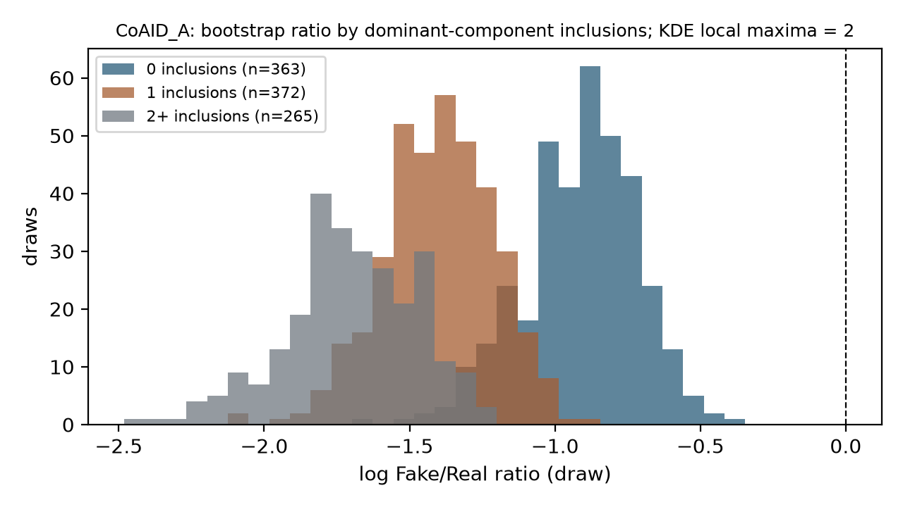
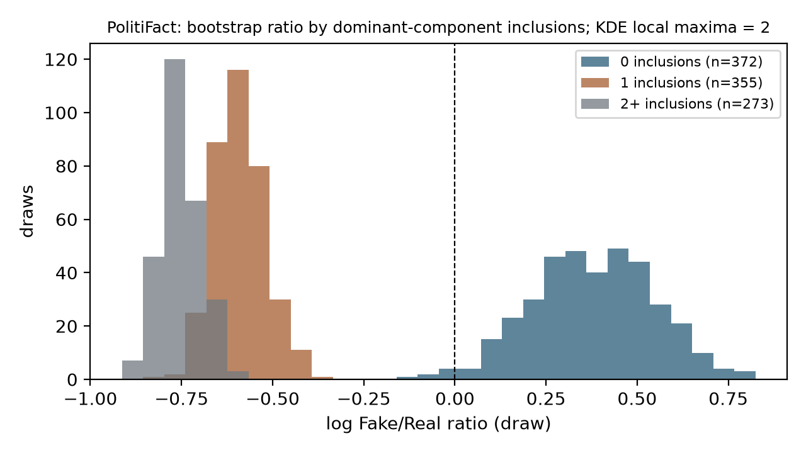
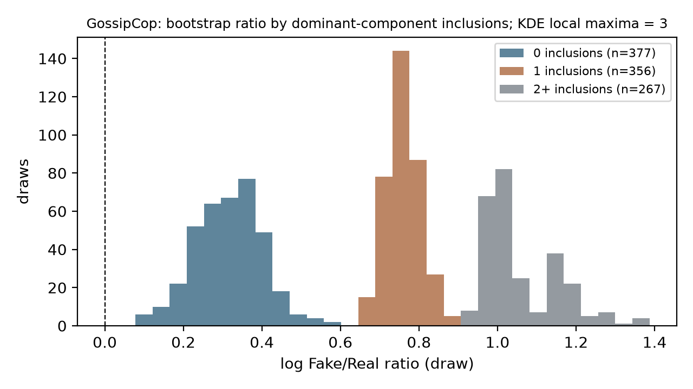

<!-- supplementary_material.md (review_package_v3), derivative of review_package_v2/supplementary_material.md built 2026-10-12 by revision_v3/build_supplement_v3.py. Sections S1-S7 and Tables S3-S10 are the v2 text with migrated Methods facts appended at the end of S1, S2, S3, S4, S6, S7; S8 and Tables S11-S17 are new. Source supplement SHA-256 40f59a54501b4ea2ca00ffc6e110c9727540f7d6722a2a47a196d953712f0805. -->

# Supplementary material

These notes specify implementation details supporting Methods Sections 2.1–2.12. All result tables are displayed below, with exact aggregate CSVs included in `data/`. Internal filenames identify archived provenance and are not dependencies for reading this package. They describe the completed protocols and do not define additional analyses.

## S1. Content identity, lineage, and engagement linkage

The authoritative CoAID populations are `A_primary_strict`, `B_resource_sensitivity`, and `C_high_certainty`, with 5,337, 5,205, and 5,082 entities, respectively. Their construction is recorded in `outputs/reports/coaid_version_aware_rebuild.md`, `outputs/tables/coaid_version_aware_entity_lineage.csv`, and `outputs/tables/coaid_version_aware_rebuild_metadata.json`. Specification A is the main population; B/C remain sensitivities.

Version partitions are the audited partitions, not clusters regenerated from a single similarity threshold. Supporting evidence includes normalized equality, token overlap, edit similarity, and body/abstract similarity, interpreted jointly with informative titles and metadata. Complete-link checks enforce compatible within-version pairs for material updates. Missing or insufficient excerpts do not establish identity, and an identical short introduction does not verify an entire historical webpage. Item-specific resource normalization remains offline; unverified redirects and cross-URL aliases are not inferred. The content-version evidence and final qualitative refinements are documented in `outputs/reports/coaid_content_version_stability.md` and its linked evidence artifacts.

Within a final entity, the representative record is selected by descending stored body length, then descending title length, then release and original UID in ascending order. All original member captures remain in provenance. Entity UIDs incorporate the specific resource, aggregation mode, and sorted source UIDs. Post and reply IDs are set-unioned within the entity; legacy aggregate counts are not added together. These rules are implemented in `materialize` in `src/rebuild_coaid_version_aware_samples.py`.

CoAID content IDs originate in `Unnamed: 0`; post files join through `index` and supply `tweet_id`, while reply files join through `news_id` and supply `reply_id`, within the release/file category. FakeHealth joins review/content/engagement records using `news_id` and retains unique IDs from the engagement dictionary's `tweets` and `replies` lists. Its separate `retweets` list is not included in the common primary count. Linkage implementations are retained in `src/build_coaid_content_table.py` and `src/build_fakehealth_content_table.py`.

Source-title changes or dates alone did not establish material change; a material-change decision required corroborating evidence across the body, title, abstract and metadata fields.

## S2. Engagement standardization and uncertainty

`src/run_version_aware_engagement_analysis.py` uses the validated count-fitting and standardization helpers in `src/run_primary_engagement_models.py` and `src/audit_engagement_estimand_robustness.py`. CoAID designs include an intercept, the Fake indicator, and first-recorded-release indicators with May as reference. FakeHealth uses the intercept and Fake indicator. For the hurdle, standardization averages each row's logistic probability multiplied by its conditional positive-count mean. Changing the reference indicator applies consistently to both model components.

Bootstrap components are sampled with replacement without class stratification; each selected component contributes all its rows. Attempt seeds depend on the sample and attempt index rather than worker scheduling. Failed warm-start fits receive the documented multistart retry on the same draw. Failure, convergence, and successful-draw records are retained; inference targets 1,000 successful post refits. Each draw uses its own sampled reference distribution. The interval excludes uncertainty about family selection, unobserved social dependence, and content-identity decisions.

`src/run_cross_context_engagement_contrast.py` combines all marginal draw pairs and uses NumPy linear empirical quantiles. The dominant-component exclusion has its own 1,000-successful-refit CoAID bootstrap, combined with the saved FakeHealth draws. This exclusion distribution is distinct from conditioning the original bootstrap on draws omitting the component. Top-five and top-1% outcome exclusions are secondary point-estimate diagnostics; their separately retained HC0 intervals are not overlap-cluster confirmation. Reply NB fits remain provisional secondary summaries rather than a replacement primary outcome.

The engagement populations were 5,337 CoAID Specification A entities (922 Fake, 4,415 Real) and 1,690 HealthStory items (472 Fake, 1,218 Real), both including entities with zero observed posts (Table S3).

FakeHealth retweets excluded from the primary outcome were also excluded from the overlap graph, so graph edges reflect only counted post and reply IDs. A connected component was a dependence unit for resampling, not a claim that its members represented identical content. The posts-only occurrence part used by the hurdle (any_post) was distinguished from the broader any-post-or-reply indicator reported as engagement_present; the two are tabulated separately in `version_aware_occurrence_results.csv`. The cross-context estimand was C = R_CoAID / R_FakeHealth, equivalently theta = log(R_CoAID) − log(R_FakeHealth); values of C below 1 indicate a smaller Fake/Real observed-post ratio in CoAID. The Cartesian bootstrap distribution was formed on these log differences and exponentiated.

## S3. Text grouping, quality, and source masking

Exact title/body comparisons use the minimally normalized case-preserved text. Near-duplicate screening uses case-preserving word shingles, ignoring punctuation for the comparison only: title bigram Jaccard >=0.95 for strings with at least 8 words, and body five-gram Jaccard >=0.90 with at least 30 words. Candidate filtering is followed by exact Jaccard verification, without learned TF-IDF or embedding features. Source lineage and specific-resource barriers are combined with text links into evaluation components. Cross-dataset flags cover directly matched rows and affected within-dataset groups; this screen does not claim to identify all paraphrases.

The final quality audit's `primary_modeling_eligible` flags supersede initial text-availability eligibility for modeling counts. All original records and decisions remain stored. Mixed artifact/substantive fields are reviewed without silently rewriting language; high-risk review-label disclosure is an exclusion rule. Primary split assignments are preserved when quality exclusions are applied. The applicable reports are `text_analysis_cohort_preparation.md` and `text_quality_and_source_cue_audit.md`; final sizes are corroborated by [tfidf_linear_svm_cohort_summary.csv](data/tfidf_linear_svm_cohort_summary.csv).

The saved `CoAID grouped-CV`, `FakeHealth grouped-CV`, and corresponding `CoAID holdout` and `FakeHealth holdout` files define original UID assignments. `cv_fold=-1` is reserved holdout; training for fold f requires `cv_fold>=0` and `cv_fold!=f`, while validation uses `cv_fold==f`. Original ineligible rows have no usable training assignment. The candidate outer fold was chosen by minimizing summed absolute deviations from 20% of total, Fake, and Real counts, breaking ties by fold index. Quality filtering does not regenerate these partitions.

The source dictionary uses prepared publisher names, article hosts/URLs, and fixed metadata-activated aliases, without labels or engagement. Overlapping identifier spans are merged and replaced with `[SOURCE]`. Explicit URL hosts are masked while paths remain; selected ambiguous short names use case-sensitive matching. Evaluation metadata contributed to dictionary preparation, so masking is a transductive sensitivity. Masking can create identical strings across previously distinct groups through deliberate information removal; existing resource barriers remain unchanged.

Text cohorts were derived from HealthStory items and CoAID Specification A entities (`A_primary_strict`), not from the B or C populations. Natural `combined_text` joined the usable title and body with a blank line; a title-only or body-only item remained eligible when the other field was unavailable. A substantive headline with a poor body could remain eligible for combined-text modeling while being excluded from body-only analyses. Exact generic-template matches could also join evaluation groups. Publisher identity or broad topic alone did not define the primary groups. Rows were sorted by stable UID before partitioning, and candidate outer partitions were generated by seed-42 StratifiedGroupKFold over leakage groups; the holdout fold was then chosen by the count rule above. For transfer evaluation, existing overlap flags and group safeguards were retained; target cohorts were not redefined in response to performance.

## S4. Classical tuning and selected settings

**Supplementary Table S1. Classical model grids and solver settings.** The settings are reproduced from the validated supplementary methods; the word n-gram notation gives inclusive bounds.

| Setting | LR | Linear SVM |
| --- | --- | --- |
| Word n-grams | (1,1), (1,2) | (1,1), (1,2) |
| min_df | 2, 5 | 2, 5 |
| C | 0.1, 1, 10 | 0.01, 0.1, 1, 10 |
| Class weighting | None, balanced | None, balanced |
| Sublinear TF; smoothed IDF; normalization | True; True; L2 | True; True; L2 |
| max_df; data type | 1.0; float64 | 1.0; float64 |
| Estimator | LogisticRegression, L2/liblinear | LinearSVC, L2/squared-hinge, dual="auto" |
| Iteration limit; tolerance | 5,000; 1e-4 | 20,000; 1e-4 |
| Fake threshold; ranking score | probability >=0.5; Fake probability | decision score >=0; decision_function |

Both vectorizers use the word-token pattern `(?u)\b\w\w+\b`, lowercase conversion, and no accent stripping. Intercepts are fitted with intercept scaling 1. In the pinned scikit-learn version, LR's pure L2 penalty is specified by `l1_ratio=0.0`. Balanced class weights depend on the training labels supplied to each fit. The mean-F1 and sample-SD tie tolerances are 0.001 for both classifiers; LR then uses unigram, smaller C, None weighting, larger min_df, and configuration ID. SVM omits the larger-min_df priority. The transformer tie policy differs: after the mean-F1 tolerance, its SD ordering has no additional tolerance.

**Supplementary Table S2. Selected natural-text configurations.** Combined-text and title-only settings retain their separate source selections.

| Selected natural configuration | n-grams | min_df | C | Class weighting |
| --- | --- | --- | --- | --- |
| Combined LR, FakeHealth | (1,2) | 5 | 1 | balanced |
| Combined LR, CoAID | (1,1) | 2 | 10 | balanced |
| Combined SVM, FakeHealth | (1,2) | 5 | 0.1 | balanced |
| Combined SVM, CoAID | (1,1) | 2 | 0.1 | balanced |
| Title LR, FakeHealth | (1,1) | 5 | 10 | balanced |
| Title LR, CoAID | (1,2) | 2 | 10 | None |

Title-only eligibility gives 1,645 FakeHealth items and 3,571 CoAID items; their holdouts contain 330 and 701 items. Comparisons with combined text use those same target rows. Natural-title settings are selected independently from combined-text settings, and masked-title fits reuse natural-title settings. Final selection tables and the corresponding baseline, SVM, and title-sensitivity reports retain these locks.

For lexical alignment, absolute ranks use minimum rank for ties, with lexical order resolving top-N selection. The above-median subset strictly exceeds either model's absolute-coefficient median among shared terms. Near-zero coefficients satisfy absolute value <0.05; the descriptive meaningful-in-both category requires both absolute values >=0.05. These audit categories do not represent statistical significance or standardized causal effect sizes.

LogisticRegression and LinearSVC were fitted with random_state 42 (seed 42 for the solvers), in addition to the seed-42 partitions. Training-only most-frequent and seed-42 stratified dummy classifiers provided baseline references for the LR evaluation; they were not selection candidates. Reverse-direction transfer results did not modify the opposite source model; each direction's source fit was saved before the other direction was scored. Within-context comparators remained the saved training-pool-to-holdout models; only evaluation rows, not training populations or sample sizes, were matched between within-context and transfer scores. The title-only design does not isolate text length alone, because title eligibility and the separately selected title configurations differ from the combined-text protocol.

## S5. Publisher-family evaluation

Names undergo Unicode NFKC normalization, case folding, and whitespace normalization. Hosts are lowercased and stripped of leading www; subdomains collapse only to an observed parent or audited identity host. Fixed aliases and unambiguous name-host links may join identities. Multiple attribution names on a host do not bridge unrelated hosts; conflicting audited identities and hosted tenants remain separate. Explicit Twitter/X account-status and YouTube channel/account URLs can define account proxies; generic platform hosts and unresolved routes do not.

The final FakeHealth outer and inner partitions use publisher/resource components, shuffled StratifiedGroupKFold, and seed 42. All outer test partitions meet the minimum support of 20 items per class, and all final inner partitions use three folds. The source map and component construction were fixed before model fitting. Selected outer-fold natural configurations are: fold 0, (1,2)/min_df=5/C=1/balanced; fold 1, (1,1)/5/1/balanced; fold 2, (1,1)/2/1/balanced. The corresponding masked fits reuse these natural settings.

Feasibility concerns in CoAID combine class-exclusive source families, sparse mixed-family data, and unresolved identities whose removal disproportionately excludes Fake support. The design therefore does not interpret a numerically feasible restricted partition as a clean language-generalization experiment. The full rationale and normalization rules are recorded in `publisher_heldout_feasibility.md`; the final experiment is `fakehealth_publisher_heldout.md`.

## S6. Transformer and external-target details

The official fast tokenizer and checkpoint revision define pair special tokens; packing is checked against that template. All titles fit the available title budget in the evaluated cohorts. Training dynamically pads each microbatch and accumulates weighted gradients to the effective batch, retaining the partial final batch. The constant scheduler allows the epoch-2 candidate checkpoint to represent the same schedule as a two-epoch refit. Completed checkpoints retain model, optimizer, and random-state provenance; execution safeguards do not change the selected optimizer or predictor protocol.

The primary experiment and token-budget follow-up are recorded in `distilroberta_text_experiment.md` and `distilroberta_budget_seed_stability.md`. The selected source settings are learning rate 2e-5 and three epochs. The targeted follow-up uses seeds 42, 123, and 2026 for both caps, reusing original seed-42 artifacts. Source class weights are recomputed for each fit's source-training population only; no target-label statistic enters training.

For COVID-Rumor NEWS, quality screening strips URLs only when checking alphabetic tokens. Text normalization otherwise preserves case and punctuation. Exact statements are compared with source title/body/combined fields, including ineligible source records. Exact specific resources use the prior offline URL normalization, remove tracking parameters, retain path identity, and exclude homepage-only matches. Missing website files are retained. High-similarity flags use title bigram Jaccard >=0.95 with >=8 words, or body/combined five-gram Jaccard >=0.90 with >=30 words. Approximate matches are retained in the primary clean cohort unless they also meet an exact exclusion rule.

Token occurrence coverage counts default-analyzer unigrams represented in the fitted source vocabulary; zero-feature diagnostics inspect transformed TF-IDF rows separately. Natural class prevalence and fixed decision thresholds are retained. The complete source-overlap evidence, quality rules, prediction-freeze checks, and evaluation scopes are recorded in `covid_rumor_external_transfer.md` and its companion validation JSON.

The following implementation details were previously stated in the main-text Methods and are consolidated here. The checkpoint was `distilbert/distilroberta-base` at immutable revision `fb53ab8802853c8e4fbdbcd0529f21fc6f459b2b`, instantiated as AutoModelForSequenceClassification with two labels. The revision-specific model card identifies RoBERTa as the teacher and the DistilBERT distillation procedure (Sanh et al., 2019; Liu et al., 2019). Training used FP32 on Apple Silicon MPS in the separate Python 3.12 environment. Microbatch size was 2, with gradient accumulation of 8 and an effective batch size of 16. AdamW used weight decay 0.01 except for bias and LayerNorm weights, betas (0.9, 0.999), epsilon 1e-8 and gradient-norm clipping at 1.0, with a constant learning-rate schedule and zero warmup. Candidate learning rates were 2e-5 and 5e-5 and candidate epoch counts were 2 and 3; each learning-rate trajectory ran for three epochs with validation at epochs 2 and 3. No early stopping, mixed precision, oversampling or target threshold tuning was used. Within-context final models trained on the source training pool; transfer models started from the pinned pretrained checkpoint and trained on all eligible source rows, including the former source holdout, with probability >= 0.5 defining Fake on the transform-only target. In the budget follow-up, CoAID's unpadded target token sequences were identical at both caps; only the available FakeHealth source body prefix changed.

The headerless NEWS item table was read using its documented rumor-ID, label, statement-content and sentiment columns. IDs, sentiment, stance, dates, engagement and source metadata were excluded as separate predictors. The quality screen required at least two alphabetic analyzer tokens after URL stripping and at least 90% Latin letters among alphabetic characters, in addition to the missing-text and artifact-only exclusions. The repository's English designation and this script check do not establish complete language identification; mixed-language statements may remain.

## S7. Reproducibility records

Saved protocol metadata provide software versions and input/output SHA-256 fingerprints. Classical versions are recorded in `engagement_model_run_metadata.json` and the classical model reports' `signature.versions` fields. Transformer versions and checkpoint identity are recorded in `transformer_feasibility.md`, `transformer_environment_audit.csv`, `requirements-transformer.txt`, and the final experiment metadata. The final experiment's saved settings take precedence over prospective feasibility proposals.

The [Methods protocol checklist](internal/provenance_notes.md) links each main-text and supplementary block to its report, table, or exact implementation helper. Reproducibility checks cover cohort/UID identity, group separation, training-only fitting, fixed configurations, prediction timing, convergence or finite-loss checks, and artifact integrity. The engagement contrast retains the documented limitation that the original within-engagement run lacked historical output-file hashes; later stages fingerprinted the saved outputs and checked their internal consistency without claiming a nonexistent earlier checksum.

**Supplementary Table S7a. Recorded software versions, checkpoint identity and seed policy.** Values are the recorded environment metadata cited in Methods; they are reproduced here so the main text can refer to them by environment name.

| Environment or item | Component | Recorded value |
| --- | --- | --- |
| `.venv` (classical and engagement) | Python | 3.14.2 |
| `.venv` | NumPy | 2.5.1 |
| `.venv` | pandas | 3.0.5 |
| `.venv` | scikit-learn | 1.9.0 |
| `.venv` | SciPy | 1.18.0 |
| `.venv` | statsmodels | 0.15.0 |
| `.venv-transformer` | Python | 3.12.7 |
| `.venv-transformer` | PyTorch | 2.14.0 |
| `.venv-transformer` | Transformers | 5.17.0 |
| Checkpoint | `distilbert/distilroberta-base` revision | `fb53ab8802853c8e4fbdbcd0529f21fc6f459b2b` |
| Seed policy | Primary seed | 42 (partitions, solvers, bootstrap resampling) |
| Seed policy | Additional seeds | 123 and 2026, used only for the targeted token-budget/seed stability check |
| Seed policy | MPS runs | Seeded; bitwise reproducibility across software or devices is not asserted |

## S8. Supplementary analyses and their timing

The primary analyses (Methods 2.2–2.8 and 2.10) followed protocols that fixed the populations, estimand, model-family rule, data splits, hyperparameter grids and transfer design before engagement outcomes were modeled or holdout labels were scored. The analyses below were specified later, after the primary results were known. Each has a written protocol under `outputs/extension_v1/protocols/`, written before the quantities it governs were computed, and each reuses the selected configurations, saved splits, saved fits or saved bootstrap draws. None reselects a hyperparameter or replaces a primary estimate. They fall into three groups.

**Reporting of saved primary quantities (Tables S11–S12).** For the CoAID Specification A hurdle, occurrence probabilities and conditional positive means by class, their ratios and the product of the two component ratios were read from the saved `version_aware_hurdle_components.csv` and the 1,000 saved successful draws in `version_aware_bootstrap_refits.csv`; percentile intervals recomputed from those draws reproduce the saved intervals exactly. The product of component ratios (0.2471) differs from the row-level-product estimand (0.2528), as expected. Table S12 lists the 25 most Fake-leaning and 25 most Real-leaning unigrams of each within-context natural LR model with coefficient, training-pool document frequency (obtained with the fitted vectorizer, without refitting), shared-vocabulary membership, the other model's sign, and whether the source-mask dictionary would remove the term as a full identifier.

**Extensions specified after the primary results (Tables S13, S16, S17).** `protocols/fakenewsnet_external_protocol.md` fixed the FakeNewsNet title-only cohort, quality and overlap rules (identical to the COVID-Rumor rules), the label-conflict gate, the title-only LR transfer fits, Fake = 1, threshold 0.5 and the metrics before scoring. Only titles exist in the local copy, so the combined-text models were not used and no title-only SVM exists; the comparison is LR-only and title-only. `protocols/fakenewsnet_engagement_protocol.md` mirrored Methods 2.4–2.5: distinct tweet IDs per item including zeros, a Fake-indicator-only design, the primary family-selection rule, the row-level-product estimand, a shared-tweet overlap graph with connected components as resampling units, 1,000 successful component-bootstrap refits with seed 42, and ratio-of-ratios against the saved CoAID A and FakeHealth draws by the same Cartesian-product rule. Descriptive feasibility medians had already been observed when this protocol was written; the protocol records this and leaves no rule discretionary. `protocols/coaid_encoding_sensitivity.md` fixed label-blind mojibake, year, month and credit patterns, a hand-written repair mapping (ftfy is not installed), and a refit of the selected CoAID LR configuration on the saved training pool with repaired text, scored on the saved holdout; the natural-text refit reproduces the primary holdout metrics exactly.

**Diagnostics (Tables S18–S23, Figure S1).** `protocols/round4_reviewer_checks.md` specified the following before any label- or outcome-dependent computation: CoAID any-post shares by label-blind publisher-resolution status, first-recorded release and fact-check site (S18); score–length correlations for every model and target and a length-only logistic regression on log token count, a diagnostic of a shared cue and not a candidate classifier (S19.1–S19.3); the saved bootstrap draws summarized by how often the dominant component entered each draw, with a label-blind title audit of PolitiFact's component (S20, Figure S1); zero-inclusive medians, percentiles and the probability that a random Fake item outdraws a random Real one (S21); refits of the selected FakeHealth LR on the text before and after the transformer's 512-token cut (S22); and fold-to-fold coefficient correlations under the selected configuration (S23). One further re-scoring check was added after the length results had been seen: the ROC-AUC of the saved LR and SVM scores within length quintiles and pooled over same-quintile Fake–Real pairs (S19.4), without refitting.

## Reading the aggregate tables

Tables S1–S2 are embedded in Section S4. Tables S3–S10 below display every scientific row and field from the included aggregate CSVs. Wide files are split into panels with repeated source-row and identity columns; scope and condition are stated for each group. Row IDs are one-based CSV data-row positions, not new observations.

Numbers are displayed to four decimal places where necessary; integers remain exact, and nonzero magnitudes below 0.0001 use scientific notation to avoid presenting them as zero. Percent fields retain their original scale. **— means a blank or non-finite value in the saved source, not zero or an imputed result.** Empty interval fields remain absent; fold/seed sample SDs are not confidence intervals. Exact source strings remain in the CSV companions. SHA-256 columns are retained only in companion data and internal mapping records. No rows are averaged or scopes combined.

## Table S3. Engagement analytical populations

Engagement populations are distinct from text cohorts. Posts and replies are captured ID totals.

### S3.1 — version_aware_sample_confirmation.csv

[Exact source CSV](data/version_aware_sample_confirmation.csv).

#### Panel S3.1.1.1.1

All saved rows. Fields: `N`, `fake_N`, `real_N`, `posts`.

| CSV row | specification | N | fake N | real N | posts |
| --- | --- | --- | --- | --- | --- |
| 1 | A_primary_strict | 5337 | 922 | 4415 | 152223 |
| 2 | B_resource_sensitivity | 5205 | 921 | 4284 | 152144 |
| 3 | C_high_certainty | 5082 | 920 | 4162 | 124743 |
| 4 | FakeHealth_HealthStory | 1690 | 472 | 1218 | 384073 |

#### Panel S3.1.1.2.1

All saved rows. Fields: `replies`.

| CSV row | specification | replies |
| --- | --- | --- |
| 1 | A_primary_strict | 120604 |
| 2 | B_resource_sensitivity | 120604 |
| 3 | C_high_certainty | 86165 |
| 4 | FakeHealth_HealthStory | 27601 |

## Table S4. Engagement specification and influence contrasts

Dataset reference populations vary by specification/exclusion. Uncertainty-method notes are repeated below. Cartesian pair counts reuse marginal draws and are not independent bootstrap samples. Tail-exclusion point estimates have no valid saved overlap-bootstrap intervals.

### S4.1 — cross_context_engagement_contrast.csv

[Exact source CSV](data/cross_context_engagement_contrast.csv).

#### Panel S4.1.1.1.1

All saved rows. Fields: `fakehealth_ratio`, `coaid_ratio`, `ratio_of_ratios`, `log_ratio_of_ratios`.

| CSV row | coaid specification | fakehealth ratio | coaid ratio | ratio of ratios | log ratio of ratios |
| --- | --- | --- | --- | --- | --- |
| 1 | A_primary_strict | 0.8403 | 0.2528 | 0.3009 | -1.2011 |
| 2 | B_resource_sensitivity | 0.8403 | 0.2401 | 0.2857 | -1.2528 |
| 3 | C_high_certainty | 0.8403 | 0.2885 | 0.3433 | -1.0692 |

#### Panel S4.1.1.2.1

All saved rows. Fields: `CI_lower_ratio`, `CI_upper_ratio`, `CI_lower_log`, `CI_upper_log`.

| CSV row | coaid specification | CI lower ratio | CI upper ratio | CI lower log | CI upper log |
| --- | --- | --- | --- | --- | --- |
| 1 | A_primary_strict | 0.1543 | 0.6452 | -1.8689 | -0.4382 |
| 2 | B_resource_sensitivity | 0.1541 | 0.6051 | -1.8700 | -0.5024 |
| 3 | C_high_certainty | 0.1817 | 0.6202 | -1.7053 | -0.4778 |

#### Panel S4.1.1.3.1

All saved rows. Fields: `bootstrap_median`, `bootstrap_median_log`, `skewness`, `excess_kurtosis`.

| CSV row | coaid specification | bootstrap median | bootstrap median log | skewness | excess kurtosis |
| --- | --- | --- | --- | --- | --- |
| 1 | A_primary_strict | 0.3163 | -1.1512 | 0.7383 | 0.0160 |
| 2 | B_resource_sensitivity | 0.2967 | -1.2150 | 0.8198 | 0.2221 |
| 3 | C_high_certainty | 0.3535 | -1.0398 | 0.5984 | 0.2879 |

#### Panel S4.1.1.4.1

All saved rows. Fields: `skewness_log`, `excess_kurtosis_log`, `ratio_interval_contains_1`, `log_interval_contains_0`.

| CSV row | coaid specification | skewness log | excess kurtosis log | ratio interval contains 1 | log interval contains 0 |
| --- | --- | --- | --- | --- | --- |
| 1 | A_primary_strict | -0.0411 | -0.5507 | False | False |
| 2 | B_resource_sensitivity | 0.0754 | -0.6289 | False | False |
| 3 | C_high_certainty | -0.2302 | -0.1370 | False | False |

#### Panel S4.1.1.5.1

All saved rows. Fields: `coaid_successful_draws`, `fakehealth_successful_draws`, `cartesian_combinations`, `percentile_025_ratio`.

| CSV row | coaid specification | coaid successful draws | fakehealth successful draws | cartesian combinations | percentile 025 ratio |
| --- | --- | --- | --- | --- | --- |
| 1 | A_primary_strict | 1000 | 1000 | 1000000 | 0.1543 |
| 2 | B_resource_sensitivity | 1000 | 1000 | 1000000 | 0.1541 |
| 3 | C_high_certainty | 1000 | 1000 | 1000000 | 0.1817 |

#### Panel S4.1.1.6.1

All saved rows. Fields: `percentile_025_log`, `percentile_25_ratio`, `percentile_25_log`, `percentile_50_ratio`.

| CSV row | coaid specification | percentile 025 log | percentile 25 ratio | percentile 25 log | percentile 50 ratio |
| --- | --- | --- | --- | --- | --- |
| 1 | A_primary_strict | -1.8689 | 0.2444 | -1.4091 | 0.3163 |
| 2 | B_resource_sensitivity | -1.8700 | 0.2318 | -1.4618 | 0.2967 |
| 3 | C_high_certainty | -1.7053 | 0.2843 | -1.2578 | 0.3535 |

#### Panel S4.1.1.7.1

All saved rows. Fields: `percentile_50_log`, `percentile_75_ratio`, `percentile_75_log`, `percentile_975_ratio`.

| CSV row | coaid specification | percentile 50 log | percentile 75 ratio | percentile 75 log | percentile 975 ratio |
| --- | --- | --- | --- | --- | --- |
| 1 | A_primary_strict | -1.1512 | 0.4394 | -0.8223 | 0.6452 |
| 2 | B_resource_sensitivity | -1.2150 | 0.4033 | -0.9082 | 0.6051 |
| 3 | C_high_certainty | -1.0398 | 0.4416 | -0.8174 | 0.6202 |

#### Panel S4.1.1.8.1

All saved rows. Fields: `percentile_975_log`.

| CSV row | coaid specification | percentile 975 log |
| --- | --- | --- |
| 1 | A_primary_strict | -0.4382 |
| 2 | B_resource_sensitivity | -0.5024 |
| 3 | C_high_certainty | -0.4778 |

**analysis role; CSV rows 1:** primary observational

**analysis role; CSV rows 2, 3:** entity/version sensitivity

**uncertainty method; CSV rows 1, 2, 3:** Full Cartesian product of independent overlap-cluster bootstrap ratios; 1000 x 1000 empirical pairs; percentile 95% interval

**interpretation note; CSV rows 1, 2, 3:** Observational dataset-context contrast; distinct standardization populations; not a causal COVID effect; dependence graph and dominant-component limitations remain

### S4.2 — cross_context_sensitivity_results.csv

[Exact source CSV](data/cross_context_sensitivity_results.csv).

#### Panel S4.2.1.1.1

All saved rows. Fields: `coaid_specification`, `fakehealth_ratio`, `coaid_ratio`, `ratio_of_ratios`.

| CSV row | sensitivity | coaid specification | fakehealth ratio | coaid ratio | ratio of ratios |
| --- | --- | --- | --- | --- | --- |
| 1 | all_retained | A_primary_strict | 0.8403 | 0.2528 | 0.3009 |
| 2 | exclude_top_1pct | A_primary_strict | 0.8403 | 0.2865 | 0.3410 |
| 3 | exclude_top_5_items | A_primary_strict | 0.8403 | 0.2611 | 0.3108 |
| 4 | exclude_dominant_component | A_exclude_dominant_component | 0.8403 | 0.4113 | 0.4895 |

#### Panel S4.2.1.2.1

All saved rows. Fields: `log_ratio_of_ratios`, `CI_lower_ratio`, `CI_upper_ratio`, `change_from_primary`.

| CSV row | sensitivity | log ratio of ratios | CI lower ratio | CI upper ratio | change from primary |
| --- | --- | --- | --- | --- | --- |
| 1 | all_retained | -1.2011 | 0.1543 | 0.6452 | 0 |
| 2 | exclude_top_1pct | -1.0758 | — | — | 0.0402 |
| 3 | exclude_top_5_items | -1.1687 | — | — | 0.0099 |
| 4 | exclude_dominant_component | -0.7145 | 0.3103 | 0.7101 | 0.1886 |

#### Panel S4.2.1.3.1

All saved rows. Fields: `relative_change_percent`, `CI_lower_log`, `CI_upper_log`, `bootstrap_median`.

| CSV row | sensitivity | relative change percent | CI lower log | CI upper log | bootstrap median |
| --- | --- | --- | --- | --- | --- |
| 1 | all_retained | 0 | — | — | — |
| 2 | exclude_top_1pct | 13.3459 | — | — | — |
| 3 | exclude_top_5_items | 3.2919 | — | — | — |
| 4 | exclude_dominant_component | 62.6842 | -1.1701 | -0.3424 | 0.4836 |

#### Panel S4.2.1.4.1

All saved rows. Fields: `bootstrap_median_log`, `skewness`, `excess_kurtosis`, `skewness_log`.

| CSV row | sensitivity | bootstrap median log | skewness | excess kurtosis | skewness log |
| --- | --- | --- | --- | --- | --- |
| 1 | all_retained | — | — | — | — |
| 2 | exclude_top_1pct | — | — | — | — |
| 3 | exclude_top_5_items | — | — | — | — |
| 4 | exclude_dominant_component | -0.7265 | 0.4097 | 0.3085 | -0.2362 |

#### Panel S4.2.1.5.1

All saved rows. Fields: `excess_kurtosis_log`, `ratio_interval_contains_1`, `log_interval_contains_0`, `coaid_successful_draws`.

| CSV row | sensitivity | excess kurtosis log | ratio interval contains 1 | log interval contains 0 | coaid successful draws |
| --- | --- | --- | --- | --- | --- |
| 1 | all_retained | — | — | — | — |
| 2 | exclude_top_1pct | — | — | — | — |
| 3 | exclude_top_5_items | — | — | — | — |
| 4 | exclude_dominant_component | 0.1799 | False | False | 1000 |

#### Panel S4.2.1.6.1

All saved rows. Fields: `fakehealth_successful_draws`, `cartesian_combinations`, `percentile_025_ratio`, `percentile_025_log`.

| CSV row | sensitivity | fakehealth successful draws | cartesian combinations | percentile 025 ratio | percentile 025 log |
| --- | --- | --- | --- | --- | --- |
| 1 | all_retained | — | — | — | — |
| 2 | exclude_top_1pct | — | — | — | — |
| 3 | exclude_top_5_items | — | — | — | — |
| 4 | exclude_dominant_component | 1000 | 1000000 | 0.3103 | -1.1701 |

#### Panel S4.2.1.7.1

All saved rows. Fields: `percentile_25_ratio`, `percentile_25_log`, `percentile_50_ratio`, `percentile_50_log`.

| CSV row | sensitivity | percentile 25 ratio | percentile 25 log | percentile 50 ratio | percentile 50 log |
| --- | --- | --- | --- | --- | --- |
| 1 | all_retained | — | — | — | — |
| 2 | exclude_top_1pct | — | — | — | — |
| 3 | exclude_top_5_items | — | — | — | — |
| 4 | exclude_dominant_component | 0.4198 | -0.8680 | 0.4836 | -0.7265 |

#### Panel S4.2.1.8.1

All saved rows. Fields: `percentile_75_ratio`, `percentile_75_log`, `percentile_975_ratio`, `percentile_975_log`.

| CSV row | sensitivity | percentile 75 ratio | percentile 75 log | percentile 975 ratio | percentile 975 log |
| --- | --- | --- | --- | --- | --- |
| 1 | all_retained | — | — | — | — |
| 2 | exclude_top_1pct | — | — | — | — |
| 3 | exclude_top_5_items | — | — | — | — |
| 4 | exclude_dominant_component | 0.5526 | -0.5931 | 0.7101 | -0.3424 |

**uncertainty method; CSV rows 1, 4:** Full Cartesian product of independent overlap-cluster bootstrap ratios; 1000 x 1000 empirical pairs; percentile 95% interval

**uncertainty method; CSV rows 2, 3:** Point only; no valid saved overlap-bootstrap distribution; no mixed HC0/cluster CI

**analysis role; CSV rows 1, 2, 3:** — (not recorded in this saved field)

**analysis role; CSV rows 4:** dominant-component influence sensitivity

**interpretation note; CSV rows 1, 2, 3:** — (not recorded in this saved field)

**interpretation note; CSV rows 4:** Observational dataset-context contrast; distinct standardization populations; not a causal COVID effect; dependence graph and dominant-component limitations remain

## Table S5. Final text cohort and partition counts

Partition labels distinguish all eligible rows, training, reserved holdout and grouped CV membership. Partitions are not additive independent populations.

### S5.1 — tfidf_linear_svm_cohort_summary.csv

[Exact source CSV](data/tfidf_linear_svm_cohort_summary.csv).

Companion-only audit fields: `uid_sha256`.

#### Panel S5.1.1.1.1

dataset: FakeHealth. Fields: `N`, `fake_N`, `real_N`, `leakage_groups`.

| CSV row | partition | N | fake N | real N | leakage groups |
| --- | --- | --- | --- | --- | --- |
| 1 | all | 1647 | 459 | 1188 | 1634 |
| 2 | training_pool | 1317 | 367 | 950 | 1305 |
| 3 | holdout | 330 | 92 | 238 | 329 |
| 4 | cv0_train | 1053 | 293 | 760 | 1042 |
| 5 | cv0_validation | 264 | 74 | 190 | 263 |
| 6 | cv1_train | 1055 | 295 | 760 | 1044 |
| 7 | cv1_validation | 262 | 72 | 190 | 261 |
| 8 | cv2_train | 1053 | 293 | 760 | 1051 |
| 9 | cv2_validation | 264 | 74 | 190 | 254 |
| 10 | cv3_train | 1053 | 293 | 760 | 1041 |

#### Panel S5.1.1.1.2

dataset: FakeHealth. Fields: `N`, `fake_N`, `real_N`, `leakage_groups`.

| CSV row | partition | N | fake N | real N | leakage groups |
| --- | --- | --- | --- | --- | --- |
| 11 | cv3_validation | 264 | 74 | 190 | 264 |
| 12 | cv4_train | 1054 | 294 | 760 | 1042 |
| 13 | cv4_validation | 263 | 73 | 190 | 263 |

#### Panel S5.1.2.1.1

dataset: CoAID. Fields: `N`, `fake_N`, `real_N`, `leakage_groups`.

| CSV row | partition | N | fake N | real N | leakage groups |
| --- | --- | --- | --- | --- | --- |
| 14 | all | 3577 | 825 | 2752 | 2828 |
| 15 | training_pool | 2875 | 659 | 2216 | 2163 |
| 16 | holdout | 702 | 166 | 536 | 665 |
| 17 | cv0_train | 2143 | 526 | 1617 | 2037 |
| 18 | cv0_validation | 732 | 133 | 599 | 126 |
| 19 | cv1_train | 2337 | 525 | 1812 | 1654 |
| 20 | cv1_validation | 538 | 134 | 404 | 509 |
| 21 | cv2_train | 2342 | 530 | 1812 | 1650 |
| 22 | cv2_validation | 533 | 129 | 404 | 513 |
| 23 | cv3_train | 2339 | 528 | 1811 | 1650 |

#### Panel S5.1.2.1.2

dataset: CoAID. Fields: `N`, `fake_N`, `real_N`, `leakage_groups`.

| CSV row | partition | N | fake N | real N | leakage groups |
| --- | --- | --- | --- | --- | --- |
| 24 | cv3_validation | 536 | 131 | 405 | 513 |
| 25 | cv4_train | 2339 | 527 | 1812 | 1661 |
| 26 | cv4_validation | 536 | 132 | 404 | 502 |

## Table S6. Title-only and combined-text comparisons

Matched comparisons use title-eligible target rows. The original combined-text and unpaired columns are separately labeled and must not be substituted for matched contrasts. CA = CoAID; FH = FakeHealth. All scopes and conditions remain separate.

### S6.1 — tfidf_logistic_title_vs_combined.csv

[Exact source CSV](data/tfidf_logistic_title_vs_combined.csv).

Companion-only audit fields: `evaluation_uid_sha256`.

#### Panel S6.1.1.1.1

evaluation: transfer; condition: natural; scope: all_eligible. Fields: `title_N`, `combined_original_N`, `matched_target_N`, `title`.

| CSV row | direction | target dataset | metric | title N | combined original N | matched target N | title |
| --- | --- | --- | --- | --- | --- | --- | --- |
| 1 | CA_to_FH | FakeHealth | macro_f1 | 1645 | 1647 | 1645 | 0.4733 |
| 2 | CA_to_FH | FakeHealth | balanced_accuracy | 1645 | 1647 | 1645 | 0.4960 |
| 3 | CA_to_FH | FakeHealth | fake_f1 | 1645 | 1647 | 1645 | 0.1524 |
| 4 | CA_to_FH | FakeHealth | roc_auc | 1645 | 1647 | 1645 | 0.4808 |
| 5 | CA_to_FH | FakeHealth | average_precision | 1645 | 1647 | 1645 | 0.2663 |
| 21 | FH_to_CA | CoAID | macro_f1 | 3571 | 3577 | 3571 | 0.4148 |
| 22 | FH_to_CA | CoAID | balanced_accuracy | 3571 | 3577 | 3571 | 0.4222 |
| 23 | FH_to_CA | CoAID | fake_f1 | 3571 | 3577 | 3571 | 0.2162 |
| 24 | FH_to_CA | CoAID | roc_auc | 3571 | 3577 | 3571 | 0.4367 |
| 25 | FH_to_CA | CoAID | average_precision | 3571 | 3577 | 3571 | 0.2019 |

#### Panel S6.1.1.2.1

evaluation: transfer; condition: natural; scope: all_eligible. Fields: `combined_same_rows`, `title_minus_combined`, `combined_original`, `unpaired_title_minus_combined_original`.

| CSV row | direction | target dataset | metric | combined same rows | title minus combined | combined original | unpaired title minus combined original |
| --- | --- | --- | --- | --- | --- | --- | --- |
| 1 | CA_to_FH | FakeHealth | macro_f1 | 0.4396 | 0.0336 | 0.4429 | 0.0304 |
| 2 | CA_to_FH | FakeHealth | balanced_accuracy | 0.4857 | 0.0103 | 0.4878 | 0.0082 |
| 3 | CA_to_FH | FakeHealth | fake_f1 | 0.0710 | 0.0814 | 0.0776 | 0.0748 |
| 4 | CA_to_FH | FakeHealth | roc_auc | 0.6032 | -0.1224 | 0.6047 | -0.1239 |
| 5 | CA_to_FH | FakeHealth | average_precision | 0.3223 | -0.0560 | 0.3246 | -0.0583 |
| 21 | FH_to_CA | CoAID | macro_f1 | 0.3746 | 0.0402 | 0.3757 | 0.0391 |
| 22 | FH_to_CA | CoAID | balanced_accuracy | 0.5210 | -0.0988 | 0.5217 | -0.0995 |
| 23 | FH_to_CA | CoAID | fake_f1 | 0.3672 | -0.1510 | 0.3694 | -0.1532 |
| 24 | FH_to_CA | CoAID | roc_auc | 0.5370 | -0.1003 | 0.5367 | -0.1001 |
| 25 | FH_to_CA | CoAID | average_precision | 0.2560 | -0.0541 | 0.2569 | -0.0550 |

#### Panel S6.1.1.3.1

evaluation: transfer; condition: natural; scope: all_eligible. Fields: `exact_same_target_rows`, `original_cohorts_identical`, `source_training_cohorts_identical`.

| CSV row | direction | target dataset | metric | exact same target rows | original cohorts identical | source training cohorts identical |
| --- | --- | --- | --- | --- | --- | --- |
| 1 | CA_to_FH | FakeHealth | macro_f1 | True | False | False |
| 2 | CA_to_FH | FakeHealth | balanced_accuracy | True | False | False |
| 3 | CA_to_FH | FakeHealth | fake_f1 | True | False | False |
| 4 | CA_to_FH | FakeHealth | roc_auc | True | False | False |
| 5 | CA_to_FH | FakeHealth | average_precision | True | False | False |
| 21 | FH_to_CA | CoAID | macro_f1 | True | False | False |
| 22 | FH_to_CA | CoAID | balanced_accuracy | True | False | False |
| 23 | FH_to_CA | CoAID | fake_f1 | True | False | False |
| 24 | FH_to_CA | CoAID | roc_auc | True | False | False |
| 25 | FH_to_CA | CoAID | average_precision | True | False | False |

#### Panel S6.1.2.1.1

evaluation: transfer; condition: natural; scope: same_target_holdout. Fields: `title_N`, `combined_original_N`, `matched_target_N`, `title`.

| CSV row | direction | target dataset | metric | title N | combined original N | matched target N | title |
| --- | --- | --- | --- | --- | --- | --- | --- |
| 6 | CA_to_FH | FakeHealth | macro_f1 | 330 | 330 | 330 | 0.4636 |
| 7 | CA_to_FH | FakeHealth | balanced_accuracy | 330 | 330 | 330 | 0.4880 |
| 8 | CA_to_FH | FakeHealth | fake_f1 | 330 | 330 | 330 | 0.1385 |
| 9 | CA_to_FH | FakeHealth | roc_auc | 330 | 330 | 330 | 0.4265 |
| 10 | CA_to_FH | FakeHealth | average_precision | 330 | 330 | 330 | 0.2568 |
| 26 | FH_to_CA | CoAID | macro_f1 | 701 | 702 | 701 | 0.4286 |
| 27 | FH_to_CA | CoAID | balanced_accuracy | 701 | 702 | 701 | 0.4288 |
| 28 | FH_to_CA | CoAID | fake_f1 | 701 | 702 | 701 | 0.2028 |
| 29 | FH_to_CA | CoAID | roc_auc | 701 | 702 | 701 | 0.4742 |
| 30 | FH_to_CA | CoAID | average_precision | 701 | 702 | 701 | 0.2220 |

#### Panel S6.1.2.2.1

evaluation: transfer; condition: natural; scope: same_target_holdout. Fields: `combined_same_rows`, `title_minus_combined`, `combined_original`, `unpaired_title_minus_combined_original`.

| CSV row | direction | target dataset | metric | combined same rows | title minus combined | combined original | unpaired title minus combined original |
| --- | --- | --- | --- | --- | --- | --- | --- |
| 6 | CA_to_FH | FakeHealth | macro_f1 | 0.4507 | 0.0129 | 0.4507 | 0.0129 |
| 7 | CA_to_FH | FakeHealth | balanced_accuracy | 0.5028 | -0.0148 | 0.5028 | -0.0148 |
| 8 | CA_to_FH | FakeHealth | fake_f1 | 0.0762 | 0.0623 | 0.0762 | 0.0623 |
| 9 | CA_to_FH | FakeHealth | roc_auc | 0.6191 | -0.1925 | 0.6191 | -0.1925 |
| 10 | CA_to_FH | FakeHealth | average_precision | 0.3409 | -0.0842 | 0.3409 | -0.0842 |
| 26 | FH_to_CA | CoAID | macro_f1 | 0.4281 | 0.0005 | 0.4290 | -0.0004 |
| 27 | FH_to_CA | CoAID | balanced_accuracy | 0.5618 | -0.1330 | 0.5624 | -0.1336 |
| 28 | FH_to_CA | CoAID | fake_f1 | 0.4012 | -0.1984 | 0.4030 | -0.2002 |
| 29 | FH_to_CA | CoAID | roc_auc | 0.5707 | -0.0965 | 0.5705 | -0.0964 |
| 30 | FH_to_CA | CoAID | average_precision | 0.2670 | -0.0449 | 0.2677 | -0.0457 |

#### Panel S6.1.2.3.1

evaluation: transfer; condition: natural; scope: same_target_holdout. Fields: `exact_same_target_rows`, `original_cohorts_identical`, `source_training_cohorts_identical`.

| CSV row | direction | target dataset | metric | exact same target rows | original cohorts identical | source training cohorts identical |
| --- | --- | --- | --- | --- | --- | --- |
| 6 | CA_to_FH | FakeHealth | macro_f1 | True | True | False |
| 7 | CA_to_FH | FakeHealth | balanced_accuracy | True | True | False |
| 8 | CA_to_FH | FakeHealth | fake_f1 | True | True | False |
| 9 | CA_to_FH | FakeHealth | roc_auc | True | True | False |
| 10 | CA_to_FH | FakeHealth | average_precision | True | True | False |
| 26 | FH_to_CA | CoAID | macro_f1 | True | False | False |
| 27 | FH_to_CA | CoAID | balanced_accuracy | True | False | False |
| 28 | FH_to_CA | CoAID | fake_f1 | True | False | False |
| 29 | FH_to_CA | CoAID | roc_auc | True | False | False |
| 30 | FH_to_CA | CoAID | average_precision | True | False | False |

#### Panel S6.1.3.1.1

evaluation: transfer; condition: source_masked; scope: all_eligible. Fields: `title_N`, `combined_original_N`, `matched_target_N`, `title`.

| CSV row | direction | target dataset | metric | title N | combined original N | matched target N | title |
| --- | --- | --- | --- | --- | --- | --- | --- |
| 11 | CA_to_FH | FakeHealth | macro_f1 | 1645 | 1647 | 1645 | 0.4719 |
| 12 | CA_to_FH | FakeHealth | balanced_accuracy | 1645 | 1647 | 1645 | 0.4943 |
| 13 | CA_to_FH | FakeHealth | fake_f1 | 1645 | 1647 | 1645 | 0.1515 |
| 14 | CA_to_FH | FakeHealth | roc_auc | 1645 | 1647 | 1645 | 0.4819 |
| 15 | CA_to_FH | FakeHealth | average_precision | 1645 | 1647 | 1645 | 0.2668 |
| 31 | FH_to_CA | CoAID | macro_f1 | 3571 | 3577 | 3571 | 0.4165 |
| 32 | FH_to_CA | CoAID | balanced_accuracy | 3571 | 3577 | 3571 | 0.4238 |
| 33 | FH_to_CA | CoAID | fake_f1 | 3571 | 3577 | 3571 | 0.2170 |
| 34 | FH_to_CA | CoAID | roc_auc | 3571 | 3577 | 3571 | 0.4378 |
| 35 | FH_to_CA | CoAID | average_precision | 3571 | 3577 | 3571 | 0.2023 |

#### Panel S6.1.3.2.1

evaluation: transfer; condition: source_masked; scope: all_eligible. Fields: `combined_same_rows`, `title_minus_combined`, `combined_original`, `unpaired_title_minus_combined_original`.

| CSV row | direction | target dataset | metric | combined same rows | title minus combined | combined original | unpaired title minus combined original |
| --- | --- | --- | --- | --- | --- | --- | --- |
| 11 | CA_to_FH | FakeHealth | macro_f1 | 0.4399 | 0.0320 | 0.4432 | 0.0287 |
| 12 | CA_to_FH | FakeHealth | balanced_accuracy | 0.4861 | 0.0082 | 0.4882 | 0.0061 |
| 13 | CA_to_FH | FakeHealth | fake_f1 | 0.0712 | 0.0803 | 0.0777 | 0.0737 |
| 14 | CA_to_FH | FakeHealth | roc_auc | 0.6059 | -0.1239 | 0.6073 | -0.1254 |
| 15 | CA_to_FH | FakeHealth | average_precision | 0.3227 | -0.0560 | 0.3252 | -0.0584 |
| 31 | FH_to_CA | CoAID | macro_f1 | 0.3886 | 0.0279 | 0.3897 | 0.0269 |
| 32 | FH_to_CA | CoAID | balanced_accuracy | 0.5558 | -0.1319 | 0.5563 | -0.1324 |
| 33 | FH_to_CA | CoAID | fake_f1 | 0.3934 | -0.1764 | 0.3955 | -0.1784 |
| 34 | FH_to_CA | CoAID | roc_auc | 0.5613 | -0.1235 | 0.5608 | -0.1230 |
| 35 | FH_to_CA | CoAID | average_precision | 0.2609 | -0.0586 | 0.2617 | -0.0594 |

#### Panel S6.1.3.3.1

evaluation: transfer; condition: source_masked; scope: all_eligible. Fields: `exact_same_target_rows`, `original_cohorts_identical`, `source_training_cohorts_identical`.

| CSV row | direction | target dataset | metric | exact same target rows | original cohorts identical | source training cohorts identical |
| --- | --- | --- | --- | --- | --- | --- |
| 11 | CA_to_FH | FakeHealth | macro_f1 | True | False | False |
| 12 | CA_to_FH | FakeHealth | balanced_accuracy | True | False | False |
| 13 | CA_to_FH | FakeHealth | fake_f1 | True | False | False |
| 14 | CA_to_FH | FakeHealth | roc_auc | True | False | False |
| 15 | CA_to_FH | FakeHealth | average_precision | True | False | False |
| 31 | FH_to_CA | CoAID | macro_f1 | True | False | False |
| 32 | FH_to_CA | CoAID | balanced_accuracy | True | False | False |
| 33 | FH_to_CA | CoAID | fake_f1 | True | False | False |
| 34 | FH_to_CA | CoAID | roc_auc | True | False | False |
| 35 | FH_to_CA | CoAID | average_precision | True | False | False |

#### Panel S6.1.4.1.1

evaluation: transfer; condition: source_masked; scope: same_target_holdout. Fields: `title_N`, `combined_original_N`, `matched_target_N`, `title`.

| CSV row | direction | target dataset | metric | title N | combined original N | matched target N | title |
| --- | --- | --- | --- | --- | --- | --- | --- |
| 16 | CA_to_FH | FakeHealth | macro_f1 | 330 | 330 | 330 | 0.4540 |
| 17 | CA_to_FH | FakeHealth | balanced_accuracy | 330 | 330 | 330 | 0.4805 |
| 18 | CA_to_FH | FakeHealth | fake_f1 | 330 | 330 | 330 | 0.1231 |
| 19 | CA_to_FH | FakeHealth | roc_auc | 330 | 330 | 330 | 0.4267 |
| 20 | CA_to_FH | FakeHealth | average_precision | 330 | 330 | 330 | 0.2561 |
| 36 | FH_to_CA | CoAID | macro_f1 | 701 | 702 | 701 | 0.4323 |
| 37 | FH_to_CA | CoAID | balanced_accuracy | 701 | 702 | 701 | 0.4325 |
| 38 | FH_to_CA | CoAID | fake_f1 | 701 | 702 | 701 | 0.2048 |
| 39 | FH_to_CA | CoAID | roc_auc | 701 | 702 | 701 | 0.4789 |
| 40 | FH_to_CA | CoAID | average_precision | 701 | 702 | 701 | 0.2238 |

#### Panel S6.1.4.2.1

evaluation: transfer; condition: source_masked; scope: same_target_holdout. Fields: `combined_same_rows`, `title_minus_combined`, `combined_original`, `unpaired_title_minus_combined_original`.

| CSV row | direction | target dataset | metric | combined same rows | title minus combined | combined original | unpaired title minus combined original |
| --- | --- | --- | --- | --- | --- | --- | --- |
| 16 | CA_to_FH | FakeHealth | macro_f1 | 0.4507 | 0.0033 | 0.4507 | 0.0033 |
| 17 | CA_to_FH | FakeHealth | balanced_accuracy | 0.5028 | -0.0224 | 0.5028 | -0.0224 |
| 18 | CA_to_FH | FakeHealth | fake_f1 | 0.0762 | 0.0469 | 0.0762 | 0.0469 |
| 19 | CA_to_FH | FakeHealth | roc_auc | 0.6229 | -0.1962 | 0.6229 | -0.1962 |
| 20 | CA_to_FH | FakeHealth | average_precision | 0.3418 | -0.0856 | 0.3418 | -0.0856 |
| 36 | FH_to_CA | CoAID | macro_f1 | 0.4420 | -0.0097 | 0.4428 | -0.0105 |
| 37 | FH_to_CA | CoAID | balanced_accuracy | 0.5996 | -0.1671 | 0.5999 | -0.1674 |
| 38 | FH_to_CA | CoAID | fake_f1 | 0.4309 | -0.2261 | 0.4325 | -0.2277 |
| 39 | FH_to_CA | CoAID | roc_auc | 0.5989 | -0.1199 | 0.5985 | -0.1195 |
| 40 | FH_to_CA | CoAID | average_precision | 0.2776 | -0.0537 | 0.2782 | -0.0544 |

#### Panel S6.1.4.3.1

evaluation: transfer; condition: source_masked; scope: same_target_holdout. Fields: `exact_same_target_rows`, `original_cohorts_identical`, `source_training_cohorts_identical`.

| CSV row | direction | target dataset | metric | exact same target rows | original cohorts identical | source training cohorts identical |
| --- | --- | --- | --- | --- | --- | --- |
| 16 | CA_to_FH | FakeHealth | macro_f1 | True | True | False |
| 17 | CA_to_FH | FakeHealth | balanced_accuracy | True | True | False |
| 18 | CA_to_FH | FakeHealth | fake_f1 | True | True | False |
| 19 | CA_to_FH | FakeHealth | roc_auc | True | True | False |
| 20 | CA_to_FH | FakeHealth | average_precision | True | True | False |
| 36 | FH_to_CA | CoAID | macro_f1 | True | False | False |
| 37 | FH_to_CA | CoAID | balanced_accuracy | True | False | False |
| 38 | FH_to_CA | CoAID | fake_f1 | True | False | False |
| 39 | FH_to_CA | CoAID | roc_auc | True | False | False |
| 40 | FH_to_CA | CoAID | average_precision | True | False | False |

#### Panel S6.1.5.1.1

evaluation: within; condition: natural; scope: same_target_holdout. Fields: `title_N`, `combined_original_N`, `matched_target_N`, `title`.

| CSV row | direction | target dataset | metric | title N | combined original N | matched target N | title |
| --- | --- | --- | --- | --- | --- | --- | --- |
| 41 | within_coaid | CoAID | macro_f1 | 701 | 702 | 701 | 0.8579 |
| 42 | within_coaid | CoAID | balanced_accuracy | 701 | 702 | 701 | 0.8594 |
| 43 | within_coaid | CoAID | fake_f1 | 701 | 702 | 701 | 0.7831 |
| 44 | within_coaid | CoAID | roc_auc | 701 | 702 | 701 | 0.9444 |
| 45 | within_coaid | CoAID | average_precision | 701 | 702 | 701 | 0.8514 |
| 51 | within_fakehealth | FakeHealth | macro_f1 | 330 | 330 | 330 | 0.5127 |
| 52 | within_fakehealth | FakeHealth | balanced_accuracy | 330 | 330 | 330 | 0.5155 |
| 53 | within_fakehealth | FakeHealth | fake_f1 | 330 | 330 | 330 | 0.3251 |
| 54 | within_fakehealth | FakeHealth | roc_auc | 330 | 330 | 330 | 0.5398 |
| 55 | within_fakehealth | FakeHealth | average_precision | 330 | 330 | 330 | 0.3387 |

#### Panel S6.1.5.2.1

evaluation: within; condition: natural; scope: same_target_holdout. Fields: `combined_same_rows`, `title_minus_combined`, `combined_original`, `unpaired_title_minus_combined_original`.

| CSV row | direction | target dataset | metric | combined same rows | title minus combined | combined original | unpaired title minus combined original |
| --- | --- | --- | --- | --- | --- | --- | --- |
| 41 | within_coaid | CoAID | macro_f1 | 0.9256 | -0.0677 | 0.9260 | -0.0680 |
| 42 | within_coaid | CoAID | balanced_accuracy | 0.9310 | -0.0716 | 0.9313 | -0.0719 |
| 43 | within_coaid | CoAID | fake_f1 | 0.8869 | -0.1038 | 0.8876 | -0.1044 |
| 44 | within_coaid | CoAID | roc_auc | 0.9826 | -0.0382 | 0.9827 | -0.0383 |
| 45 | within_coaid | CoAID | average_precision | 0.9267 | -0.0754 | 0.9280 | -0.0766 |
| 51 | within_fakehealth | FakeHealth | macro_f1 | 0.6752 | -0.1625 | 0.6752 | -0.1625 |
| 52 | within_fakehealth | FakeHealth | balanced_accuracy | 0.6677 | -0.1522 | 0.6677 | -0.1522 |
| 53 | within_fakehealth | FakeHealth | fake_f1 | 0.5176 | -0.1925 | 0.5176 | -0.1925 |
| 54 | within_fakehealth | FakeHealth | roc_auc | 0.7701 | -0.2303 | 0.7701 | -0.2303 |
| 55 | within_fakehealth | FakeHealth | average_precision | 0.5707 | -0.2320 | 0.5707 | -0.2320 |

#### Panel S6.1.5.3.1

evaluation: within; condition: natural; scope: same_target_holdout. Fields: `exact_same_target_rows`, `original_cohorts_identical`, `source_training_cohorts_identical`.

| CSV row | direction | target dataset | metric | exact same target rows | original cohorts identical | source training cohorts identical |
| --- | --- | --- | --- | --- | --- | --- |
| 41 | within_coaid | CoAID | macro_f1 | True | False | False |
| 42 | within_coaid | CoAID | balanced_accuracy | True | False | False |
| 43 | within_coaid | CoAID | fake_f1 | True | False | False |
| 44 | within_coaid | CoAID | roc_auc | True | False | False |
| 45 | within_coaid | CoAID | average_precision | True | False | False |
| 51 | within_fakehealth | FakeHealth | macro_f1 | True | True | False |
| 52 | within_fakehealth | FakeHealth | balanced_accuracy | True | True | False |
| 53 | within_fakehealth | FakeHealth | fake_f1 | True | True | False |
| 54 | within_fakehealth | FakeHealth | roc_auc | True | True | False |
| 55 | within_fakehealth | FakeHealth | average_precision | True | True | False |

#### Panel S6.1.6.1.1

evaluation: within; condition: source_masked; scope: same_target_holdout. Fields: `title_N`, `combined_original_N`, `matched_target_N`, `title`.

| CSV row | direction | target dataset | metric | title N | combined original N | matched target N | title |
| --- | --- | --- | --- | --- | --- | --- | --- |
| 46 | within_coaid | CoAID | macro_f1 | 701 | 702 | 701 | 0.8573 |
| 47 | within_coaid | CoAID | balanced_accuracy | 701 | 702 | 701 | 0.8573 |
| 48 | within_coaid | CoAID | fake_f1 | 701 | 702 | 701 | 0.7818 |
| 49 | within_coaid | CoAID | roc_auc | 701 | 702 | 701 | 0.9400 |
| 50 | within_coaid | CoAID | average_precision | 701 | 702 | 701 | 0.8458 |
| 56 | within_fakehealth | FakeHealth | macro_f1 | 330 | 330 | 330 | 0.5127 |
| 57 | within_fakehealth | FakeHealth | balanced_accuracy | 330 | 330 | 330 | 0.5155 |
| 58 | within_fakehealth | FakeHealth | fake_f1 | 330 | 330 | 330 | 0.3251 |
| 59 | within_fakehealth | FakeHealth | roc_auc | 330 | 330 | 330 | 0.5398 |
| 60 | within_fakehealth | FakeHealth | average_precision | 330 | 330 | 330 | 0.3387 |

#### Panel S6.1.6.2.1

evaluation: within; condition: source_masked; scope: same_target_holdout. Fields: `combined_same_rows`, `title_minus_combined`, `combined_original`, `unpaired_title_minus_combined_original`.

| CSV row | direction | target dataset | metric | combined same rows | title minus combined | combined original | unpaired title minus combined original |
| --- | --- | --- | --- | --- | --- | --- | --- |
| 46 | within_coaid | CoAID | macro_f1 | 0.9274 | -0.0701 | 0.9278 | -0.0704 |
| 47 | within_coaid | CoAID | balanced_accuracy | 0.9319 | -0.0746 | 0.9322 | -0.0749 |
| 48 | within_coaid | CoAID | fake_f1 | 0.8896 | -0.1077 | 0.8902 | -0.1084 |
| 49 | within_coaid | CoAID | roc_auc | 0.9817 | -0.0417 | 0.9818 | -0.0418 |
| 50 | within_coaid | CoAID | average_precision | 0.9257 | -0.0799 | 0.9269 | -0.0811 |
| 56 | within_fakehealth | FakeHealth | macro_f1 | 0.6726 | -0.1599 | 0.6726 | -0.1599 |
| 57 | within_fakehealth | FakeHealth | balanced_accuracy | 0.6644 | -0.1489 | 0.6644 | -0.1489 |
| 58 | within_fakehealth | FakeHealth | fake_f1 | 0.5119 | -0.1868 | 0.5119 | -0.1868 |
| 59 | within_fakehealth | FakeHealth | roc_auc | 0.7648 | -0.2250 | 0.7648 | -0.2250 |
| 60 | within_fakehealth | FakeHealth | average_precision | 0.5643 | -0.2256 | 0.5643 | -0.2256 |

#### Panel S6.1.6.3.1

evaluation: within; condition: source_masked; scope: same_target_holdout. Fields: `exact_same_target_rows`, `original_cohorts_identical`, `source_training_cohorts_identical`.

| CSV row | direction | target dataset | metric | exact same target rows | original cohorts identical | source training cohorts identical |
| --- | --- | --- | --- | --- | --- | --- |
| 46 | within_coaid | CoAID | macro_f1 | True | False | False |
| 47 | within_coaid | CoAID | balanced_accuracy | True | False | False |
| 48 | within_coaid | CoAID | fake_f1 | True | False | False |
| 49 | within_coaid | CoAID | roc_auc | True | False | False |
| 50 | within_coaid | CoAID | average_precision | True | False | False |
| 56 | within_fakehealth | FakeHealth | macro_f1 | True | True | False |
| 57 | within_fakehealth | FakeHealth | balanced_accuracy | True | True | False |
| 58 | within_fakehealth | FakeHealth | fake_f1 | True | True | False |
| 59 | within_fakehealth | FakeHealth | roc_auc | True | True | False |
| 60 | within_fakehealth | FakeHealth | average_precision | True | True | False |

## Table S7. Publisher-held-out evaluation

Natural and masked results retain separate fold and pooled scopes. Outer mean/sample SD and pooled metrics are distinct. The manuscript summarizes ROC-AUC within folds; the saved pooled ranking column is shown for completeness, not substituted for that estimand.

### S7.1 — fakehealth_publisher_heldout_results.csv

[Exact source CSV](data/fakehealth_publisher_heldout_results.csv).

Companion-only audit fields: `evaluation_uid_sha256`.

#### Panel S7.1.1.1.1

condition: natural; scope: outer_fold. Fields: `threshold`, `N`, `fake_N`, `real_N`.

| CSV row | outer fold | threshold | N | fake N | real N |
| --- | --- | --- | --- | --- | --- |
| 1 | 0 | 0.5000 | 549 | 153 | 396 |
| 2 | 1 | 0.5000 | 549 | 152 | 397 |
| 3 | 2 | 0.5000 | 549 | 154 | 395 |

#### Panel S7.1.1.2.1

condition: natural; scope: outer_fold. Fields: `accuracy`, `balanced_accuracy`, `macro_f1`, `fake_precision`.

| CSV row | outer fold | accuracy | balanced accuracy | macro f1 | fake precision |
| --- | --- | --- | --- | --- | --- |
| 1 | 0 | 0.6685 | 0.6078 | 0.6030 | 0.4162 |
| 2 | 1 | 0.7086 | 0.6462 | 0.6432 | 0.4753 |
| 3 | 2 | 0.7177 | 0.6057 | 0.6125 | 0.4954 |

#### Panel S7.1.1.3.1

condition: natural; scope: outer_fold. Fields: `fake_recall`, `fake_f1`, `real_precision`, `real_recall`.

| CSV row | outer fold | fake recall | fake f1 | real precision | real recall |
| --- | --- | --- | --- | --- | --- |
| 1 | 0 | 0.4706 | 0.4417 | 0.7846 | 0.7449 |
| 2 | 1 | 0.5066 | 0.4904 | 0.8062 | 0.7859 |
| 3 | 2 | 0.3506 | 0.4106 | 0.7727 | 0.8608 |

#### Panel S7.1.1.4.1

condition: natural; scope: outer_fold. Fields: `real_f1`, `roc_auc`, `average_precision`, `tn`.

| CSV row | outer fold | real f1 | roc auc | average precision | tn |
| --- | --- | --- | --- | --- | --- |
| 1 | 0 | 0.7642 | 0.6772 | 0.4010 | 295 |
| 2 | 1 | 0.7959 | 0.7134 | 0.5006 | 312 |
| 3 | 2 | 0.8144 | 0.7078 | 0.4599 | 340 |

#### Panel S7.1.1.5.1

condition: natural; scope: outer_fold. Fields: `fp`, `fn`, `tp`, `actual_fake_prevalence`.

| CSV row | outer fold | fp | fn | tp | actual fake prevalence |
| --- | --- | --- | --- | --- | --- |
| 1 | 0 | 101 | 81 | 72 | 0.2787 |
| 2 | 1 | 85 | 75 | 77 | 0.2769 |
| 3 | 2 | 55 | 100 | 54 | 0.2805 |

#### Panel S7.1.1.6.1

condition: natural; scope: outer_fold. Fields: `predicted_fake_prevalence`, `mean_fake_probability`.

| CSV row | outer fold | predicted fake prevalence | mean fake probability |
| --- | --- | --- | --- |
| 1 | 0 | 0.3151 | 0.4517 |
| 2 | 1 | 0.2951 | 0.4426 |
| 3 | 2 | 0.1985 | 0.4213 |

#### Panel S7.1.2.1.1

condition: natural; scope: pooled. Fields: `threshold`, `N`, `fake_N`, `real_N`.

| CSV row | outer fold | threshold | N | fake N | real N |
| --- | --- | --- | --- | --- | --- |
| 4 | -1 | 0.5000 | 1647 | 459 | 1188 |

#### Panel S7.1.2.2.1

condition: natural; scope: pooled. Fields: `accuracy`, `balanced_accuracy`, `macro_f1`, `fake_precision`.

| CSV row | outer fold | accuracy | balanced accuracy | macro f1 | fake precision |
| --- | --- | --- | --- | --- | --- |
| 4 | -1 | 0.6982 | 0.6197 | 0.6209 | 0.4572 |

#### Panel S7.1.2.3.1

condition: natural; scope: pooled. Fields: `fake_recall`, `fake_f1`, `real_precision`, `real_recall`.

| CSV row | outer fold | fake recall | fake f1 | real precision | real recall |
| --- | --- | --- | --- | --- | --- |
| 4 | -1 | 0.4423 | 0.4496 | 0.7872 | 0.7971 |

#### Panel S7.1.2.4.1

condition: natural; scope: pooled. Fields: `real_f1`, `roc_auc`, `average_precision`, `tn`.

| CSV row | outer fold | real f1 | roc auc | average precision | tn |
| --- | --- | --- | --- | --- | --- |
| 4 | -1 | 0.7921 | 0.6976 | 0.4467 | 947 |

#### Panel S7.1.2.5.1

condition: natural; scope: pooled. Fields: `fp`, `fn`, `tp`, `actual_fake_prevalence`.

| CSV row | outer fold | fp | fn | tp | actual fake prevalence |
| --- | --- | --- | --- | --- | --- |
| 4 | -1 | 241 | 256 | 203 | 0.2787 |

#### Panel S7.1.2.6.1

condition: natural; scope: pooled. Fields: `predicted_fake_prevalence`, `mean_fake_probability`.

| CSV row | outer fold | predicted fake prevalence | mean fake probability |
| --- | --- | --- | --- |
| 4 | -1 | 0.2696 | 0.4385 |

#### Panel S7.1.3.1.1

condition: source_masked; scope: outer_fold. Fields: `threshold`, `N`, `fake_N`, `real_N`.

| CSV row | outer fold | threshold | N | fake N | real N |
| --- | --- | --- | --- | --- | --- |
| 5 | 0 | 0.5000 | 549 | 153 | 396 |
| 6 | 1 | 0.5000 | 549 | 152 | 397 |
| 7 | 2 | 0.5000 | 549 | 154 | 395 |

#### Panel S7.1.3.2.1

condition: source_masked; scope: outer_fold. Fields: `accuracy`, `balanced_accuracy`, `macro_f1`, `fake_precision`.

| CSV row | outer fold | accuracy | balanced accuracy | macro f1 | fake precision |
| --- | --- | --- | --- | --- | --- |
| 5 | 0 | 0.6794 | 0.6194 | 0.6147 | 0.4327 |
| 6 | 1 | 0.7013 | 0.6412 | 0.6370 | 0.4639 |
| 7 | 2 | 0.7086 | 0.6014 | 0.6071 | 0.4741 |

#### Panel S7.1.3.3.1

condition: source_masked; scope: outer_fold. Fields: `fake_recall`, `fake_f1`, `real_precision`, `real_recall`.

| CSV row | outer fold | fake recall | fake f1 | real precision | real recall |
| --- | --- | --- | --- | --- | --- |
| 5 | 0 | 0.4837 | 0.4568 | 0.7910 | 0.7551 |
| 6 | 1 | 0.5066 | 0.4843 | 0.8042 | 0.7758 |
| 7 | 2 | 0.3571 | 0.4074 | 0.7714 | 0.8456 |

#### Panel S7.1.3.4.1

condition: source_masked; scope: outer_fold. Fields: `real_f1`, `roc_auc`, `average_precision`, `tn`.

| CSV row | outer fold | real f1 | roc auc | average precision | tn |
| --- | --- | --- | --- | --- | --- |
| 5 | 0 | 0.7726 | 0.6781 | 0.3975 | 299 |
| 6 | 1 | 0.7897 | 0.7092 | 0.4982 | 308 |
| 7 | 2 | 0.8068 | 0.7072 | 0.4554 | 334 |

#### Panel S7.1.3.5.1

condition: source_masked; scope: outer_fold. Fields: `fp`, `fn`, `tp`, `actual_fake_prevalence`.

| CSV row | outer fold | fp | fn | tp | actual fake prevalence |
| --- | --- | --- | --- | --- | --- |
| 5 | 0 | 97 | 79 | 74 | 0.2787 |
| 6 | 1 | 89 | 75 | 77 | 0.2769 |
| 7 | 2 | 61 | 99 | 55 | 0.2805 |

#### Panel S7.1.3.6.1

condition: source_masked; scope: outer_fold. Fields: `predicted_fake_prevalence`, `mean_fake_probability`.

| CSV row | outer fold | predicted fake prevalence | mean fake probability |
| --- | --- | --- | --- |
| 5 | 0 | 0.3115 | 0.4495 |
| 6 | 1 | 0.3024 | 0.4458 |
| 7 | 2 | 0.2113 | 0.4233 |

#### Panel S7.1.4.1.1

condition: source_masked; scope: pooled. Fields: `threshold`, `N`, `fake_N`, `real_N`.

| CSV row | outer fold | threshold | N | fake N | real N |
| --- | --- | --- | --- | --- | --- |
| 8 | -1 | 0.5000 | 1647 | 459 | 1188 |

#### Panel S7.1.4.2.1

condition: source_masked; scope: pooled. Fields: `accuracy`, `balanced_accuracy`, `macro_f1`, `fake_precision`.

| CSV row | outer fold | accuracy | balanced accuracy | macro f1 | fake precision |
| --- | --- | --- | --- | --- | --- |
| 8 | -1 | 0.6964 | 0.6204 | 0.6209 | 0.4547 |

#### Panel S7.1.4.3.1

condition: source_masked; scope: pooled. Fields: `fake_recall`, `fake_f1`, `real_precision`, `real_recall`.

| CSV row | outer fold | fake recall | fake f1 | real precision | real recall |
| --- | --- | --- | --- | --- | --- |
| 8 | -1 | 0.4488 | 0.4518 | 0.7881 | 0.7921 |

#### Panel S7.1.4.4.1

condition: source_masked; scope: pooled. Fields: `real_f1`, `roc_auc`, `average_precision`, `tn`.

| CSV row | outer fold | real f1 | roc auc | average precision | tn |
| --- | --- | --- | --- | --- | --- |
| 8 | -1 | 0.7901 | 0.6966 | 0.4438 | 941 |

#### Panel S7.1.4.5.1

condition: source_masked; scope: pooled. Fields: `fp`, `fn`, `tp`, `actual_fake_prevalence`.

| CSV row | outer fold | fp | fn | tp | actual fake prevalence |
| --- | --- | --- | --- | --- | --- |
| 8 | -1 | 247 | 253 | 206 | 0.2787 |

#### Panel S7.1.4.6.1

condition: source_masked; scope: pooled. Fields: `predicted_fake_prevalence`, `mean_fake_probability`.

| CSV row | outer fold | predicted fake prevalence | mean fake probability |
| --- | --- | --- | --- |
| 8 | -1 | 0.2750 | 0.4395 |

### S7.2 — fakehealth_publisher_heldout_summary.csv

[Exact source CSV](data/fakehealth_publisher_heldout_summary.csv).

#### Panel S7.2.1.1.1

condition: natural. Fields: `outer_mean`, `outer_sample_sd`, `outer_min`, `outer_max`.

| CSV row | metric | outer mean | outer sample sd | outer min | outer max |
| --- | --- | --- | --- | --- | --- |
| 1 | macro_f1 | 0.6196 | 0.0210 | 0.6030 | 0.6432 |
| 2 | balanced_accuracy | 0.6199 | 0.0228 | 0.6057 | 0.6462 |
| 3 | fake_f1 | 0.4476 | 0.0402 | 0.4106 | 0.4904 |
| 4 | roc_auc | 0.6995 | 0.0195 | 0.6772 | 0.7134 |
| 5 | average_precision | 0.4538 | 0.0500 | 0.4010 | 0.5006 |

#### Panel S7.2.1.2.1

condition: natural. Fields: `pooled`.

| CSV row | metric | pooled |
| --- | --- | --- |
| 1 | macro_f1 | 0.6209 |
| 2 | balanced_accuracy | 0.6197 |
| 3 | fake_f1 | 0.4496 |
| 4 | roc_auc | 0.6976 |
| 5 | average_precision | 0.4467 |

#### Panel S7.2.2.1.1

condition: source_masked. Fields: `outer_mean`, `outer_sample_sd`, `outer_min`, `outer_max`.

| CSV row | metric | outer mean | outer sample sd | outer min | outer max |
| --- | --- | --- | --- | --- | --- |
| 6 | macro_f1 | 0.6196 | 0.0156 | 0.6071 | 0.6370 |
| 7 | balanced_accuracy | 0.6206 | 0.0200 | 0.6014 | 0.6412 |
| 8 | fake_f1 | 0.4495 | 0.0390 | 0.4074 | 0.4843 |
| 9 | roc_auc | 0.6982 | 0.0174 | 0.6781 | 0.7092 |
| 10 | average_precision | 0.4504 | 0.0505 | 0.3975 | 0.4982 |

#### Panel S7.2.2.2.1

condition: source_masked. Fields: `pooled`.

| CSV row | metric | pooled |
| --- | --- | --- |
| 6 | macro_f1 | 0.6209 |
| 7 | balanced_accuracy | 0.6204 |
| 8 | fake_f1 | 0.4518 |
| 9 | roc_auc | 0.6966 |
| 10 | average_precision | 0.4438 |

## Table S8. Transformer token-budget and seed sensitivity

Direction is FakeHealth to CoAID. Paired differences are 256 minus 512. Budget and paired-delta summaries retain their saved scopes. Sample SDs/ranges describe the tested seeds, not confidence intervals or a new search.

### S8.1 — distilroberta_budget_seed_paired_deltas.csv

[Exact source CSV](data/distilroberta_budget_seed_paired_deltas.csv).

#### Panel S8.1.1.1.1

scope: all_eligible. Fields: `value_512`, `value_256`, `delta_256_minus_512`.

| CSV row | seed | metric | value 512 | value 256 | delta 256 minus 512 |
| --- | --- | --- | --- | --- | --- |
| 1 | 42 | macro_f1 | 0.3226 | 0.5120 | 0.1894 |
| 2 | 42 | balanced_accuracy | 0.3797 | 0.5366 | 0.1569 |
| 3 | 42 | fake_f1 | 0.2445 | 0.3351 | 0.0905 |
| 4 | 42 | roc_auc | 0.3495 | 0.5409 | 0.1914 |
| 5 | 42 | average_precision | 0.1688 | 0.2302 | 0.0614 |
| 6 | 42 | predicted_fake_prevalence | 0.6542 | 0.4068 | -0.2474 |
| 13 | 123 | macro_f1 | 0.2543 | 0.3273 | 0.0731 |
| 14 | 123 | balanced_accuracy | 0.4480 | 0.4670 | 0.0190 |
| 15 | 123 | fake_f1 | 0.3314 | 0.3324 | 0.0010 |
| 16 | 123 | roc_auc | 0.3958 | 0.3597 | -0.0360 |

#### Panel S8.1.1.1.2

scope: all_eligible. Fields: `value_512`, `value_256`, `delta_256_minus_512`.

| CSV row | seed | metric | value 512 | value 256 | delta 256 minus 512 |
| --- | --- | --- | --- | --- | --- |
| 17 | 123 | average_precision | 0.1952 | 0.1696 | -0.0256 |
| 18 | 123 | predicted_fake_prevalence | 0.8728 | 0.7769 | -0.0959 |
| 25 | 2026 | macro_f1 | 0.4389 | 0.4656 | 0.0267 |
| 26 | 2026 | balanced_accuracy | 0.4905 | 0.4840 | -0.0065 |
| 27 | 2026 | fake_f1 | 0.3167 | 0.2819 | -0.0347 |
| 28 | 2026 | roc_auc | 0.4949 | 0.4659 | -0.0290 |
| 29 | 2026 | average_precision | 0.2358 | 0.1989 | -0.0369 |
| 30 | 2026 | predicted_fake_prevalence | 0.5516 | 0.4258 | -0.1258 |

#### Panel S8.1.2.1.1

scope: same_target_holdout. Fields: `value_512`, `value_256`, `delta_256_minus_512`.

| CSV row | seed | metric | value 512 | value 256 | delta 256 minus 512 |
| --- | --- | --- | --- | --- | --- |
| 7 | 42 | macro_f1 | 0.3956 | 0.5773 | 0.1816 |
| 8 | 42 | balanced_accuracy | 0.4622 | 0.5957 | 0.1334 |
| 9 | 42 | fake_f1 | 0.3113 | 0.3990 | 0.0878 |
| 10 | 42 | roc_auc | 0.4415 | 0.6460 | 0.2045 |
| 11 | 42 | average_precision | 0.2009 | 0.2935 | 0.0926 |
| 12 | 42 | predicted_fake_prevalence | 0.6239 | 0.3419 | -0.2821 |
| 19 | 123 | macro_f1 | 0.2867 | 0.3846 | 0.0979 |
| 20 | 123 | balanced_accuracy | 0.4863 | 0.5284 | 0.0421 |
| 21 | 123 | fake_f1 | 0.3629 | 0.3811 | 0.0182 |
| 22 | 123 | roc_auc | 0.4672 | 0.4375 | -0.0297 |

#### Panel S8.1.2.1.2

scope: same_target_holdout. Fields: `value_512`, `value_256`, `delta_256_minus_512`.

| CSV row | seed | metric | value 512 | value 256 | delta 256 minus 512 |
| --- | --- | --- | --- | --- | --- |
| 23 | 123 | average_precision | 0.2240 | 0.1948 | -0.0293 |
| 24 | 123 | predicted_fake_prevalence | 0.8704 | 0.7578 | -0.1125 |
| 31 | 2026 | macro_f1 | 0.5101 | 0.5339 | 0.0238 |
| 32 | 2026 | balanced_accuracy | 0.5590 | 0.5476 | -0.0114 |
| 33 | 2026 | fake_f1 | 0.3782 | 0.3406 | -0.0375 |
| 34 | 2026 | roc_auc | 0.6022 | 0.5739 | -0.0283 |
| 35 | 2026 | average_precision | 0.3094 | 0.2483 | -0.0611 |
| 36 | 2026 | predicted_fake_prevalence | 0.4943 | 0.3490 | -0.1453 |

### S8.2 — distilroberta_budget_seed_summary.csv

[Exact source CSV](data/distilroberta_budget_seed_summary.csv).

#### Panel S8.2.1.1.1

kind: budget; scope: all_eligible. Fields: `N_seeds`, `mean`, `sample_sd`, `minimum`.

| CSV row | max length | metric | N seeds | mean | sample sd | minimum |
| --- | --- | --- | --- | --- | --- | --- |
| 1 | 256 | macro_f1 | 3 | 0.4350 | 0.0961 | 0.3273 |
| 2 | 256 | roc_auc | 3 | 0.4555 | 0.0910 | 0.3597 |
| 3 | 256 | average_precision | 3 | 0.1996 | 0.0303 | 0.1696 |
| 4 | 256 | fake_f1 | 3 | 0.3165 | 0.0299 | 0.2819 |
| 5 | 512 | macro_f1 | 3 | 0.3386 | 0.0933 | 0.2543 |
| 6 | 512 | roc_auc | 3 | 0.4134 | 0.0743 | 0.3495 |
| 7 | 512 | average_precision | 3 | 0.1999 | 0.0338 | 0.1688 |
| 8 | 512 | fake_f1 | 3 | 0.2975 | 0.0465 | 0.2445 |

#### Panel S8.2.1.2.1

kind: budget; scope: all_eligible. Fields: `maximum`, `positive_seeds`.

| CSV row | max length | metric | maximum | positive seeds |
| --- | --- | --- | --- | --- |
| 1 | 256 | macro_f1 | 0.5120 | — |
| 2 | 256 | roc_auc | 0.5409 | — |
| 3 | 256 | average_precision | 0.2302 | — |
| 4 | 256 | fake_f1 | 0.3351 | — |
| 5 | 512 | macro_f1 | 0.4389 | — |
| 6 | 512 | roc_auc | 0.4949 | — |
| 7 | 512 | average_precision | 0.2358 | — |
| 8 | 512 | fake_f1 | 0.3314 | — |

#### Panel S8.2.2.1.1

kind: budget; scope: same_target_holdout. Fields: `N_seeds`, `mean`, `sample_sd`, `minimum`.

| CSV row | max length | metric | N seeds | mean | sample sd | minimum |
| --- | --- | --- | --- | --- | --- | --- |
| 9 | 256 | macro_f1 | 3 | 0.4986 | 0.1011 | 0.3846 |
| 10 | 256 | roc_auc | 3 | 0.5525 | 0.1059 | 0.4375 |
| 11 | 256 | average_precision | 3 | 0.2455 | 0.0494 | 0.1948 |
| 12 | 256 | fake_f1 | 3 | 0.3736 | 0.0299 | 0.3406 |
| 13 | 512 | macro_f1 | 3 | 0.3975 | 0.1117 | 0.2867 |
| 14 | 512 | roc_auc | 3 | 0.5036 | 0.0863 | 0.4415 |
| 15 | 512 | average_precision | 3 | 0.2448 | 0.0572 | 0.2009 |
| 16 | 512 | fake_f1 | 3 | 0.3508 | 0.0351 | 0.3113 |

#### Panel S8.2.2.2.1

kind: budget; scope: same_target_holdout. Fields: `maximum`, `positive_seeds`.

| CSV row | max length | metric | maximum | positive seeds |
| --- | --- | --- | --- | --- |
| 9 | 256 | macro_f1 | 0.5773 | — |
| 10 | 256 | roc_auc | 0.6460 | — |
| 11 | 256 | average_precision | 0.2935 | — |
| 12 | 256 | fake_f1 | 0.3990 | — |
| 13 | 512 | macro_f1 | 0.5101 | — |
| 14 | 512 | roc_auc | 0.6022 | — |
| 15 | 512 | average_precision | 0.3094 | — |
| 16 | 512 | fake_f1 | 0.3782 | — |

#### Panel S8.2.3.1.1

kind: paired_delta; scope: all_eligible. Fields: `N_seeds`, `mean`, `sample_sd`, `minimum`.

| CSV row | max length | metric | N seeds | mean | sample sd | minimum |
| --- | --- | --- | --- | --- | --- | --- |
| 17 | — | average_precision | 3 | -0.0003 | 0.0538 | -0.0369 |
| 18 | — | balanced_accuracy | 3 | 0.0565 | 0.0879 | -0.0065 |
| 19 | — | fake_f1 | 3 | 0.0189 | 0.0645 | -0.0347 |
| 20 | — | macro_f1 | 3 | 0.0964 | 0.0838 | 0.0267 |
| 21 | — | predicted_fake_prevalence | 3 | -0.1564 | 0.0803 | -0.2474 |
| 22 | — | roc_auc | 3 | 0.0421 | 0.1293 | -0.0360 |

#### Panel S8.2.3.2.1

kind: paired_delta; scope: all_eligible. Fields: `maximum`, `positive_seeds`.

| CSV row | max length | metric | maximum | positive seeds |
| --- | --- | --- | --- | --- |
| 17 | — | average_precision | 0.0614 | 1 |
| 18 | — | balanced_accuracy | 0.1569 | 2 |
| 19 | — | fake_f1 | 0.0905 | 2 |
| 20 | — | macro_f1 | 0.1894 | 3 |
| 21 | — | predicted_fake_prevalence | -0.0959 | 0 |
| 22 | — | roc_auc | 0.1914 | 1 |

#### Panel S8.2.4.1.1

kind: paired_delta; scope: same_target_holdout. Fields: `N_seeds`, `mean`, `sample_sd`, `minimum`.

| CSV row | max length | metric | N seeds | mean | sample sd | minimum |
| --- | --- | --- | --- | --- | --- | --- |
| 23 | — | average_precision | 3 | 0.0008 | 0.0812 | -0.0611 |
| 24 | — | balanced_accuracy | 3 | 0.0547 | 0.0732 | -0.0114 |
| 25 | — | fake_f1 | 3 | 0.0228 | 0.0628 | -0.0375 |
| 26 | — | macro_f1 | 3 | 0.1011 | 0.0790 | 0.0238 |
| 27 | — | predicted_fake_prevalence | 3 | -0.1800 | 0.0899 | -0.2821 |
| 28 | — | roc_auc | 3 | 0.0489 | 0.1348 | -0.0297 |

#### Panel S8.2.4.2.1

kind: paired_delta; scope: same_target_holdout. Fields: `maximum`, `positive_seeds`.

| CSV row | max length | metric | maximum | positive seeds |
| --- | --- | --- | --- | --- |
| 23 | — | average_precision | 0.0926 | 1 |
| 24 | — | balanced_accuracy | 0.1334 | 2 |
| 25 | — | fake_f1 | 0.0878 | 2 |
| 26 | — | macro_f1 | 0.1816 | 3 |
| 27 | — | predicted_fake_prevalence | -0.1125 | 0 |
| 28 | — | roc_auc | 0.2045 | 1 |

## Table S9. Independent COVID-Rumor target and representation diagnostics

External models are the full-source LR/SVM fits, applied unchanged. Source and clean-primary versus sensitivity scopes remain explicit. Target labels are inherited True/False annotations. Vocabulary coverage counts unigram occurrences without double-counting bigrams.

### S9.1 — covid_rumor_external_cohort_summary.csv

[Exact source CSV](data/covid_rumor_external_cohort_summary.csv).

#### Panel S9.1.1.1.1

All saved rows. Fields: `value`.

| CSV row | measure | value |
| --- | --- | --- |
| 1 | original_NEWS_N | 4129 |
| 2 | True_N | 659 |
| 3 | False_N | 3041 |
| 4 | Unverified_N | 429 |
| 5 | unusable_or_missing_text_N | 0 |
| 6 | duplicate_ID_excess_N | 0 |
| 7 | otherwise_eligible_binary_N | 3700 |
| 8 | exact_source_overlap_excluded_N | 33 |
| 9 | final_clean_binary_N | 3667 |
| 10 | clean_high_similarity_flagged_N | 22 |

#### Panel S9.1.1.1.2

All saved rows. Fields: `value`.

| CSV row | measure | value |
| --- | --- | --- |
| 11 | all_NEWS_exact_duplicate_text_excess_N | 0 |
| 12 | all_NEWS_exact_duplicate_text_involved_N | 0 |
| 13 | all_eligible_exact_duplicate_text_excess_N | 0 |
| 14 | all_eligible_exact_duplicate_text_involved_N | 0 |
| 15 | clean_primary_exact_duplicate_text_excess_N | 0 |
| 16 | clean_primary_exact_duplicate_text_involved_N | 0 |
| 17 | clean_Fake_N | 3015 |
| 18 | clean_Real_N | 652 |
| 19 | clean_Fake_prevalence | 0.8222 |

### S9.2 — covid_rumor_external_transfer_results.csv

[Exact source CSV](data/covid_rumor_external_transfer_results.csv).

Companion-only audit fields: `evaluation_uid_sha256`.

#### Panel S9.2.1.1.1

scope: clean_primary. Fields: `N`, `fake_N`, `real_N`, `accuracy`.

| CSV row | classifier | source dataset | N | fake N | real N | accuracy |
| --- | --- | --- | --- | --- | --- | --- |
| 1 | LR | CoAID | 3667 | 3015 | 652 | 0.8064 |
| 4 | LR | FakeHealth | 3667 | 3015 | 652 | 0.7565 |
| 7 | SVM | CoAID | 3667 | 3015 | 652 | 0.8064 |
| 10 | SVM | FakeHealth | 3667 | 3015 | 652 | 0.7737 |

#### Panel S9.2.1.2.1

scope: clean_primary. Fields: `balanced_accuracy`, `macro_f1`, `fake_precision`, `fake_recall`.

| CSV row | classifier | source dataset | balanced accuracy | macro f1 | fake precision | fake recall |
| --- | --- | --- | --- | --- | --- | --- |
| 1 | LR | CoAID | 0.5529 | 0.5580 | 0.8389 | 0.9463 |
| 4 | LR | FakeHealth | 0.5021 | 0.4969 | 0.8229 | 0.8968 |
| 7 | SVM | CoAID | 0.5349 | 0.5314 | 0.8330 | 0.9562 |
| 10 | SVM | FakeHealth | 0.5059 | 0.4973 | 0.8241 | 0.9214 |

#### Panel S9.2.1.3.1

scope: clean_primary. Fields: `fake_f1`, `real_precision`, `real_recall`, `real_f1`.

| CSV row | classifier | source dataset | fake f1 | real precision | real recall | real f1 |
| --- | --- | --- | --- | --- | --- | --- |
| 1 | LR | CoAID | 0.8893 | 0.3910 | 0.1595 | 0.2266 |
| 4 | LR | FakeHealth | 0.8583 | 0.1837 | 0.1074 | 0.1355 |
| 7 | SVM | CoAID | 0.8904 | 0.3592 | 0.1135 | 0.1725 |
| 10 | SVM | FakeHealth | 0.8700 | 0.1993 | 0.0905 | 0.1245 |

#### Panel S9.2.1.4.1

scope: clean_primary. Fields: `roc_auc`, `average_precision`, `tn`, `fp`.

| CSV row | classifier | source dataset | roc auc | average precision | tn | fp |
| --- | --- | --- | --- | --- | --- | --- |
| 1 | LR | CoAID | 0.6995 | 0.9114 | 104 | 548 |
| 4 | LR | FakeHealth | 0.5219 | 0.8331 | 70 | 582 |
| 7 | SVM | CoAID | 0.6816 | 0.9045 | 74 | 578 |
| 10 | SVM | FakeHealth | 0.5248 | 0.8345 | 59 | 593 |

#### Panel S9.2.1.5.1

scope: clean_primary. Fields: `fn`, `tp`, `threshold`, `actual_fake_prevalence`.

| CSV row | classifier | source dataset | fn | tp | threshold | actual fake prevalence |
| --- | --- | --- | --- | --- | --- | --- |
| 1 | LR | CoAID | 162 | 2853 | 0.5000 | 0.8222 |
| 4 | LR | FakeHealth | 311 | 2704 | 0.5000 | 0.8222 |
| 7 | SVM | CoAID | 132 | 2883 | 0 | 0.8222 |
| 10 | SVM | FakeHealth | 237 | 2778 | 0 | 0.8222 |

#### Panel S9.2.1.6.1

scope: clean_primary. Fields: `predicted_fake_prevalence`.

| CSV row | classifier | source dataset | predicted fake prevalence |
| --- | --- | --- | --- |
| 1 | LR | CoAID | 0.9275 |
| 4 | LR | FakeHealth | 0.8961 |
| 7 | SVM | CoAID | 0.9438 |
| 10 | SVM | FakeHealth | 0.9193 |

#### Panel S9.2.2.1.1

scope: all_eligible. Fields: `N`, `fake_N`, `real_N`, `accuracy`.

| CSV row | classifier | source dataset | N | fake N | real N | accuracy |
| --- | --- | --- | --- | --- | --- | --- |
| 2 | LR | CoAID | 3700 | 3041 | 659 | 0.8059 |
| 5 | LR | FakeHealth | 3700 | 3041 | 659 | 0.7551 |
| 8 | SVM | CoAID | 3700 | 3041 | 659 | 0.8059 |
| 11 | SVM | FakeHealth | 3700 | 3041 | 659 | 0.7722 |

#### Panel S9.2.2.2.1

scope: all_eligible. Fields: `balanced_accuracy`, `macro_f1`, `fake_precision`, `fake_recall`.

| CSV row | classifier | source dataset | balanced accuracy | macro f1 | fake precision | fake recall |
| --- | --- | --- | --- | --- | --- | --- |
| 2 | LR | CoAID | 0.5527 | 0.5577 | 0.8385 | 0.9461 |
| 5 | LR | FakeHealth | 0.5016 | 0.4964 | 0.8224 | 0.8954 |
| 8 | SVM | CoAID | 0.5349 | 0.5314 | 0.8327 | 0.9559 |
| 11 | SVM | FakeHealth | 0.5054 | 0.4968 | 0.8236 | 0.9198 |

#### Panel S9.2.2.3.1

scope: all_eligible. Fields: `fake_f1`, `real_precision`, `real_recall`, `real_f1`.

| CSV row | classifier | source dataset | fake f1 | real precision | real recall | real f1 |
| --- | --- | --- | --- | --- | --- | --- |
| 2 | LR | CoAID | 0.8891 | 0.3903 | 0.1593 | 0.2263 |
| 5 | LR | FakeHealth | 0.8574 | 0.1825 | 0.1077 | 0.1355 |
| 8 | SVM | CoAID | 0.8901 | 0.3589 | 0.1138 | 0.1728 |
| 11 | SVM | FakeHealth | 0.8690 | 0.1974 | 0.0910 | 0.1246 |

#### Panel S9.2.2.4.1

scope: all_eligible. Fields: `roc_auc`, `average_precision`, `tn`, `fp`.

| CSV row | classifier | source dataset | roc auc | average precision | tn | fp |
| --- | --- | --- | --- | --- | --- | --- |
| 2 | LR | CoAID | 0.7001 | 0.9116 | 105 | 554 |
| 5 | LR | FakeHealth | 0.5205 | 0.8320 | 71 | 588 |
| 8 | SVM | CoAID | 0.6823 | 0.9047 | 75 | 584 |
| 11 | SVM | FakeHealth | 0.5234 | 0.8334 | 60 | 599 |

#### Panel S9.2.2.5.1

scope: all_eligible. Fields: `fn`, `tp`, `threshold`, `actual_fake_prevalence`.

| CSV row | classifier | source dataset | fn | tp | threshold | actual fake prevalence |
| --- | --- | --- | --- | --- | --- | --- |
| 2 | LR | CoAID | 164 | 2877 | 0.5000 | 0.8219 |
| 5 | LR | FakeHealth | 318 | 2723 | 0.5000 | 0.8219 |
| 8 | SVM | CoAID | 134 | 2907 | 0 | 0.8219 |
| 11 | SVM | FakeHealth | 244 | 2797 | 0 | 0.8219 |

#### Panel S9.2.2.6.1

scope: all_eligible. Fields: `predicted_fake_prevalence`.

| CSV row | classifier | source dataset | predicted fake prevalence |
| --- | --- | --- | --- |
| 2 | LR | CoAID | 0.9273 |
| 5 | LR | FakeHealth | 0.8949 |
| 8 | SVM | CoAID | 0.9435 |
| 11 | SVM | FakeHealth | 0.9178 |

#### Panel S9.2.3.1.1

scope: clean_without_high_similarity. Fields: `N`, `fake_N`, `real_N`, `accuracy`.

| CSV row | classifier | source dataset | N | fake N | real N | accuracy |
| --- | --- | --- | --- | --- | --- | --- |
| 3 | LR | CoAID | 3645 | 2994 | 651 | 0.8055 |
| 6 | LR | FakeHealth | 3645 | 2994 | 651 | 0.7553 |
| 9 | SVM | CoAID | 3645 | 2994 | 651 | 0.8055 |
| 12 | SVM | FakeHealth | 3645 | 2994 | 651 | 0.7726 |

#### Panel S9.2.3.2.1

scope: clean_without_high_similarity. Fields: `balanced_accuracy`, `macro_f1`, `fake_precision`, `fake_recall`.

| CSV row | classifier | source dataset | balanced accuracy | macro f1 | fake precision | fake recall |
| --- | --- | --- | --- | --- | --- | --- |
| 3 | LR | CoAID | 0.5528 | 0.5578 | 0.8381 | 0.9459 |
| 6 | LR | FakeHealth | 0.5018 | 0.4966 | 0.8220 | 0.8961 |
| 9 | SVM | CoAID | 0.5348 | 0.5312 | 0.8322 | 0.9559 |
| 12 | SVM | FakeHealth | 0.5057 | 0.4970 | 0.8232 | 0.9208 |

#### Panel S9.2.3.3.1

scope: clean_without_high_similarity. Fields: `fake_f1`, `real_precision`, `real_recall`, `real_f1`.

| CSV row | classifier | source dataset | fake f1 | real precision | real recall | real f1 |
| --- | --- | --- | --- | --- | --- | --- |
| 3 | LR | CoAID | 0.8887 | 0.3910 | 0.1598 | 0.2268 |
| 6 | LR | FakeHealth | 0.8575 | 0.1837 | 0.1075 | 0.1357 |
| 9 | SVM | CoAID | 0.8898 | 0.3592 | 0.1137 | 0.1727 |
| 12 | SVM | FakeHealth | 0.8693 | 0.1993 | 0.0906 | 0.1246 |

#### Panel S9.2.3.4.1

scope: clean_without_high_similarity. Fields: `roc_auc`, `average_precision`, `tn`, `fp`.

| CSV row | classifier | source dataset | roc auc | average precision | tn | fp |
| --- | --- | --- | --- | --- | --- | --- |
| 3 | LR | CoAID | 0.6985 | 0.9106 | 104 | 547 |
| 6 | LR | FakeHealth | 0.5217 | 0.8324 | 70 | 581 |
| 9 | SVM | CoAID | 0.6808 | 0.9036 | 74 | 577 |
| 12 | SVM | FakeHealth | 0.5246 | 0.8338 | 59 | 592 |

#### Panel S9.2.3.5.1

scope: clean_without_high_similarity. Fields: `fn`, `tp`, `threshold`, `actual_fake_prevalence`.

| CSV row | classifier | source dataset | fn | tp | threshold | actual fake prevalence |
| --- | --- | --- | --- | --- | --- | --- |
| 3 | LR | CoAID | 162 | 2832 | 0.5000 | 0.8214 |
| 6 | LR | FakeHealth | 311 | 2683 | 0.5000 | 0.8214 |
| 9 | SVM | CoAID | 132 | 2862 | 0 | 0.8214 |
| 12 | SVM | FakeHealth | 237 | 2757 | 0 | 0.8214 |

#### Panel S9.2.3.6.1

scope: clean_without_high_similarity. Fields: `predicted_fake_prevalence`.

| CSV row | classifier | source dataset | predicted fake prevalence |
| --- | --- | --- | --- |
| 3 | LR | CoAID | 0.9270 |
| 6 | LR | FakeHealth | 0.8955 |
| 9 | SVM | CoAID | 0.9435 |
| 12 | SVM | FakeHealth | 0.9188 |

### S9.3 — covid_rumor_external_vocabulary_diagnostics.csv

[Exact source CSV](data/covid_rumor_external_vocabulary_diagnostics.csv).

#### Panel S9.3.1.1.1

scope: clean_primary. Fields: `vocabulary_size`, `source_N`, `target_N`, `target_documents_with_known_token_percent`.

| CSV row | classifier | source dataset | vocabulary size | source N | target N | target documents with known token percent |
| --- | --- | --- | --- | --- | --- | --- |
| 1 | LR | FakeHealth | 35168 | 1647 | 3667 | 100 |
| 3 | LR | CoAID | 7299 | 3577 | 3667 | 100 |
| 5 | SVM | FakeHealth | 35168 | 1647 | 3667 | 100 |
| 7 | SVM | CoAID | 7299 | 3577 | 3667 | 100 |

#### Panel S9.3.1.2.1

scope: clean_primary. Fields: `target_token_occurrence_coverage_percent`, `target_median_known_token_fraction`, `target_empty_token_document_N`, `zero_feature_rows`.

| CSV row | classifier | source dataset | target token occurrence coverage percent | target median known token fraction | target empty token document N | zero feature rows |
| --- | --- | --- | --- | --- | --- | --- |
| 1 | LR | FakeHealth | 81.8743 | 0.8182 | 0 | 0 |
| 3 | LR | CoAID | 89.4714 | 0.9032 | 0 | 0 |
| 5 | SVM | FakeHealth | 81.8743 | 0.8182 | 0 | 0 |
| 7 | SVM | CoAID | 89.4714 | 0.9032 | 0 | 0 |

#### Panel S9.3.1.3.1

scope: clean_primary. Fields: `zero_feature_percent`, `target_nonzero_features`, `target_total_feature_cells`, `target_feature_sparsity`.

| CSV row | classifier | source dataset | zero feature percent | target nonzero features | target total feature cells | target feature sparsity |
| --- | --- | --- | --- | --- | --- | --- |
| 1 | LR | FakeHealth | 0 | 66020 | 128961056 | 0.9995 |
| 3 | LR | CoAID | 0 | 52818 | 26765433 | 0.9980 |
| 5 | SVM | FakeHealth | 0 | 66020 | 128961056 | 0.9995 |
| 7 | SVM | CoAID | 0 | 52818 | 26765433 | 0.9980 |

#### Panel S9.3.1.4.1

scope: clean_primary. Fields: `median_target_nonzero_features`, `total_target_token_occurrences`, `known_target_token_occurrences`, `source_characters_p05`.

| CSV row | classifier | source dataset | median target nonzero features | total target token occurrences | known target token occurrences | source characters p05 |
| --- | --- | --- | --- | --- | --- | --- |
| 1 | LR | FakeHealth | 15 | 64814 | 53066 | 83.1000 |
| 3 | LR | CoAID | 12 | 64814 | 57990 | 57 |
| 5 | SVM | FakeHealth | 15 | 64814 | 53066 | 83.1000 |
| 7 | SVM | CoAID | 12 | 64814 | 57990 | 57 |

#### Panel S9.3.1.5.1

scope: clean_primary. Fields: `source_characters_median`, `source_characters_p95`, `source_whitespace_tokens_p05`, `source_whitespace_tokens_median`.

| CSV row | classifier | source dataset | source characters median | source characters p95 | source whitespace tokens p05 | source whitespace tokens median |
| --- | --- | --- | --- | --- | --- | --- |
| 1 | LR | FakeHealth | 3665 | 7850.5000 | 13.3000 | 593 |
| 3 | LR | CoAID | 537 | 573 | 9 | 84 |
| 5 | SVM | FakeHealth | 3665 | 7850.5000 | 13.3000 | 593 |
| 7 | SVM | CoAID | 537 | 573 | 9 | 84 |

#### Panel S9.3.1.6.1

scope: clean_primary. Fields: `source_whitespace_tokens_p95`, `source_analyzer_unigrams_p05`, `source_analyzer_unigrams_median`, `source_analyzer_unigrams_p95`.

| CSV row | classifier | source dataset | source whitespace tokens p95 | source analyzer unigrams p05 | source analyzer unigrams median | source analyzer unigrams p95 |
| --- | --- | --- | --- | --- | --- | --- |
| 1 | LR | FakeHealth | 1286.1000 | 13.3000 | 583 | 1250.7000 |
| 3 | LR | CoAID | 97 | 9 | 85 | 96 |
| 5 | SVM | FakeHealth | 1286.1000 | 13.3000 | 583 | 1250.7000 |
| 7 | SVM | CoAID | 97 | 9 | 85 | 96 |

#### Panel S9.3.1.7.1

scope: clean_primary. Fields: `target_characters_p05`, `target_characters_median`, `target_characters_p95`, `target_whitespace_tokens_p05`.

| CSV row | classifier | source dataset | target characters p05 | target characters median | target characters p95 | target whitespace tokens p05 |
| --- | --- | --- | --- | --- | --- | --- |
| 1 | LR | FakeHealth | 40 | 89 | 247 | 6 |
| 3 | LR | CoAID | 40 | 89 | 247 | 6 |
| 5 | SVM | FakeHealth | 40 | 89 | 247 | 6 |
| 7 | SVM | CoAID | 40 | 89 | 247 | 6 |

#### Panel S9.3.1.8.1

scope: clean_primary. Fields: `target_whitespace_tokens_median`, `target_whitespace_tokens_p95`, `target_analyzer_unigrams_p05`, `target_analyzer_unigrams_median`.

| CSV row | classifier | source dataset | target whitespace tokens median | target whitespace tokens p95 | target analyzer unigrams p05 | target analyzer unigrams median |
| --- | --- | --- | --- | --- | --- | --- |
| 1 | LR | FakeHealth | 14 | 40 | 6 | 14 |
| 3 | LR | CoAID | 14 | 40 | 6 | 14 |
| 5 | SVM | FakeHealth | 14 | 40 | 6 | 14 |
| 7 | SVM | CoAID | 14 | 40 | 6 | 14 |

#### Panel S9.3.1.9.1

scope: clean_primary. Fields: `target_analyzer_unigrams_p95`.

| CSV row | classifier | source dataset | target analyzer unigrams p95 |
| --- | --- | --- | --- |
| 1 | LR | FakeHealth | 39 |
| 3 | LR | CoAID | 39 |
| 5 | SVM | FakeHealth | 39 |
| 7 | SVM | CoAID | 39 |

**token definition; CSV rows 1, 3, 5, 7:** Occurrences of preprocessed default word-tokenizer unigrams; no bigram double counting

#### Panel S9.3.2.1.1

scope: all_eligible. Fields: `vocabulary_size`, `source_N`, `target_N`, `target_documents_with_known_token_percent`.

| CSV row | classifier | source dataset | vocabulary size | source N | target N | target documents with known token percent |
| --- | --- | --- | --- | --- | --- | --- |
| 2 | LR | FakeHealth | 35168 | 1647 | 3700 | 100 |
| 4 | LR | CoAID | 7299 | 3577 | 3700 | 100 |
| 6 | SVM | FakeHealth | 35168 | 1647 | 3700 | 100 |
| 8 | SVM | CoAID | 7299 | 3577 | 3700 | 100 |

#### Panel S9.3.2.2.1

scope: all_eligible. Fields: `target_token_occurrence_coverage_percent`, `target_median_known_token_fraction`, `target_empty_token_document_N`, `zero_feature_rows`.

| CSV row | classifier | source dataset | target token occurrence coverage percent | target median known token fraction | target empty token document N | zero feature rows |
| --- | --- | --- | --- | --- | --- | --- |
| 2 | LR | FakeHealth | 81.8935 | 0.8182 | 0 | 0 |
| 4 | LR | CoAID | 89.5176 | 0.9048 | 0 | 0 |
| 6 | SVM | FakeHealth | 81.8935 | 0.8182 | 0 | 0 |
| 8 | SVM | CoAID | 89.5176 | 0.9048 | 0 | 0 |

#### Panel S9.3.2.3.1

scope: all_eligible. Fields: `zero_feature_percent`, `target_nonzero_features`, `target_total_feature_cells`, `target_feature_sparsity`.

| CSV row | classifier | source dataset | zero feature percent | target nonzero features | target total feature cells | target feature sparsity |
| --- | --- | --- | --- | --- | --- | --- |
| 2 | LR | FakeHealth | 0 | 66562 | 130121600 | 0.9995 |
| 4 | LR | CoAID | 0 | 53266 | 27006300 | 0.9980 |
| 6 | SVM | FakeHealth | 0 | 66562 | 130121600 | 0.9995 |
| 8 | SVM | CoAID | 0 | 53266 | 27006300 | 0.9980 |

#### Panel S9.3.2.4.1

scope: all_eligible. Fields: `median_target_nonzero_features`, `total_target_token_occurrences`, `known_target_token_occurrences`, `source_characters_p05`.

| CSV row | classifier | source dataset | median target nonzero features | total target token occurrences | known target token occurrences | source characters p05 |
| --- | --- | --- | --- | --- | --- | --- |
| 2 | LR | FakeHealth | 15 | 65319 | 53492 | 83.1000 |
| 4 | LR | CoAID | 12 | 65319 | 58472 | 57 |
| 6 | SVM | FakeHealth | 15 | 65319 | 53492 | 83.1000 |
| 8 | SVM | CoAID | 12 | 65319 | 58472 | 57 |

#### Panel S9.3.2.5.1

scope: all_eligible. Fields: `source_characters_median`, `source_characters_p95`, `source_whitespace_tokens_p05`, `source_whitespace_tokens_median`.

| CSV row | classifier | source dataset | source characters median | source characters p95 | source whitespace tokens p05 | source whitespace tokens median |
| --- | --- | --- | --- | --- | --- | --- |
| 2 | LR | FakeHealth | 3665 | 7850.5000 | 13.3000 | 593 |
| 4 | LR | CoAID | 537 | 573 | 9 | 84 |
| 6 | SVM | FakeHealth | 3665 | 7850.5000 | 13.3000 | 593 |
| 8 | SVM | CoAID | 537 | 573 | 9 | 84 |

#### Panel S9.3.2.6.1

scope: all_eligible. Fields: `source_whitespace_tokens_p95`, `source_analyzer_unigrams_p05`, `source_analyzer_unigrams_median`, `source_analyzer_unigrams_p95`.

| CSV row | classifier | source dataset | source whitespace tokens p95 | source analyzer unigrams p05 | source analyzer unigrams median | source analyzer unigrams p95 |
| --- | --- | --- | --- | --- | --- | --- |
| 2 | LR | FakeHealth | 1286.1000 | 13.3000 | 583 | 1250.7000 |
| 4 | LR | CoAID | 97 | 9 | 85 | 96 |
| 6 | SVM | FakeHealth | 1286.1000 | 13.3000 | 583 | 1250.7000 |
| 8 | SVM | CoAID | 97 | 9 | 85 | 96 |

#### Panel S9.3.2.7.1

scope: all_eligible. Fields: `target_characters_p05`, `target_characters_median`, `target_characters_p95`, `target_whitespace_tokens_p05`.

| CSV row | classifier | source dataset | target characters p05 | target characters median | target characters p95 | target whitespace tokens p05 |
| --- | --- | --- | --- | --- | --- | --- |
| 2 | LR | FakeHealth | 40 | 89 | 247 | 6 |
| 4 | LR | CoAID | 40 | 89 | 247 | 6 |
| 6 | SVM | FakeHealth | 40 | 89 | 247 | 6 |
| 8 | SVM | CoAID | 40 | 89 | 247 | 6 |

#### Panel S9.3.2.8.1

scope: all_eligible. Fields: `target_whitespace_tokens_median`, `target_whitespace_tokens_p95`, `target_analyzer_unigrams_p05`, `target_analyzer_unigrams_median`.

| CSV row | classifier | source dataset | target whitespace tokens median | target whitespace tokens p95 | target analyzer unigrams p05 | target analyzer unigrams median |
| --- | --- | --- | --- | --- | --- | --- |
| 2 | LR | FakeHealth | 14 | 40 | 6 | 14 |
| 4 | LR | CoAID | 14 | 40 | 6 | 14 |
| 6 | SVM | FakeHealth | 14 | 40 | 6 | 14 |
| 8 | SVM | CoAID | 14 | 40 | 6 | 14 |

#### Panel S9.3.2.9.1

scope: all_eligible. Fields: `target_analyzer_unigrams_p95`.

| CSV row | classifier | source dataset | target analyzer unigrams p95 |
| --- | --- | --- | --- |
| 2 | LR | FakeHealth | 39 |
| 4 | LR | CoAID | 39 |
| 6 | SVM | FakeHealth | 39 |
| 8 | SVM | CoAID | 39 |

**token definition; CSV rows 2, 4, 6, 8:** Occurrences of preprocessed default word-tokenizer unigrams; no bigram double counting

## Table S10. Lexical alignment importance subsets

Signed coefficient comparisons use shared unigrams from separately fitted within-context LR models. Raw magnitudes are not comparable causal effect sizes. Importance cutoffs are descriptive.

### S10.1 — text_coefficient_alignment_summary.csv

[Exact source CSV](data/text_coefficient_alignment_summary.csv).

#### Panel S10.1.1.1.1

All saved rows. Fields: `N`, `pearson`, `spearman`, `absolute_magnitude_spearman`.

| CSV row | cutoff | N | pearson | spearman | absolute magnitude spearman |
| --- | --- | --- | --- | --- | --- |
| 1 | all | 4174 | -0.0148 | -0.0034 | 0.1292 |
| 2 | above_median_either | 3052 | -0.0191 | -0.0098 | -0.1819 |
| 3 | top1000 | 1000 | -0.0393 | 0.0094 | 0.1369 |
| 4 | top500 | 500 | -0.0569 | 0.0050 | 0.1831 |
| 5 | top100 | 100 | -0.1451 | -0.1013 | 0.2983 |

#### Panel S10.1.1.2.1

All saved rows. Fields: `sign_agreement_N`, `sign_agreement_percent`, `sign_reversal_N`, `sign_reversal_percent`.

| CSV row | cutoff | sign agreement N | sign agreement percent | sign reversal N | sign reversal percent |
| --- | --- | --- | --- | --- | --- |
| 1 | all | 2154 | 51.6052 | 2020 | 48.3948 |
| 2 | above_median_either | 1572 | 51.5072 | 1480 | 48.4928 |
| 3 | top1000 | 512 | 51.2000 | 488 | 48.8000 |
| 4 | top500 | 265 | 53 | 235 | 47 |
| 5 | top100 | 52 | 52 | 48 | 48 |

#### Panel S10.1.1.3.1

All saved rows. Fields: `positive_both_N`, `positive_both_percent`, `negative_both_N`, `negative_both_percent`.

| CSV row | cutoff | positive both N | positive both percent | negative both N | negative both percent |
| --- | --- | --- | --- | --- | --- |
| 1 | all | 496 | 11.8831 | 1658 | 39.7221 |
| 2 | above_median_either | 389 | 12.7457 | 1183 | 38.7615 |
| 3 | top1000 | 128 | 12.8000 | 384 | 38.4000 |
| 4 | top500 | 56 | 11.2000 | 209 | 41.8000 |
| 5 | top100 | 8 | 8 | 44 | 44 |

#### Panel S10.1.1.4.1

All saved rows. Fields: `positive_fh_negative_ca_N`, `positive_fh_negative_ca_percent`, `negative_fh_positive_ca_N`, `negative_fh_positive_ca_percent`.

| CSV row | cutoff | positive fh negative ca N | positive fh negative ca percent | negative fh positive ca N | negative fh positive ca percent |
| --- | --- | --- | --- | --- | --- |
| 1 | all | 1354 | 32.4389 | 666 | 15.9559 |
| 2 | above_median_either | 959 | 31.4220 | 521 | 17.0708 |
| 3 | top1000 | 296 | 29.6000 | 192 | 19.2000 |
| 4 | top500 | 148 | 29.6000 | 87 | 17.4000 |
| 5 | top100 | 31 | 31 | 17 | 17 |

#### Panel S10.1.1.5.1

All saved rows. Fields: `either_exact_zero_N`, `either_exact_zero_percent`.

| CSV row | cutoff | either exact zero N | either exact zero percent |
| --- | --- | --- | --- |
| 1 | all | 0 | 0 |
| 2 | above_median_either | 0 | 0 |
| 3 | top1000 | 0 | 0 |
| 4 | top500 | 0 | 0 |
| 5 | top100 | 0 | 0 |

## Table S11. CoAID Specification A hurdle components

Standardized occurrence probability and conditional positive mean by class for the primary CoAID hurdle (logit + zero-truncated NB2, first-release fixed effects), with the full row-level-product estimand for comparison. Point estimates are the saved values; intervals are 2.5th/97.5th linear percentiles of the 1,000 saved successful overlap-cluster bootstrap draws and reproduce the saved intervals exactly. The product of the two component ratios is not the full ratio because the estimand averages row-level products.

### S11.1 — coaid_hurdle_components.csv

Source CSV: `outputs/extension_v1/tables/coaid_hurdle_components.csv`; SHA-256 `5d2cd1f9ecef71bbd44d11c9e45ddf2bb36c113670fa874cedb1f92cfaa6bec7`.

#### Panel S11.1.1

All saved rows. Fields: `measure`, `estimate`, `CI_lower`, `CI_upper`, `note`.

| CSV row | measure | estimate | CI lower | CI upper | note |
| --- | --- | --- | --- | --- | --- |
| 1 | P_posts_gt_0_fake | 0.1172 | 0.1008 | 0.1348 | standardized over the A population covariate mix (first-release fixed effects); hurdle logit + zero-truncated NB2 |
| 2 | P_posts_gt_0_real | 0.6168 | 0.5922 | 0.6457 | standardized over the A population covariate mix (first-release fixed effects); hurdle logit + zero-truncated NB2 |
| 3 | E_posts_given_positive_fake | 51.4005 | 36.3582 | 71.2154 | standardized over the A population covariate mix (first-release fixed effects); hurdle logit + zero-truncated NB2 |
| 4 | E_posts_given_positive_real | 39.5277 | 23.5300 | 64.1466 | standardized over the A population covariate mix (first-release fixed effects); hurdle logit + zero-truncated NB2 |
| 5 | conditional_count_ratio_fake_over_real | 1.3004 | 0.7285 | 2.5464 | standardized over the A population covariate mix (first-release fixed effects); hurdle logit + zero-truncated NB2 |
| 6 | E_posts_fake_full | 8.8278 | 5.9332 | 12.4141 | standardized over the A population covariate mix (first-release fixed effects); hurdle logit + zero-truncated NB2 |
| 7 | E_posts_real_full | 34.9197 | 20.3507 | 57.8835 | standardized over the A population covariate mix (first-release fixed effects); hurdle logit + zero-truncated NB2 |
| 8 | full_ratio_fake_over_real | 0.2528 | 0.1322 | 0.5220 | standardized over the A population covariate mix (first-release fixed effects); hurdle logit + zero-truncated NB2 |
| 9 | occurrence_probability_ratio_fake_over_real | 0.1900 | 0.1639 | 0.2182 | ratio of marginal standardized probabilities; NOT the conditional logistic odds ratio |
| 10 | product_of_component_ratios | 0.2471 | 0.1290 | 0.5012 | product of averaged components; differs from the frozen estimand, which averages row-level P(Y>0\|X)*E(Y\|Y>0,X) before taking the Fake/Real ratio |
| 11 | full_ratio_minus_product | 0.0057 | 0.0012 | 0.0245 | share of draws with product > full ratio = 0.008 |
| 12 | draw_level_median_product | 0.2593 | — | — | descriptive only |

## Table S12. Top Fake- and Real-leaning unigrams of the within-context LR models

The 25 unigrams with the largest positive (Fake-leaning) and largest negative (Real-leaning) coefficients in each saved natural-text within-context LR model (`final_coaid_natural.joblib`, `final_fakehealth_natural.joblib`; Fake = 1). Training document frequency was obtained by transforming the saved training pool with the fitted vectorizer. "In shared vocabulary" is membership in the 4,174-term unigram intersection of Table S10; "other-model sign" is the sign of the same term in the other dataset's model. "Masked as full identifier" marks terms the unchanged source-mask dictionary removes as whole identifiers; "fragment" marks terms that are tokens of a longer dictionary identifier and are removed only inside that phrase. Coefficients are model-specific conditional associations, not effect sizes.

### S12.1 — top_fake_real_terms.csv

Source CSV: `outputs/extension_v1/tables/top_fake_real_terms.csv`; SHA-256 `640cc327ee98308e3326b6aa5a3b29a8ae4a3381851cf1f580842307139e29c9`.

#### Panel S12.1.1

CoAID, Fake-leaning top 25 (training N 2875; other model: FakeHealth).

| CSV row | rank | term | coefficient | training doc. frequency | in shared vocabulary | other-model sign | sign reversal | masked as full identifier | fragment of identifier |
| --- | --- | --- | --- | --- | --- | --- | --- | --- | --- |
| 1 | 1 | coronavirus | 3.9574 | 1516 | False | — | False | False | True |
| 2 | 2 | trump | 3.5883 | 107 | False | — | False | False | False |
| 3 | 3 | facebook | 3.5235 | 137 | True | Real | True | True | True |
| 4 | 4 | òthe | 3.1391 | 13 | False | — | False | False | False |
| 5 | 5 | you | 3.0340 | 371 | True | Real | True | False | False |
| 6 | 6 | says | 2.9898 | 110 | True | Real | True | False | False |
| 7 | 7 | the | 2.7804 | 1918 | True | Fake | False | False | True |
| 8 | 8 | stimulus | 2.7761 | 14 | False | — | False | False | False |
| 9 | 9 | president | 2.7028 | 102 | True | Real | True | False | False |
| 10 | 10 | government | 2.6324 | 59 | True | Real | True | False | False |
| 11 | 11 | claim | 2.5854 | 25 | True | Real | True | False | False |
| 12 | 12 | video | 2.5760 | 48 | True | Fake | False | False | True |
| 13 | 13 | florida | 2.5659 | 23 | True | Fake | False | False | False |
| 14 | 14 | michigan | 2.4294 | 16 | True | Fake | False | False | False |
| 15 | 15 | was | 2.4227 | 322 | True | Real | True | False | False |
| 16 | 16 | starting | 2.4109 | 11 | True | Real | True | False | False |
| 17 | 17 | came | 2.3709 | 12 | True | Real | True | False | False |
| 18 | 18 | died | 2.3695 | 60 | True | Real | True | False | False |
| 19 | 19 | gates | 2.3631 | 20 | False | — | False | False | False |
| 20 | 20 | donõt | 2.3353 | 4 | False | — | False | False | False |
| 21 | 21 | election | 2.3226 | 20 | False | — | False | False | False |
| 22 | 22 | oil | 2.2994 | 2 | True | Real | True | False | False |
| 23 | 23 | media | 2.2685 | 62 | True | Fake | False | False | False |
| 24 | 24 | citizens | 2.2490 | 17 | False | — | False | False | False |
| 25 | 25 | drinking | 2.2345 | 13 | True | Fake | False | False | False |

#### Panel S12.1.2

CoAID, Real-leaning top 25 (training N 2875; other model: FakeHealth).

| CSV row | rank | term | coefficient | training doc. frequency | in shared vocabulary | other-model sign | sign reversal | masked as full identifier | fragment of identifier |
| --- | --- | --- | --- | --- | --- | --- | --- | --- | --- |
| 1 | 1 | and | -9.2397 | 2204 | True | Fake | True | False | True |
| 2 | 2 | 2020 | -8.1817 | 629 | True | Fake | True | False | False |
| 3 | 3 | disease | -6.9610 | 819 | True | Real | False | False | True |
| 4 | 4 | 19 | -6.5716 | 1987 | True | Real | False | False | False |
| 5 | 5 | april | -5.8565 | 305 | True | Fake | True | False | False |
| 6 | 6 | covid | -5.6598 | 1996 | False | — | False | False | True |
| 7 | 7 | health | -5.3675 | 719 | True | Real | False | False | True |
| 8 | 8 | of | -5.1850 | 2275 | True | Fake | True | False | False |
| 9 | 9 | for | -4.7084 | 1562 | True | Fake | True | False | True |
| 10 | 10 | new | -4.6080 | 639 | True | Real | False | False | True |
| 11 | 11 | 2019 | -4.3986 | 578 | False | — | False | False | False |
| 12 | 12 | may | -4.3957 | 728 | True | Real | False | False | False |
| 13 | 13 | experts | -4.1899 | 310 | True | Real | False | False | False |
| 14 | 14 | as | -4.0902 | 858 | True | Fake | True | False | False |
| 15 | 15 | images | -4.0283 | 288 | True | Fake | True | False | False |
| 16 | 16 | yes | -3.9876 | 11 | True | Real | False | False | False |
| 17 | 17 | getty | -3.9479 | 288 | True | Real | False | False | False |
| 18 | 18 | data | -3.9412 | 485 | True | Real | False | False | False |
| 19 | 19 | in | -3.8493 | 1775 | True | Fake | True | False | False |
| 20 | 20 | march | -3.8296 | 267 | True | Fake | True | False | False |
| 21 | 21 | medscape | -3.5131 | 218 | False | — | False | False | False |
| 22 | 22 | other | -3.4913 | 349 | True | Real | False | False | False |
| 23 | 23 | some | -3.4809 | 548 | True | Real | False | False | False |
| 24 | 24 | at | -3.4439 | 980 | True | Fake | True | False | False |
| 25 | 25 | reading | -3.3935 | 230 | True | Real | False | False | False |

#### Panel S12.1.3

FakeHealth, Fake-leaning top 25 (training N 1317; other model: CoAID).

| CSV row | rank | term | coefficient | training doc. frequency | in shared vocabulary | other-model sign | sign reversal | masked as full identifier | fragment of identifier |
| --- | --- | --- | --- | --- | --- | --- | --- | --- | --- |
| 1 | 1 | release | 1.0228 | 127 | True | Real | True | False | False |
| 2 | 2 | news | 0.8836 | 433 | True | Real | True | False | True |
| 3 | 3 | and | 0.8417 | 1218 | True | Real | True | False | True |
| 4 | 4 | the | 0.8383 | 1235 | True | Fake | False | False | True |
| 5 | 5 | to | 0.7763 | 1235 | True | Real | True | False | False |
| 6 | 6 | artificial | 0.6716 | 27 | True | Real | True | False | False |
| 7 | 7 | mri | 0.6647 | 53 | False | — | False | False | False |
| 8 | 8 | pfizer | 0.6395 | 34 | False | — | False | False | False |
| 9 | 9 | of | 0.6238 | 1228 | True | Real | True | False | False |
| 10 | 10 | chronic | 0.6165 | 140 | True | Real | True | False | False |
| 11 | 11 | london | 0.5794 | 63 | True | Fake | False | False | False |
| 12 | 12 | traditional | 0.5529 | 89 | True | Real | True | False | False |
| 13 | 13 | cbs | 0.5456 | 22 | True | Real | True | False | True |
| 14 | 14 | scans | 0.5057 | 75 | True | Real | True | False | False |
| 15 | 15 | able | 0.4979 | 245 | True | Fake | False | False | False |
| 16 | 16 | menopause | 0.4945 | 50 | False | — | False | False | False |
| 17 | 17 | development | 0.4876 | 159 | True | Real | True | False | False |
| 18 | 18 | activity | 0.4872 | 120 | True | Real | True | False | False |
| 19 | 19 | imaging | 0.4785 | 74 | True | Real | True | False | False |
| 20 | 20 | proton | 0.4765 | 6 | False | — | False | False | False |
| 21 | 21 | my | 0.4721 | 196 | True | Fake | False | False | False |
| 22 | 22 | hope | 0.4550 | 167 | True | Real | True | False | False |
| 23 | 23 | pancreas | 0.4519 | 27 | False | — | False | False | False |
| 24 | 24 | 2010 | 0.4518 | 210 | True | Fake | False | False | False |
| 25 | 25 | pump | 0.4491 | 30 | False | — | False | False | False |

#### Panel S12.1.4

FakeHealth, Real-leaning top 25 (training N 1317; other model: CoAID).

| CSV row | rank | term | coefficient | training doc. frequency | in shared vocabulary | other-model sign | sign reversal | masked as full identifier | fragment of identifier |
| --- | --- | --- | --- | --- | --- | --- | --- | --- | --- |
| 1 | 1 | still | -0.7700 | 437 | True | Fake | True | False | False |
| 2 | 2 | says | -0.7370 | 455 | True | Fake | True | False | False |
| 3 | 3 | there | -0.7016 | 744 | True | Real | False | False | False |
| 4 | 4 | drug | -0.6585 | 489 | True | Real | False | False | False |
| 5 | 5 | costs | -0.6553 | 146 | True | Real | False | False | False |
| 6 | 6 | many | -0.6520 | 580 | True | Real | False | False | False |
| 7 | 7 | vaccine | -0.6427 | 40 | True | Fake | True | False | True |
| 8 | 8 | he | -0.5835 | 706 | True | Fake | True | False | False |
| 9 | 9 | involved | -0.5779 | 305 | True | Fake | True | False | False |
| 10 | 10 | cost | -0.5762 | 204 | True | Real | False | False | False |
| 11 | 11 | some | -0.5414 | 736 | True | Real | False | False | False |
| 12 | 12 | however | -0.5409 | 339 | True | Real | False | False | False |
| 13 | 13 | dr | -0.5364 | 715 | True | Fake | True | False | False |
| 14 | 14 | sleep | -0.5360 | 87 | True | Real | False | False | False |
| 15 | 15 | 000 | -0.5307 | 419 | True | Real | False | False | False |
| 16 | 16 | therapy | -0.5250 | 364 | True | Real | False | False | False |
| 17 | 17 | last | -0.5240 | 256 | True | Fake | True | False | False |
| 18 | 18 | safe | -0.5209 | 179 | True | Real | False | False | False |
| 19 | 19 | deaths | -0.5173 | 134 | True | Fake | True | False | False |
| 20 | 20 | evidence | -0.5105 | 308 | True | Fake | True | False | False |
| 21 | 21 | vision | -0.5102 | 58 | False | — | False | False | False |
| 22 | 22 | studies | -0.5052 | 560 | True | Real | False | False | False |
| 23 | 23 | intake | -0.4804 | 64 | False | — | False | False | False |
| 24 | 24 | debate | -0.4800 | 61 | True | Real | False | False | False |
| 25 | 25 | experimental | -0.4752 | 138 | True | Real | False | False | False |

## Table S13. FakeNewsNet title-only external text target: cohort and LR transfer results

**Title-only and LR-only.** The local FakeNewsNet copy contains titles, URLs and tweet IDs but no article body, so the combined-text models were not applied; the title-only natural LR transfer fits (CoAID source: 3,571 title-eligible rows, cfg_16; FakeHealth source: 1,645 rows, cfg_11) were scored unchanged at threshold 0.5. No title-only SVM fit exists, so the SVM arm of the COVID-Rumor comparison is not replicated. Quality and overlap rules are identical to the COVID-Rumor evaluation; the two PolitiFact ids present in both label files were excluded. Labels are inherited from FakeNewsNet (PolitiFact fact-checker verdicts; GossipCop site scores) and were not verified locally. Results are item-weighted descriptives.

### S13.1 — fakenewsnet_external_cohort_summary.csv

Source CSV: `outputs/extension_v1/tables/fakenewsnet_external_cohort_summary.csv`; SHA-256 `c5b9a442fb8df016b7182d87634555190d8121c73141e0dde985ac8d4d093b45`.

#### Panel S13.1.1

All saved rows; counts are items.

| CSV row | subset | label | rows | label conflict excluded ids in subset | body text present locally | news url present | tweet ids present | zero tweet share | median tweet ids | quality excluded | exact duplicate title rows | all eligible | exact source overlap excluded | clean primary | high similarity flagged clean |
| --- | --- | --- | --- | --- | --- | --- | --- | --- | --- | --- | --- | --- | --- | --- | --- |
| 1 | GossipCop | fake | 5323 | 0 | 0 | 5067 | 5135 | 0.0353 | 12 | 8 | 819 | 5315 | 0 | 5315 | 0 |
| 2 | GossipCop | real | 16817 | 0 | 0 | 16804 | 15759 | 0.0629 | 45 | 18 | 1498 | 16799 | 0 | 16799 | 0 |
| 3 | PolitiFact | fake | 430 | 2 | 0 | 426 | 390 | 0.0930 | 77.5000 | 1 | 9 | 429 | 0 | 429 | 0 |
| 4 | PolitiFact | real | 622 | 2 | 0 | 565 | 407 | 0.3457 | 7.5000 | 26 | 105 | 596 | 0 | 596 | 0 |

### S13.2 — fakenewsnet_external_transfer_results.csv

Source CSV: `outputs/extension_v1/tables/fakenewsnet_external_transfer_results.csv`; SHA-256 `bebc7cdbef8661c05f886ad25db6d3b4e716158ff3102ee631ac550d0f04d337`.

#### Panel S13.2.1

Scope `clean_primary`; Fake = 1; LR probability threshold 0.5.

| CSV row | classifier | source dataset | subset | scope | representation | N | fake N | real N | balanced accuracy | macro f1 | fake f1 | roc auc | average precision | threshold | actual fake prevalence | predicted fake prevalence |
| --- | --- | --- | --- | --- | --- | --- | --- | --- | --- | --- | --- | --- | --- | --- | --- | --- |
| 1 | LR | CoAID | GossipCop | clean_primary | title_only | 22114 | 5315 | 16799 | 0.5245 | 0.4624 | 0.3601 | 0.5323 | 0.2609 | 0.5000 | 0.2403 | 0.5693 |
| 2 | LR | CoAID | PolitiFact | clean_primary | title_only | 1025 | 429 | 596 | 0.5748 | 0.5419 | 0.5817 | 0.6084 | 0.5043 | 0.5000 | 0.4185 | 0.6683 |
| 3 | LR | FakeHealth | GossipCop | clean_primary | title_only | 22114 | 5315 | 16799 | 0.4814 | 0.4742 | 0.2689 | 0.4770 | 0.2233 | 0.5000 | 0.2403 | 0.3691 |
| 4 | LR | FakeHealth | PolitiFact | clean_primary | title_only | 1025 | 429 | 596 | 0.5395 | 0.5370 | 0.4213 | 0.5034 | 0.4262 | 0.5000 | 0.4185 | 0.3317 |

#### Panel S13.2.2

Scope `all_eligible`; Fake = 1; LR probability threshold 0.5.

| CSV row | classifier | source dataset | subset | scope | representation | N | fake N | real N | balanced accuracy | macro f1 | fake f1 | roc auc | average precision | threshold | actual fake prevalence | predicted fake prevalence |
| --- | --- | --- | --- | --- | --- | --- | --- | --- | --- | --- | --- | --- | --- | --- | --- | --- |
| 1 | LR | CoAID | GossipCop | all_eligible | title_only | 22114 | 5315 | 16799 | 0.5245 | 0.4624 | 0.3601 | 0.5323 | 0.2609 | 0.5000 | 0.2403 | 0.5693 |
| 2 | LR | CoAID | PolitiFact | all_eligible | title_only | 1025 | 429 | 596 | 0.5748 | 0.5419 | 0.5817 | 0.6084 | 0.5043 | 0.5000 | 0.4185 | 0.6683 |
| 3 | LR | FakeHealth | GossipCop | all_eligible | title_only | 22114 | 5315 | 16799 | 0.4814 | 0.4742 | 0.2689 | 0.4770 | 0.2233 | 0.5000 | 0.2403 | 0.3691 |
| 4 | LR | FakeHealth | PolitiFact | all_eligible | title_only | 1025 | 429 | 596 | 0.5395 | 0.5370 | 0.4213 | 0.5034 | 0.4262 | 0.5000 | 0.4185 | 0.3317 |

#### Panel S13.2.3

Scope `clean_without_high_similarity`; Fake = 1; LR probability threshold 0.5.

| CSV row | classifier | source dataset | subset | scope | representation | N | fake N | real N | balanced accuracy | macro f1 | fake f1 | roc auc | average precision | threshold | actual fake prevalence | predicted fake prevalence |
| --- | --- | --- | --- | --- | --- | --- | --- | --- | --- | --- | --- | --- | --- | --- | --- | --- |
| 1 | LR | CoAID | GossipCop | clean_without_high_similarity | title_only | 22114 | 5315 | 16799 | 0.5245 | 0.4624 | 0.3601 | 0.5323 | 0.2609 | 0.5000 | 0.2403 | 0.5693 |
| 2 | LR | CoAID | PolitiFact | clean_without_high_similarity | title_only | 1025 | 429 | 596 | 0.5748 | 0.5419 | 0.5817 | 0.6084 | 0.5043 | 0.5000 | 0.4185 | 0.6683 |
| 3 | LR | FakeHealth | GossipCop | clean_without_high_similarity | title_only | 22114 | 5315 | 16799 | 0.4814 | 0.4742 | 0.2689 | 0.4770 | 0.2233 | 0.5000 | 0.2403 | 0.3691 |
| 4 | LR | FakeHealth | PolitiFact | clean_without_high_similarity | title_only | 1025 | 429 | 596 | 0.5395 | 0.5370 | 0.4213 | 0.5034 | 0.4262 | 0.5000 | 0.4185 | 0.3317 |

## Table S14. Source–class association (Cramér's V)

Descriptive association between source identity and the analytical Fake/Real label, for all input rows and for primary-eligible rows, using the publisher-source field and the article host separately. Cramér's V is computed over non-missing sources; missing sources are counted separately and never treated as one publisher. Major sources have at least 10 items and near-exclusive sources draw at least 95% of their items from one class. No classifier or p-value is involved; source is audit metadata, not a predictor.

### S14.1 — text_source_label_association.csv

Source CSV: `outputs/tables/text_source_label_association.csv`; SHA-256 `1be6b53c5bbb8d1362ab55cfeda8425c084e3de2849cd6e1feb3a132e614cd64`.

#### Panel S14.1.1

All saved rows; both row scopes.

| CSV row | dataset | scope | source measure | distinct nonmissing sources | missing source rows | cramers V | majority label baseline | major nearly exclusive sources | rows in major nearly exclusive sources |
| --- | --- | --- | --- | --- | --- | --- | --- | --- | --- |
| 1 | FakeHealth | all_input_rows | publisher_source | 49 | 19 | 0.3532 | 0.7207 | 0 | 0 |
| 2 | FakeHealth | all_input_rows | article_host | 96 | 1 | 0.3859 | 0.7207 | 0 | 0 |
| 3 | FakeHealth | primary_eligible | publisher_source | 48 | 16 | 0.3519 | 0.7209 | 0 | 0 |
| 4 | FakeHealth | primary_eligible | article_host | 90 | 1 | 0.3787 | 0.7209 | 0 | 0 |
| 5 | CoAID | all_input_rows | publisher_source | 198 | 43 | 0.9693 | 0.8272 | 12 | 4905 |
| 6 | CoAID | all_input_rows | article_host | 198 | 43 | 0.9693 | 0.8272 | 12 | 4905 |
| 7 | CoAID | primary_eligible | publisher_source | 181 | 43 | 0.9710 | 0.7734 | 9 | 3298 |
| 8 | CoAID | primary_eligible | article_host | 181 | 43 | 0.9710 | 0.7734 | 9 | 3298 |

## Table S15. Engagement comparability support (aggregate rows)

Aggregate support rows from the engagement comparability feasibility audit (`outputs/reports/engagement_comparability_feasibility.md`): cohort totals, publisher-identity coverage, publisher restrictions, the ten shared publisher families, timing-metadata coverage, topic-metadata coverage and the (not established) common-topic support, for CoAID `A_primary_strict` and the FakeHealth HealthStory engagement populations. The 654 native HealthStory review-category and review-tag rows of the source CSV are omitted here; they overlap and must not be summed. `retained_percent` uses the full engagement cohort as denominator; positive-post columns count entities with nonzero stored outcomes. Blank common-topic counts mean support is not established, not zero. In summary, only two publisher families, ABC News and CNN, carry both labels in both datasets, retaining 11 CoAID items (5 Fake, 6 Real) and 97 FakeHealth items (28 Fake, 69 Real); no shared family has five items of each label in each dataset; and restricting CoAID to identified publisher families would discard 66.81% of its Fake items (616 of 922).

### S15.1 — engagement_comparability_support.csv

Source CSV: `outputs/tables/engagement_comparability_support.csv`; SHA-256 `37c2987f7b6964d348d72815e8a9d394faf9c62ca2320df156ec68935cc6832a`.

#### Panel S15.1.1

group_type `cohort` (2 rows).

| CSV row | dataset | group | group count | N | fake N | real N | fake with observed posts N | real with observed posts N | retained percent | status |
| --- | --- | --- | --- | --- | --- | --- | --- | --- | --- | --- |
| 1 | CoAID | all | — | 5337 | 922 | 4415 | 147 | 2530 | 100.0 | observed_metadata_support |
| 2 | FakeHealth | all | — | 1690 | 472 | 1218 | 471 | 1212 | 100.0 | observed_metadata_support |

#### Panel S15.1.2

group_type `publisher_metadata_coverage` (4 rows).

| CSV row | dataset | group | group count | N | fake N | real N | fake with observed posts N | real with observed posts N | retained percent | status |
| --- | --- | --- | --- | --- | --- | --- | --- | --- | --- | --- |
| 1 | CoAID | prepared_source_name_missing | — | 43 | 40 | 3 | 3 | 1 | 0.8057 | observed_metadata_support |
| 2 | CoAID | prepared_article_host_missing | — | 43 | 40 | 3 | 3 | 1 | 0.8057 | observed_metadata_support |
| 3 | FakeHealth | prepared_source_name_missing | — | 19 | 8 | 11 | 8 | 11 | 1.1243 | observed_metadata_support |
| 4 | FakeHealth | prepared_article_host_missing | — | 1 | 1 | 0 | 1 | 0 | 0.0592 | observed_metadata_support |

#### Panel S15.1.3

group_type `publisher_metadata_status` (6 rows).

| CSV row | dataset | group | group count | N | fake N | real N | fake with observed posts N | real with observed posts N | retained percent | status |
| --- | --- | --- | --- | --- | --- | --- | --- | --- | --- | --- |
| 1 | CoAID | identified | — | 4600 | 233 | 4367 | 96 | 2522 | 86.1907 | observed_metadata_support |
| 2 | CoAID | identified_account_proxy | — | 89 | 73 | 16 | 5 | 2 | 1.6676 | observed_metadata_support |
| 3 | CoAID | missing_source_metadata | — | 43 | 40 | 3 | 3 | 1 | 0.8057 | observed_metadata_support |
| 4 | CoAID | unresolved_platform_publisher | — | 605 | 576 | 29 | 43 | 5 | 11.336 | observed_metadata_support |
| 5 | FakeHealth | identified | — | 1689 | 471 | 1218 | 470 | 1212 | 99.9408 | observed_metadata_support |
| 6 | FakeHealth | missing_source_metadata | — | 1 | 1 | 0 | 1 | 0 | 0.0592 | observed_metadata_support |

#### Panel S15.1.4

group_type `publisher_restriction` (20 rows).

| CSV row | dataset | group | group count | N | fake N | real N | fake with observed posts N | real with observed posts N | retained percent | status |
| --- | --- | --- | --- | --- | --- | --- | --- | --- | --- | --- |
| 1 | CoAID | identified_families | 262 | 4689 | 306 | 4383 | 101 | 2524 | 87.8583 | observed_metadata_support |
| 2 | CoAID | mixed_label_within_dataset | 9 | 38 | 24 | 14 | 8 | 2 | 0.712 | observed_metadata_support |
| 3 | CoAID | within_min_5_per_class | 0 | 0 | 0 | 0 | 0 | 0 | 0.0 | observed_metadata_support |
| 4 | CoAID | within_min_10_per_class | 0 | 0 | 0 | 0 | 0 | 0 | 0.0 | observed_metadata_support |
| 5 | CoAID | within_min_20_per_class | 0 | 0 | 0 | 0 | 0 | 0 | 0.0 | observed_metadata_support |
| 6 | CoAID | shared_families_any_label | 10 | 2190 | 12 | 2178 | 6 | 1232 | 41.0343 | observed_metadata_support |
| 7 | CoAID | shared_families_mixed_in_both | 2 | 11 | 5 | 6 | 2 | 1 | 0.2061 | observed_metadata_support |
| 8 | CoAID | shared_min_5_per_class_per_dataset | 0 | 0 | 0 | 0 | 0 | 0 | 0.0 | observed_metadata_support |
| 9 | CoAID | shared_min_10_per_class_per_dataset | 0 | 0 | 0 | 0 | 0 | 0 | 0.0 | observed_metadata_support |
| 10 | CoAID | shared_min_20_per_class_per_dataset | 0 | 0 | 0 | 0 | 0 | 0 | 0.0 | observed_metadata_support |
| 11 | FakeHealth | identified_families | 51 | 1689 | 471 | 1218 | 470 | 1212 | 99.9408 | observed_metadata_support |
| 12 | FakeHealth | mixed_label_within_dataset | 36 | 1666 | 461 | 1205 | 460 | 1199 | 98.5799 | observed_metadata_support |
| 13 | FakeHealth | within_min_5_per_class | 21 | 1490 | 429 | 1061 | 428 | 1056 | 88.1657 | observed_metadata_support |
| 14 | FakeHealth | within_min_10_per_class | 11 | 1228 | 337 | 891 | 336 | 887 | 72.6627 | observed_metadata_support |
| 15 | FakeHealth | within_min_20_per_class | 5 | 829 | 235 | 594 | 234 | 592 | 49.0533 | observed_metadata_support |
| 16 | FakeHealth | shared_families_any_label | 10 | 382 | 151 | 231 | 150 | 230 | 22.6036 | observed_metadata_support |
| 17 | FakeHealth | shared_families_mixed_in_both | 2 | 97 | 28 | 69 | 28 | 69 | 5.7396 | observed_metadata_support |
| 18 | FakeHealth | shared_min_5_per_class_per_dataset | 0 | 0 | 0 | 0 | 0 | 0 | 0.0 | observed_metadata_support |
| 19 | FakeHealth | shared_min_10_per_class_per_dataset | 0 | 0 | 0 | 0 | 0 | 0 | 0.0 | observed_metadata_support |
| 20 | FakeHealth | shared_min_20_per_class_per_dataset | 0 | 0 | 0 | 0 | 0 | 0 | 0.0 | observed_metadata_support |

#### Panel S15.1.5

group_type `shared_publisher_family` (20 rows).

| CSV row | dataset | group | group count | N | fake N | real N | fake with observed posts N | real with observed posts N | retained percent | status |
| --- | --- | --- | --- | --- | --- | --- | --- | --- | --- | --- |
| 1 | CoAID | host:abcnews.go.com | — | 4 | 2 | 2 | 2 | 0 | 0.0749 | observed_metadata_support |
| 2 | CoAID | host:azcentral.com | — | 1 | 0 | 1 | 0 | 1 | 0.0187 | observed_metadata_support |
| 3 | CoAID | host:cbsnews.com | — | 2 | 2 | 0 | 2 | 0 | 0.0375 | observed_metadata_support |
| 4 | CoAID | host:cnn.com | — | 7 | 3 | 4 | 0 | 1 | 0.1312 | observed_metadata_support |
| 5 | CoAID | host:foxnews.com | — | 4 | 4 | 0 | 2 | 0 | 0.0749 | observed_metadata_support |
| 6 | CoAID | host:medicalnewstoday.com | — | 459 | 0 | 459 | 0 | 289 | 8.6003 | observed_metadata_support |
| 7 | CoAID | host:nbcnews.com | — | 1 | 0 | 1 | 0 | 0 | 0.0187 | observed_metadata_support |
| 8 | CoAID | host:newsweek.com | — | 1 | 1 | 0 | 0 | 0 | 0.0187 | observed_metadata_support |
| 9 | CoAID | host:theguardian.com | — | 1 | 0 | 1 | 0 | 0 | 0.0187 | observed_metadata_support |
| 10 | CoAID | host:webmd.com | — | 1710 | 0 | 1710 | 0 | 941 | 32.0405 | observed_metadata_support |
| 11 | FakeHealth | host:abcnews.go.com | — | 29 | 9 | 20 | 9 | 20 | 1.716 | observed_metadata_support |
| 12 | FakeHealth | host:azcentral.com | — | 1 | 1 | 0 | 1 | 0 | 0.0592 | observed_metadata_support |
| 13 | FakeHealth | host:cbsnews.com | — | 35 | 19 | 16 | 19 | 16 | 2.071 | observed_metadata_support |
| 14 | FakeHealth | host:cnn.com | — | 68 | 19 | 49 | 19 | 49 | 4.0237 | observed_metadata_support |
| 15 | FakeHealth | host:foxnews.com | — | 29 | 20 | 9 | 20 | 9 | 1.716 | observed_metadata_support |
| 16 | FakeHealth | host:medicalnewstoday.com | — | 2 | 0 | 2 | 0 | 2 | 0.1183 | observed_metadata_support |
| 17 | FakeHealth | host:nbcnews.com | — | 35 | 9 | 26 | 9 | 26 | 2.071 | observed_metadata_support |
| 18 | FakeHealth | host:newsweek.com | — | 26 | 7 | 19 | 7 | 19 | 1.5385 | observed_metadata_support |
| 19 | FakeHealth | host:theguardian.com | — | 21 | 15 | 6 | 15 | 6 | 1.2426 | observed_metadata_support |
| 20 | FakeHealth | host:webmd.com | — | 136 | 52 | 84 | 51 | 83 | 8.0473 | observed_metadata_support |

#### Panel S15.1.6

group_type `timing_metadata_coverage` (8 rows).

| CSV row | dataset | group | group count | N | fake N | real N | fake with observed posts N | real with observed posts N | retained percent | status |
| --- | --- | --- | --- | --- | --- | --- | --- | --- | --- | --- |
| 1 | CoAID | publication_date_present | — | 1081 | 140 | 941 | 73 | 559 | 20.2548 | observed_metadata_support |
| 2 | CoAID | first_observed_post_time_present | — | 2677 | 147 | 2530 | 147 | 2530 | 50.1593 | observed_metadata_support |
| 3 | CoAID | last_observed_post_time_present | — | 2677 | 147 | 2530 | 147 | 2530 | 50.1593 | observed_metadata_support |
| 4 | CoAID | publication_date_valid | — | 1080 | 139 | 941 | 72 | 559 | 20.2361 | observed_metadata_support |
| 5 | FakeHealth | publication_date_present | — | 1038 | 292 | 746 | 291 | 741 | 61.4201 | observed_metadata_support |
| 6 | FakeHealth | first_observed_post_time_present | — | 1683 | 471 | 1212 | 471 | 1212 | 99.5858 | observed_metadata_support |
| 7 | FakeHealth | last_observed_post_time_present | — | 1683 | 471 | 1212 | 471 | 1212 | 99.5858 | observed_metadata_support |
| 8 | FakeHealth | publication_date_valid | — | 1038 | 292 | 746 | 291 | 741 | 61.4201 | observed_metadata_support |

#### Panel S15.1.7

group_type `topic_metadata_coverage` (5 rows).

| CSV row | dataset | group | group count | N | fake N | real N | fake with observed posts N | real with observed posts N | retained percent | status |
| --- | --- | --- | --- | --- | --- | --- | --- | --- | --- | --- |
| 1 | FakeHealth | review_tags_nonempty | — | 1194 | 296 | 898 | 296 | 897 | 70.6509 | observed_metadata_support |
| 2 | FakeHealth | review_tags_empty | — | 496 | 176 | 320 | 175 | 315 | 29.3491 | observed_metadata_support |
| 3 | FakeHealth | review_category_nonempty | — | 1326 | 342 | 984 | 342 | 983 | 78.4615 | observed_metadata_support |
| 4 | FakeHealth | review_category_missing | — | 364 | 130 | 234 | 129 | 229 | 21.5385 | observed_metadata_support |
| 5 | CoAID | no_prepared_topic_annotation | — | 5337 | 922 | 4415 | 147 | 2530 | 100.0 | observed_metadata_support |

#### Panel S15.1.8

group_type `common_topic_support` (2 rows).

| CSV row | dataset | group | group count | N | fake N | real N | fake with observed posts N | real with observed posts N | retained percent | status |
| --- | --- | --- | --- | --- | --- | --- | --- | --- | --- | --- |
| 1 | CoAID | harmonized_topic_categories | 0 | — | — | — | — | — | — | not_established |
| 2 | FakeHealth | harmonized_topic_categories | 0 | — | — | — | — | — | — | not_established |

## Table S16. CoAID encoding-artifact prevalence and repair sensitivity

Supplementary analysis (Methods S8; protocol `protocols/coaid_encoding_sensitivity.md`). S16.1: holdout metrics of the selected CoAID LR configuration (cfg_05) refitted on the saved 2,875-row training pool after deterministic text repair and scored on the saved 702-row holdout, next to the saved primary result and a natural-text refit check. ftfy is not installed; the repair mapping is hand-written and recorded in `scripts/task_a_encoding_audit.py`. S16.2: share of documents in the combined-text cohorts containing each label-blind pattern, by dataset and class. The CoAID mojibake consists entirely of Mac-Roman curly-quote substitutes (Ò, Ó, Õ read as Latin-1); no Windows-1252/UTF-8 sequences or U+FFFD occur.

### S16.1 — coaid_encoding_sensitivity.csv

Source CSV: `outputs/extension_v1/tables/coaid_encoding_sensitivity.csv`; SHA-256 `a062cc7468425eb642f7e2e8edae125e8fc981492bb0073d59540dc6307d82c1`.

#### Panel S16.1.1

All saved rows; macro F1, ROC-AUC and AP on the saved holdout, Fake = 1, threshold 0.5.

| CSV row | variant | text transform | N train | N holdout | macro f1 | roc auc | average precision | balanced accuracy | fake f1 | vocabulary size | train docs changed | holdout docs changed |
| --- | --- | --- | --- | --- | --- | --- | --- | --- | --- | --- | --- | --- |
| 1 | frozen_saved | none (saved result) | 2875 | 702 | 0.9260 | 0.9827 | 0.9280 | 0.9313 | 0.8876 | 6428 | 0 | 0 |
| 2 | natural_refit_check | none | 2875 | 702 | 0.9260 | 0.9827 | 0.9280 | 0.9313 | 0.8876 | 6428 | 0 | 0 |
| 3 | repaired | mojibake map + NFKC | 2875 | 702 | 0.9281 | 0.9824 | 0.9264 | 0.9343 | 0.8909 | 6412 | 171 | 51 |
| 4 | repaired_strict | mojibake map + NFKC + remove years/months/credits | 2875 | 702 | 0.9188 | 0.9793 | 0.9168 | 0.9276 | 0.8772 | 6379 | 2651 | 658 |

### S16.2 — coaid_encoding_prevalence.csv

Source CSV: `outputs/extension_v1/tables/coaid_encoding_prevalence.csv`; SHA-256 `a25d6fa88689dfdcf87be8869e9e71b0bea7a6979997031d1ad806bcd027abde`.

#### Panel S16.2.1

Cohort rows: share of documents containing at least one match.

| CSV row | dataset | label | N | mojibake any share | macroman quote share | cp1252 utf8 share | c1 control share | replacement char share | year token share | month name share | month name excl may share | credit fragment share |
| --- | --- | --- | --- | --- | --- | --- | --- | --- | --- | --- | --- | --- |
| 1 | CoAID | Fake | 825 | 0.2594 | 0.2594 | 0 | 0 | 0 | 0.0836 | 0.0873 | 0.0570 | 0.0012 |
| 2 | CoAID | Real | 2752 | 0 | 0 | 0 | 0 | 0 | 0.4898 | 0.5730 | 0.3001 | 0.2482 |
| 3 | CoAID | All | 3577 | 0.0598 | 0.0598 | 0 | 0 | 0 | 0.3961 | 0.4610 | 0.2441 | 0.1912 |
| 4 | FakeHealth | Fake | 459 | 0.0044 | 0 | 0 | 0.0044 | 0 | 0.5882 | 0.7298 | 0.3290 | 0.2309 |
| 5 | FakeHealth | Real | 1188 | 0.0017 | 0 | 0 | 0.0017 | 0 | 0.6246 | 0.7643 | 0.3426 | 0.1785 |
| 6 | FakeHealth | All | 1647 | 0.0024 | 0 | 0 | 0.0024 | 0 | 0.6145 | 0.7547 | 0.3388 | 0.1931 |

#### Panel S16.2.2

CoAID publisher-family rows (families with ≥20 eligible rows; unresolved/missing identity reported separately; smaller families pooled).

| CSV row | group | label | N | mojibake any share | year token share | month name share | credit fragment share |
| --- | --- | --- | --- | --- | --- | --- | --- |
| 1 | host:cdc.gov | Real | 809 | 0 | 0.7330 | 0.3609 | 0.0012 |
| 2 | host:healthline.com | Real | 562 | 0 | 0.0445 | 0.4858 | 0.6957 |
| 3 | host:instagram.com | Fake | 21 | 0.3333 | 0.0476 | 0.0476 | 0 |
| 4 | host:medicalnewstoday.com | Real | 459 | 0 | 0.1176 | 0.7473 | 0.0196 |
| 5 | host:nih.gov | Real | 74 | 0 | 0.2838 | 0.1216 | 0 |
| 6 | host:webmd.com | Real | 626 | 0 | 0.9569 | 0.9425 | 0.4505 |
| 7 | host:who.int | Real | 158 | 0 | 0.2532 | 0.3101 | 0 |
| 8 | other (<20 rows) | Fake | 197 | 0.0102 | 0.2081 | 0.3046 | 0.0051 |
| 9 | other (<20 rows) | Real | 28 | 0 | 0.2857 | 0.5714 | 0 |
| 10 | unresolved/missing | Fake | 607 | 0.3377 | 0.0445 | 0.0181 | 0 |
| 11 | unresolved/missing | Real | 36 | 0 | 0.2222 | 0.1389 | 0 |

## Table S17. FakeNewsNet engagement under the primary estimand

Supplementary analysis (Methods S8; protocol `protocols/fakenewsnet_engagement_protocol.md`). Outcome: distinct tweet IDs per item including zeros; design: intercept and Fake indicator (no release structure); family chosen by the primary selection rule (hurdle selected in both subsets); standardized Fake/Real expected-count ratio by the row-level-product rule; dependence via shared-tweet connected components; 1,000 successful component-bootstrap refits, seed 42, linear percentile intervals; ratio-of-ratios against the saved CoAID A and FakeHealth draws by the same Cartesian-product rule (C = subset ratio / reference ratio). Replies and retweets are not available; tweets were collected by title search in 2016–2018 crawls; labels are inherited. Observational dataset-context quantities.

### S17.1 — fakenewsnet_overlap_graph_summary.csv

Source CSV: `outputs/extension_v1/tables/fakenewsnet_overlap_graph_summary.csv`; SHA-256 `927370a317e951421b18575082e742e240d9ec5a064225b09cfa566df0027a5c`.

#### Panel S17.1.1

Dependence graph by subset.

| CSV row | subset | N | fake N | real N | zero N | total unique posts | components | singleton components | multi row components | rows in multi row components | largest component rows | largest component fake N | largest component real N | largest component post membership share | largest component row share |
| --- | --- | --- | --- | --- | --- | --- | --- | --- | --- | --- | --- | --- | --- | --- | --- |
| 1 | PolitiFact | 1052 | 430 | 622 | 255 | 578316 | 948 | 930 | 18 | 122 | 84 | 5 | 79 | 0.6672 | 0.0798 |
| 2 | GossipCop | 22140 | 5323 | 16817 | 1246 | 1479926 | 20777 | 20406 | 371 | 1734 | 692 | 582 | 110 | 0.1914 | 0.0313 |

### S17.2 — fakenewsnet_engagement_model_comparison.csv

Source CSV: `outputs/extension_v1/tables/fakenewsnet_engagement_model_comparison.csv`; SHA-256 `55e4dd922f93d42ffc2b80dfe246e4384d5a50d55e97e6aadbf9ddd817ef8227`.

#### Panel S17.2.1

Candidate families on the full outcome; Poisson is diagnostic only.

| CSV row | subset | model | k | log likelihood | AIC | BIC | converged | stable | boundary | selected |
| --- | --- | --- | --- | --- | --- | --- | --- | --- | --- | --- |
| 1 | PolitiFact | Poisson | 2 | -1117285.7262 | 2234575.4523 | 2234585.3692 | True | True | False | False |
| 2 | PolitiFact | NB2 | 3 | -5843.4579 | 11692.9159 | 11707.7912 | True | True | False | False |
| 3 | PolitiFact | Hurdle_Logit_ZTNB2 | 5 | -5777.0918 | 11564.1836 | 11588.9758 | True | True | False | True |
| 4 | GossipCop | Poisson | 2 | -1434907.4013 | 2869818.8025 | 2869834.8128 | True | True | False | False |
| 5 | GossipCop | NB2 | 3 | -111801.6001 | 223609.2001 | 223633.2155 | True | True | False | False |
| 6 | GossipCop | Hurdle_Logit_ZTNB2 | 5 | -111758.9186 | 223527.8373 | 223567.8630 | True | True | False | True |

### S17.3 — fakenewsnet_engagement_results.csv

Source CSV: `outputs/extension_v1/tables/fakenewsnet_engagement_results.csv`; SHA-256 `a6ffd970be011b3c4002c1ecbb0895d6bd008d656b107ba9b1ff1e941ec7f3df`.

#### Panel S17.3.1

PolitiFact: standardized means, ratio and hurdle components with 95% component-bootstrap percentile intervals.

| CSV row | subset | model | measure | estimate | CI lower | CI upper | successful draws | attempts | N | fake N | real N |
| --- | --- | --- | --- | --- | --- | --- | --- | --- | --- | --- | --- |
| 1 | PolitiFact | Hurdle_Logit_ZTNB2 | standardized_fake_mean | 374.9907 | 212.2860 | 659.4343 | 1000 | 1002 | 1052 | 430 | 622 |
| 2 | PolitiFact | Hurdle_Logit_ZTNB2 | standardized_real_mean | 670.5306 | 134.6226 | 1406.2999 | 1000 | 1002 | 1052 | 430 | 622 |
| 3 | PolitiFact | Hurdle_Logit_ZTNB2 | mean_difference | -295.5398 | -775.1475 | 123.1480 | 1000 | 1002 | 1052 | 430 | 622 |
| 4 | PolitiFact | Hurdle_Logit_ZTNB2 | mean_ratio | 0.5592 | 0.4394 | 1.8677 | 1000 | 1002 | 1052 | 430 | 622 |
| 5 | PolitiFact | Hurdle_Logit_ZTNB2 | post_probability_fake | 0.9070 | 0.8798 | 0.9364 | 1000 | 1002 | 1052 | 430 | 622 |
| 6 | PolitiFact | Hurdle_Logit_ZTNB2 | post_probability_real | 0.6543 | 0.5766 | 0.7427 | 1000 | 1002 | 1052 | 430 | 622 |
| 7 | PolitiFact | Hurdle_Logit_ZTNB2 | post_probability_difference | 0.2526 | 0.1621 | 0.3383 | 1000 | 1002 | 1052 | 430 | 622 |
| 8 | PolitiFact | Hurdle_Logit_ZTNB2 | positive_fake_mean | 413.4513 | 234.1129 | 727.9047 | 1000 | 1002 | 1052 | 430 | 622 |
| 9 | PolitiFact | Hurdle_Logit_ZTNB2 | positive_real_mean | 1024.7420 | 223.8414 | 1944.0982 | 1000 | 1002 | 1052 | 430 | 622 |
| 10 | PolitiFact | Hurdle_Logit_ZTNB2 | positive_mean_ratio | 0.4035 | 0.3357 | 1.2545 | 1000 | 1002 | 1052 | 430 | 622 |

#### Panel S17.3.2

GossipCop: standardized means, ratio and hurdle components with 95% component-bootstrap percentile intervals.

| CSV row | subset | model | measure | estimate | CI lower | CI upper | successful draws | attempts | N | fake N | real N |
| --- | --- | --- | --- | --- | --- | --- | --- | --- | --- | --- | --- |
| 1 | GossipCop | Hurdle_Logit_ZTNB2 | standardized_fake_mean | 112.3988 | 62.1222 | 178.1587 | 1000 | 1001 | 22140 | 5323 | 16817 |
| 2 | GossipCop | Hurdle_Logit_ZTNB2 | standardized_real_mean | 52.4247 | 50.6412 | 54.8465 | 1000 | 1001 | 22140 | 5323 | 16817 |
| 3 | GossipCop | Hurdle_Logit_ZTNB2 | mean_difference | 59.9741 | 10.8400 | 123.5271 | 1000 | 1001 | 22140 | 5323 | 16817 |
| 4 | GossipCop | Hurdle_Logit_ZTNB2 | mean_ratio | 2.1440 | 1.2116 | 3.2904 | 1000 | 1001 | 22140 | 5323 | 16817 |
| 5 | GossipCop | Hurdle_Logit_ZTNB2 | post_probability_fake | 0.9647 | 0.9561 | 0.9723 | 1000 | 1001 | 22140 | 5323 | 16817 |
| 6 | GossipCop | Hurdle_Logit_ZTNB2 | post_probability_real | 0.9371 | 0.9334 | 0.9408 | 1000 | 1001 | 22140 | 5323 | 16817 |
| 7 | GossipCop | Hurdle_Logit_ZTNB2 | post_probability_difference | 0.0276 | 0.0183 | 0.0359 | 1000 | 1001 | 22140 | 5323 | 16817 |
| 8 | GossipCop | Hurdle_Logit_ZTNB2 | positive_fake_mean | 116.5139 | 64.8865 | 183.1834 | 1000 | 1001 | 22140 | 5323 | 16817 |
| 9 | GossipCop | Hurdle_Logit_ZTNB2 | positive_real_mean | 55.9443 | 54.1147 | 58.4590 | 1000 | 1001 | 22140 | 5323 | 16817 |
| 10 | GossipCop | Hurdle_Logit_ZTNB2 | positive_mean_ratio | 2.0827 | 1.1849 | 3.1788 | 1000 | 1001 | 22140 | 5323 | 16817 |

### S17.4 — fakenewsnet_engagement_contrast.csv

Source CSV: `outputs/extension_v1/tables/fakenewsnet_engagement_contrast.csv`; SHA-256 `d4944bb55c05de060d83b2de06dfeec579a89daa7b135cc7dd2939613aaed11b`.

#### Panel S17.4.1

Ratio-of-ratios against the saved references; interval from the 1000 x 1000 Cartesian product of draws.

| CSV row | subset | reference | subset ratio | reference ratio | ratio of ratios | CI lower ratio | CI upper ratio | bootstrap median | ratio interval contains 1 | cartesian combinations |
| --- | --- | --- | --- | --- | --- | --- | --- | --- | --- | --- |
| 1 | PolitiFact | CoAID_A_primary_strict | 0.5592 | 0.2528 | 2.2122 | 0.9866 | 9.8943 | 2.5972 | True | 1000000 |
| 2 | PolitiFact | FakeHealth_HealthStory | 0.5592 | 0.8403 | 0.6656 | 0.4875 | 2.2906 | 0.6864 | True | 1000000 |
| 3 | GossipCop | CoAID_A_primary_strict | 2.1440 | 0.2528 | 8.4809 | 2.8207 | 18.2246 | 7.1957 | False | 1000000 |
| 4 | GossipCop | FakeHealth_HealthStory | 2.1440 | 0.8403 | 2.5516 | 1.3565 | 4.0868 | 2.4468 | False | 1000000 |

### S17.5 — fakenewsnet_duplicate_title_sensitivity.csv

Source CSV: `outputs/extension_v1/tables/fakenewsnet_duplicate_title_sensitivity.csv`; SHA-256 `41e3dd5ad3b8a2c629fcb2a958fb73d44715f8da5809dc84cb042299c5741a74`.

#### Panel S17.5.1

Rows with repeated normalized titles dropped; fixed family refitted; point estimates only.

| CSV row | subset | model | primary N | dropped rows | dropped fake | dropped real | sensitivity N | primary ratio | sensitivity ratio | ratio change | log ratio change | sensitivity fit stable |
| --- | --- | --- | --- | --- | --- | --- | --- | --- | --- | --- | --- | --- |
| 1 | PolitiFact | Hurdle_Logit_ZTNB2 | 1052 | 112 | 7 | 105 | 940 | 0.5592 | 0.6217 | 0.0625 | 0.1059 | True |
| 2 | GossipCop | Hurdle_Logit_ZTNB2 | 22140 | 2316 | 818 | 1498 | 19824 | 2.1440 | 1.7667 | -0.3773 | -0.1936 | True |

## Table S18. CoAID A findability: any observed post by publisher resolution and first-recorded release

Supplementary analysis (Methods S8; protocol `protocols/round4_reviewer_checks.md`). Publisher-resolution status is assigned label-blind by the identity helper used for the primary populations (resolved = identified family or account proxy; unresolved = platform host without an account; missing = no source metadata); first-recorded release is the earliest member release; fact-check site is the host of the recorded fact-check URL (Fake entities only). Shares are the fraction of entities with at least one unique observed post. Counts and shares only; title-length summaries are in `round4_title_length.csv`.

### S18.1 — round4_findability.csv

Source CSV: `outputs/extension_v1/tables/round4_findability.csv`; SHA-256 `5cff4b1b817d832a89dfebd324018877be93458f87544c66eeff5ca1cc5b9cce`.

#### Panel S18.1.1

Class × publisher-resolution status.

| CSV row | label | group | N | fake N | real N | share any post | any post N |
| --- | --- | --- | --- | --- | --- | --- | --- |
| 1 | Fake | missing | 40 | 40 | 0 | 0.0750 | 3 |
| 2 | Fake | resolved | 306 | 306 | 0 | 0.3301 | 101 |
| 3 | Fake | unresolved | 576 | 576 | 0 | 0.0747 | 43 |
| 4 | Real | missing | 3 | 0 | 3 | 0.3333 | 1 |
| 5 | Real | resolved | 4383 | 0 | 4383 | 0.5759 | 2524 |
| 6 | Real | unresolved | 29 | 0 | 29 | 0.1724 | 5 |

#### Panel S18.1.2

Class totals.

| CSV row | label | group | N | fake N | real N | share any post | any post N |
| --- | --- | --- | --- | --- | --- | --- | --- |
| 1 | Fake | all | 922 | 922 | 0 | 0.1594 | 147 |
| 2 | Real | all | 4415 | 0 | 4415 | 0.5730 | 2530 |

#### Panel S18.1.3

Class × first-recorded release.

| CSV row | label | group | N | fake N | real N | share any post | any post N |
| --- | --- | --- | --- | --- | --- | --- | --- |
| 1 | Fake | 05-01-2020 | 572 | 572 | 0 | 0.1276 | 73 |
| 2 | Fake | 07-01-2020 | 263 | 263 | 0 | 0.2624 | 69 |
| 3 | Fake | 09-01-2020 | 56 | 56 | 0 | 0.0714 | 4 |
| 4 | Fake | 11-01-2020 | 31 | 31 | 0 | 0.0323 | 1 |
| 5 | Real | 05-01-2020 | 1585 | 0 | 1585 | 0.9129 | 1447 |
| 6 | Real | 07-01-2020 | 1076 | 0 | 1076 | 0.9015 | 970 |
| 7 | Real | 09-01-2020 | 851 | 0 | 851 | 0.0764 | 65 |
| 8 | Real | 11-01-2020 | 903 | 0 | 903 | 0.0532 | 48 |

#### Panel S18.1.4

Fake entities by originating fact-check site (sites with ≥10 entities; smaller sites pooled).

| CSV row | label | group | N | fake N | real N | share any post | any post N |
| --- | --- | --- | --- | --- | --- | --- | --- |
| 1 | Fake | politifact.com | 352 | 352 | 0 | 0.2216 | 78 |
| 2 | Fake | leadstories.com | 121 | 121 | 0 | 0.1322 | 16 |
| 3 | Fake | hoax-alert.leadstories.com | 103 | 103 | 0 | 0.1650 | 17 |
| 4 | Fake | healthfeedback.org | 100 | 100 | 0 | 0.1500 | 15 |
| 5 | Fake | factcheck.org | 89 | 89 | 0 | 0.1236 | 11 |
| 6 | Fake | factcheck.afp.com | 73 | 73 | 0 | 0.0548 | 4 |
| 7 | Fake | checkyourfact.com | 41 | 41 | 0 | 0.0976 | 4 |
| 8 | Fake | washingtonpost.com | 20 | 20 | 0 | 0.0500 | 1 |
| 9 | Fake | other sites (<10 each; 10 sites) | 23 | 23 | 0 | 0.0435 | 1 |

## Table S19. Document length as a shared cue: score–length correlations and a length-only diagnostic baseline

Supplementary analysis (Methods S8). S19.1: Spearman correlation between log(1 + analyzer tokens) and the model score, with the primary ROC-AUC, per model and target (within-context holdouts and cross-context all-eligible targets re-scored transform-only with the saved pipelines; COVID-Rumor and FakeNewsNet from the saved predictions). S19.2: **a diagnostic model, not a candidate classifier** — logistic regression on the single feature log(1 + tokens), fitted on each source training pool (combined-text pool for combined-text targets, title pool for the FakeNewsNet title targets), scored on the same targets; its ROC-AUC is shown next to the word LR. S19.3: the per-quintile rates from `round4_length_bins.csv` (rank-based quintiles of analyzer token count per target; the source of the 93% figure quoted in Results 3.3), rendered as saved. S19.4 re-scores the saved models within length quintiles without refitting: the ROC-AUC of the saved LR and SVM scores within each length quintile, and the length-stratified ROC-AUC over same-quintile (Fake, Real) pairs.

### S19.1 — round4_length_spearman.csv

Source CSV: `outputs/extension_v1/tables/round4_length_spearman.csv`; SHA-256 `8878dd8bbdaf77e37e25064f1d54d1fb6415458544605b439857839c620735f2`.

#### Panel S19.1.1

All saved rows.

| CSV row | target | classifier | source | N | spearman log tokens vs score | frozen roc auc |
| --- | --- | --- | --- | --- | --- | --- |
| 1 | within_CoAID_holdout | LR | CoAID | 702 | -0.5424 | 0.9827 |
| 2 | within_CoAID_holdout | SVM | CoAID | 702 | -0.5497 | 0.9795 |
| 3 | within_FakeHealth_holdout | LR | FakeHealth | 330 | -0.6280 | 0.7701 |
| 4 | within_FakeHealth_holdout | SVM | FakeHealth | 330 | -0.6355 | 0.7695 |
| 5 | transfer_CoAID_to_FakeHealth_all_eligible | LR | CoAID | 1647 | -0.6872 | 0.6047 |
| 6 | transfer_CoAID_to_FakeHealth_all_eligible | SVM | CoAID | 1647 | -0.6741 | 0.6113 |
| 7 | transfer_FakeHealth_to_CoAID_all_eligible | LR | FakeHealth | 3577 | -0.1185 | 0.5367 |
| 8 | transfer_FakeHealth_to_CoAID_all_eligible | SVM | FakeHealth | 3577 | -0.1383 | 0.5471 |
| 9 | external_COVIDRumor_clean | LR | CoAID | 3667 | -0.3558 | 0.6995 |
| 10 | external_COVIDRumor_clean | SVM | CoAID | 3667 | -0.3812 | 0.6816 |
| 11 | external_COVIDRumor_clean | LR | FakeHealth | 3667 | 0.0398 | 0.5219 |
| 12 | external_COVIDRumor_clean | SVM | FakeHealth | 3667 | 0.0262 | 0.5248 |
| 13 | external_FakeNewsNet_GossipCop_title_clean | LR | CoAID | 22114 | 0.0091 | 0.5323 |
| 14 | external_FakeNewsNet_GossipCop_title_clean | LR | FakeHealth | 22114 | -0.1253 | 0.4770 |
| 15 | external_FakeNewsNet_PolitiFact_title_clean | LR | CoAID | 1025 | 0.0941 | 0.6084 |
| 16 | external_FakeNewsNet_PolitiFact_title_clean | LR | FakeHealth | 1025 | -0.0528 | 0.5034 |

### S19.2 — round4_length_baseline.csv

Source CSV: `outputs/extension_v1/tables/round4_length_baseline.csv`; SHA-256 `38abbf70c940bbb867be2f38ca898b40d89f870d919f4fd438f7538faf7e1d46`.

#### Panel S19.2.1

Length-only diagnostic baseline (NEW model; not a candidate classifier).

| CSV row | target | source pool | representation | train N | coefficient log tokens | roc auc length only | roc auc frozen LR |
| --- | --- | --- | --- | --- | --- | --- | --- |
| 1 | within_CoAID_holdout | CoAID | combined_text | 2875 | -2.6543 | 0.8818 | 0.9827 |
| 2 | within_FakeHealth_holdout | FakeHealth | combined_text | 1317 | -0.1292 | 0.7289 | 0.7701 |
| 3 | transfer_CoAID_to_FakeHealth_all_eligible | CoAID | combined_text | 2875 | -2.6543 | 0.6491 | 0.6047 |
| 4 | transfer_FakeHealth_to_CoAID_all_eligible | FakeHealth | combined_text | 1317 | -0.1292 | 0.8521 | 0.5367 |
| 5 | external_COVIDRumor_clean | CoAID | combined_text | 2875 | -2.6543 | 0.7158 | 0.6995 |
| 6 | external_COVIDRumor_clean | FakeHealth | combined_text | 1317 | -0.1292 | 0.7158 | 0.5219 |
| 7 | external_FakeNewsNet_GossipCop_title_clean | CoAID | title_text | 2870 | 0.6540 | 0.4806 | 0.5323 |
| 8 | external_FakeNewsNet_GossipCop_title_clean | FakeHealth | title_text | 1315 | -0.2341 | 0.5194 | 0.4770 |
| 9 | external_FakeNewsNet_PolitiFact_title_clean | CoAID | title_text | 2870 | 0.6540 | 0.7388 | 0.6084 |
| 10 | external_FakeNewsNet_PolitiFact_title_clean | FakeHealth | title_text | 1315 | -0.2341 | 0.2612 | 0.5034 |

### S19.3 — round4_length_bins.csv

Source CSV: `outputs/extension_v1/tables/round4_length_bins.csv`; SHA-256 `f6f18b3db71670f9658b4c511f6436af7e16e769127ebc2b5cda9cfafdf37485`.

#### Panel S19.3.1

All saved rows: per length quintile (rank-based quintiles of analyzer token count within each target), N, token range, predicted and actual Fake rates, macro F1 and ROC-AUC of the saved score. Within-context and cross-context rows are transform-only re-scores with the saved pipelines; COVID-Rumor and FakeNewsNet rows use the saved predictions.

| CSV row | target | classifier | source | quintile | N | tokens min | tokens max | predicted fake rate | actual fake rate | macro f1 | roc auc |
| --- | --- | --- | --- | --- | --- | --- | --- | --- | --- | --- | --- |
| 1 | within_CoAID_holdout | LR | CoAID | 1 | 141 | 4 | 36 | 0.9716 | 0.9291 | 0.5490 | 0.5840 |
| 2 | within_CoAID_holdout | LR | CoAID | 2 | 140 | 36 | 84 | 0.1000 | 0.0857 | 0.7456 | 0.9447 |
| 3 | within_CoAID_holdout | LR | CoAID | 3 | 140 | 84 | 88 | 0.0286 | 0.0429 | 0.7926 | 0.9826 |
| 4 | within_CoAID_holdout | LR | CoAID | 4 | 140 | 88 | 92 | 0.0286 | 0.0214 | 0.9267 | 0.9951 |
| 5 | within_CoAID_holdout | LR | CoAID | 5 | 141 | 92 | 114 | 0.0922 | 0.0993 | 0.8157 | 0.9612 |
| 6 | within_CoAID_holdout | SVM | CoAID | 1 | 141 | 4 | 36 | 1 | 0.9291 | 0.4816 | 0.5260 |
| 7 | within_CoAID_holdout | SVM | CoAID | 2 | 140 | 36 | 84 | 0.1143 | 0.0857 | 0.7222 | 0.9284 |
| 8 | within_CoAID_holdout | SVM | CoAID | 3 | 140 | 84 | 88 | 0.0571 | 0.0429 | 0.6992 | 0.9751 |
| 9 | within_CoAID_holdout | SVM | CoAID | 4 | 140 | 88 | 92 | 0.0429 | 0.0214 | 0.8278 | 0.9951 |
| 10 | within_CoAID_holdout | SVM | CoAID | 5 | 141 | 92 | 114 | 0.1064 | 0.0993 | 0.7886 | 0.9584 |
| 11 | within_FakeHealth_holdout | LR | FakeHealth | 1 | 66 | 5 | 328 | 0.6364 | 0.4697 | 0.5863 | 0.6065 |
| 12 | within_FakeHealth_holdout | LR | FakeHealth | 2 | 66 | 328 | 528 | 0.3333 | 0.5303 | 0.6140 | 0.7005 |
| 13 | within_FakeHealth_holdout | LR | FakeHealth | 3 | 66 | 533 | 706 | 0.1212 | 0.2121 | 0.6182 | 0.6662 |
| 14 | within_FakeHealth_holdout | LR | FakeHealth | 4 | 66 | 715 | 894 | 0.0606 | 0.0909 | 0.5672 | 0.7667 |
| 15 | within_FakeHealth_holdout | LR | FakeHealth | 5 | 66 | 911 | 3903 | 0.0303 | 0.0909 | 0.4677 | 0.7000 |
| 16 | within_FakeHealth_holdout | SVM | FakeHealth | 1 | 66 | 5 | 328 | 0.6667 | 0.4697 | 0.5523 | 0.6046 |
| 17 | within_FakeHealth_holdout | SVM | FakeHealth | 2 | 66 | 328 | 528 | 0.3333 | 0.5303 | 0.6140 | 0.7023 |
| 18 | within_FakeHealth_holdout | SVM | FakeHealth | 3 | 66 | 533 | 706 | 0.1212 | 0.2121 | 0.6182 | 0.6662 |
| 19 | within_FakeHealth_holdout | SVM | FakeHealth | 4 | 66 | 715 | 894 | 0.0606 | 0.0909 | 0.5672 | 0.7694 |
| 20 | within_FakeHealth_holdout | SVM | FakeHealth | 5 | 66 | 911 | 3903 | 0.0303 | 0.0909 | 0.4677 | 0.6944 |
| 21 | transfer_CoAID_to_FakeHealth_all_eligible | LR | CoAID | 1 | 330 | 4 | 293 | 0.3273 | 0.3515 | 0.3918 | 0.3460 |
| 22 | transfer_CoAID_to_FakeHealth_all_eligible | LR | CoAID | 2 | 329 | 295 | 494 | 0 | 0.4620 | 0.3498 | 0.5017 |
| 23 | transfer_CoAID_to_FakeHealth_all_eligible | LR | CoAID | 3 | 329 | 496 | 660 | 0 | 0.3040 | 0.4104 | 0.5846 |
| 24 | transfer_CoAID_to_FakeHealth_all_eligible | LR | CoAID | 4 | 329 | 662 | 849 | 0 | 0.1337 | 0.4642 | 0.5624 |
| 25 | transfer_CoAID_to_FakeHealth_all_eligible | LR | CoAID | 5 | 330 | 851 | 3903 | 0 | 0.1424 | 0.4617 | 0.5717 |
| 26 | transfer_CoAID_to_FakeHealth_all_eligible | SVM | CoAID | 1 | 330 | 4 | 293 | 0.3545 | 0.3515 | 0.3930 | 0.3500 |
| 27 | transfer_CoAID_to_FakeHealth_all_eligible | SVM | CoAID | 2 | 329 | 295 | 494 | 0 | 0.4620 | 0.3498 | 0.5135 |
| 28 | transfer_CoAID_to_FakeHealth_all_eligible | SVM | CoAID | 3 | 329 | 496 | 660 | 0 | 0.3040 | 0.4104 | 0.5967 |
| 29 | transfer_CoAID_to_FakeHealth_all_eligible | SVM | CoAID | 4 | 329 | 662 | 849 | 0 | 0.1337 | 0.4642 | 0.5808 |
| 30 | transfer_CoAID_to_FakeHealth_all_eligible | SVM | CoAID | 5 | 330 | 851 | 3903 | 0 | 0.1424 | 0.4617 | 0.5959 |
| 31 | transfer_FakeHealth_to_CoAID_all_eligible | LR | FakeHealth | 1 | 716 | 1 | 36 | 0.8087 | 0.8743 | 0.4582 | 0.4196 |
| 32 | transfer_FakeHealth_to_CoAID_all_eligible | LR | FakeHealth | 2 | 715 | 36 | 82 | 0.8294 | 0.0713 | 0.2005 | 0.4870 |
| 33 | transfer_FakeHealth_to_CoAID_all_eligible | LR | FakeHealth | 3 | 715 | 82 | 87 | 0.7538 | 0.0322 | 0.2232 | 0.5098 |
| 34 | transfer_FakeHealth_to_CoAID_all_eligible | LR | FakeHealth | 4 | 715 | 87 | 91 | 0.7091 | 0.0601 | 0.2880 | 0.5690 |
| 35 | transfer_FakeHealth_to_CoAID_all_eligible | LR | FakeHealth | 5 | 716 | 91 | 115 | 0.6955 | 0.1145 | 0.3509 | 0.6177 |
| 36 | transfer_FakeHealth_to_CoAID_all_eligible | SVM | FakeHealth | 1 | 716 | 1 | 36 | 0.9022 | 0.8743 | 0.4864 | 0.4213 |
| 37 | transfer_FakeHealth_to_CoAID_all_eligible | SVM | FakeHealth | 2 | 715 | 36 | 82 | 0.8573 | 0.0713 | 0.1790 | 0.4863 |
| 38 | transfer_FakeHealth_to_CoAID_all_eligible | SVM | FakeHealth | 3 | 715 | 82 | 87 | 0.7818 | 0.0322 | 0.2061 | 0.5106 |
| 39 | transfer_FakeHealth_to_CoAID_all_eligible | SVM | FakeHealth | 4 | 715 | 87 | 91 | 0.7343 | 0.0601 | 0.2728 | 0.5691 |
| 40 | transfer_FakeHealth_to_CoAID_all_eligible | SVM | FakeHealth | 5 | 716 | 91 | 115 | 0.7151 | 0.1145 | 0.3355 | 0.6177 |
| 41 | external_COVIDRumor_clean | LR | CoAID | 1 | 734 | 2 | 9 | 0.9728 | 0.9550 | 0.4813 | 0.5339 |
| 42 | external_COVIDRumor_clean | LR | CoAID | 2 | 733 | 9 | 12 | 0.9591 | 0.8909 | 0.5086 | 0.5812 |
| 43 | external_COVIDRumor_clean | LR | CoAID | 3 | 733 | 12 | 16 | 0.9386 | 0.8649 | 0.5148 | 0.6087 |
| 44 | external_COVIDRumor_clean | LR | CoAID | 4 | 733 | 16 | 25 | 0.9304 | 0.7790 | 0.5194 | 0.6529 |
| 45 | external_COVIDRumor_clean | LR | CoAID | 5 | 734 | 25 | 123 | 0.8365 | 0.6213 | 0.5588 | 0.7055 |
| 46 | external_COVIDRumor_clean | SVM | CoAID | 1 | 734 | 2 | 9 | 0.9782 | 0.9550 | 0.4827 | 0.5161 |
| 47 | external_COVIDRumor_clean | SVM | CoAID | 2 | 733 | 9 | 12 | 0.9632 | 0.8909 | 0.5010 | 0.5574 |
| 48 | external_COVIDRumor_clean | SVM | CoAID | 3 | 733 | 12 | 16 | 0.9509 | 0.8649 | 0.4982 | 0.5860 |
| 49 | external_COVIDRumor_clean | SVM | CoAID | 4 | 733 | 16 | 25 | 0.9495 | 0.7790 | 0.4971 | 0.6334 |
| 50 | external_COVIDRumor_clean | SVM | CoAID | 5 | 734 | 25 | 123 | 0.8774 | 0.6213 | 0.5177 | 0.6702 |
| 51 | external_COVIDRumor_clean | LR | FakeHealth | 1 | 734 | 2 | 9 | 0.8760 | 0.9550 | 0.4715 | 0.5190 |
| 52 | external_COVIDRumor_clean | LR | FakeHealth | 2 | 733 | 9 | 12 | 0.9181 | 0.8909 | 0.4946 | 0.5610 |
| 53 | external_COVIDRumor_clean | LR | FakeHealth | 3 | 733 | 12 | 16 | 0.9072 | 0.8649 | 0.5641 | 0.6046 |
| 54 | external_COVIDRumor_clean | LR | FakeHealth | 4 | 733 | 16 | 25 | 0.8895 | 0.7790 | 0.4894 | 0.5627 |
| 55 | external_COVIDRumor_clean | LR | FakeHealth | 5 | 734 | 25 | 123 | 0.8896 | 0.6213 | 0.4303 | 0.4662 |
| 56 | external_COVIDRumor_clean | SVM | FakeHealth | 1 | 734 | 2 | 9 | 0.9005 | 0.9550 | 0.4814 | 0.5180 |
| 57 | external_COVIDRumor_clean | SVM | FakeHealth | 2 | 733 | 9 | 12 | 0.9454 | 0.8909 | 0.4917 | 0.5594 |
| 58 | external_COVIDRumor_clean | SVM | FakeHealth | 3 | 733 | 12 | 16 | 0.9277 | 0.8649 | 0.5449 | 0.6039 |
| 59 | external_COVIDRumor_clean | SVM | FakeHealth | 4 | 733 | 16 | 25 | 0.9154 | 0.7790 | 0.5047 | 0.5632 |
| 60 | external_COVIDRumor_clean | SVM | FakeHealth | 5 | 734 | 25 | 123 | 0.9074 | 0.6213 | 0.4252 | 0.4664 |
| 61 | external_FakeNewsNet_GossipCop_title_clean | LR | CoAID | 1 | 4423 | 2 | 8 | 0.6000 | 0.3070 | 0.4809 | 0.5372 |
| 62 | external_FakeNewsNet_GossipCop_title_clean | LR | CoAID | 2 | 4423 | 8 | 10 | 0.5605 | 0.2571 | 0.4733 | 0.5425 |
| 63 | external_FakeNewsNet_GossipCop_title_clean | LR | CoAID | 3 | 4422 | 10 | 12 | 0.5595 | 0.2546 | 0.4683 | 0.5320 |
| 64 | external_FakeNewsNet_GossipCop_title_clean | LR | CoAID | 4 | 4423 | 12 | 14 | 0.5625 | 0.1981 | 0.4417 | 0.5251 |
| 65 | external_FakeNewsNet_GossipCop_title_clean | LR | CoAID | 5 | 4423 | 14 | 37 | 0.5641 | 0.1849 | 0.4376 | 0.5245 |
| 66 | external_FakeNewsNet_GossipCop_title_clean | LR | FakeHealth | 1 | 4423 | 2 | 8 | 0.3118 | 0.3070 | 0.4860 | 0.4592 |
| 67 | external_FakeNewsNet_GossipCop_title_clean | LR | FakeHealth | 2 | 4423 | 8 | 10 | 0.3981 | 0.2571 | 0.4781 | 0.4705 |
| 68 | external_FakeNewsNet_GossipCop_title_clean | LR | FakeHealth | 3 | 4422 | 10 | 12 | 0.3899 | 0.2546 | 0.4714 | 0.4746 |
| 69 | external_FakeNewsNet_GossipCop_title_clean | LR | FakeHealth | 4 | 4423 | 12 | 14 | 0.3893 | 0.1981 | 0.4632 | 0.4611 |
| 70 | external_FakeNewsNet_GossipCop_title_clean | LR | FakeHealth | 5 | 4423 | 14 | 37 | 0.3565 | 0.1849 | 0.4661 | 0.4841 |
| 71 | external_FakeNewsNet_PolitiFact_title_clean | LR | CoAID | 1 | 205 | 2 | 5 | 0.6488 | 0.1707 | 0.4353 | 0.6352 |
| 72 | external_FakeNewsNet_PolitiFact_title_clean | LR | CoAID | 2 | 205 | 5 | 8 | 0.6244 | 0.2829 | 0.5178 | 0.6546 |
| 73 | external_FakeNewsNet_PolitiFact_title_clean | LR | CoAID | 3 | 205 | 8 | 10 | 0.6976 | 0.4537 | 0.5407 | 0.5876 |
| 74 | external_FakeNewsNet_PolitiFact_title_clean | LR | CoAID | 4 | 205 | 10 | 13 | 0.6683 | 0.5366 | 0.5876 | 0.5817 |
| 75 | external_FakeNewsNet_PolitiFact_title_clean | LR | CoAID | 5 | 205 | 13 | 53 | 0.7024 | 0.6488 | 0.5382 | 0.5603 |
| 76 | external_FakeNewsNet_PolitiFact_title_clean | LR | FakeHealth | 1 | 205 | 2 | 5 | 0.2000 | 0.1707 | 0.4508 | 0.4593 |
| 77 | external_FakeNewsNet_PolitiFact_title_clean | LR | FakeHealth | 2 | 205 | 5 | 8 | 0.2976 | 0.2829 | 0.5915 | 0.5826 |
| 78 | external_FakeNewsNet_PolitiFact_title_clean | LR | FakeHealth | 3 | 205 | 8 | 10 | 0.4488 | 0.4537 | 0.5223 | 0.5154 |
| 79 | external_FakeNewsNet_PolitiFact_title_clean | LR | FakeHealth | 4 | 205 | 10 | 13 | 0.3756 | 0.5366 | 0.5232 | 0.5111 |
| 80 | external_FakeNewsNet_PolitiFact_title_clean | LR | FakeHealth | 5 | 205 | 13 | 53 | 0.3366 | 0.6488 | 0.4438 | 0.4807 |

### S19.4 — round5_within_length_auc.csv (re-scoring check)

Source CSV: `outputs/extension_v1/round5/round5_within_length_auc.csv`; SHA-256 `837b19a1afffbc23fbaf09102dffbc304f7dcc1fe35dd1e79b2561aff8e1708e`.

Within-length-quintile ROC-AUC of the saved scores. Bins are the same rank-based quintiles of analyzer token count as S19.3, reconstructed by executing the same scoring code as S19.3 and checked cell-for-cell against `round4_length_bins.csv` before any computation; the unstratified ROC-AUC in each pooled row equals Table S19.1. Within-bin ROC-AUC is left blank (`estimable` = False) when a bin has fewer than 5 Fake or 5 Real items. The `pooled_length_stratified` row is the share of same-quintile (Fake, Real) pairs that the score orders correctly, ties counting 0.5, over all such pairs (`same bin pairs`). The small Fake counts in CoAID's longer quintiles (3–14 items) make those bins imprecise; no intervals are reported. No model was refit, retrained or tuned.

#### Panel S19.4.1

All saved rows.

| CSV row | target | classifier | source | bin | tokens min | tokens max | N | fake N | real N | same bin pairs | roc auc | estimable | unstratified frozen roc auc | s19 1 frozen roc auc |
| --- | --- | --- | --- | --- | --- | --- | --- | --- | --- | --- | --- | --- | --- | --- |
| 1 | within_CoAID_holdout | LR | CoAID | 1 | 4 | 36 | 141 | 131 | 10 | 1310 | 0.5840 | True | — | — |
| 2 | within_CoAID_holdout | LR | CoAID | 2 | 36 | 84 | 140 | 12 | 128 | 1536 | 0.9447 | True | — | — |
| 3 | within_CoAID_holdout | LR | CoAID | 3 | 84 | 88 | 140 | 6 | 134 | 804 | 0.9826 | True | — | — |
| 4 | within_CoAID_holdout | LR | CoAID | 4 | 88 | 92 | 140 | 3 | 137 | 411 | — | False | — | — |
| 5 | within_CoAID_holdout | LR | CoAID | 5 | 92 | 114 | 141 | 14 | 127 | 1778 | 0.9612 | True | — | — |
| 6 | within_CoAID_holdout | LR | CoAID | pooled_length_stratified | 4 | 114 | 702 | 166 | 536 | 5839 | 0.8775 | True | 0.9827 | 0.9827 |
| 7 | within_CoAID_holdout | SVM | CoAID | 1 | 4 | 36 | 141 | 131 | 10 | 1310 | 0.5260 | True | — | — |
| 8 | within_CoAID_holdout | SVM | CoAID | 2 | 36 | 84 | 140 | 12 | 128 | 1536 | 0.9284 | True | — | — |
| 9 | within_CoAID_holdout | SVM | CoAID | 3 | 84 | 88 | 140 | 6 | 134 | 804 | 0.9751 | True | — | — |
| 10 | within_CoAID_holdout | SVM | CoAID | 4 | 88 | 92 | 140 | 3 | 137 | 411 | — | False | — | — |
| 11 | within_CoAID_holdout | SVM | CoAID | 5 | 92 | 114 | 141 | 14 | 127 | 1778 | 0.9584 | True | — | — |
| 12 | within_CoAID_holdout | SVM | CoAID | pooled_length_stratified | 4 | 114 | 702 | 166 | 536 | 5839 | 0.8584 | True | 0.9795 | 0.9795 |
| 13 | within_FakeHealth_holdout | LR | FakeHealth | 1 | 5 | 328 | 66 | 31 | 35 | 1085 | 0.6065 | True | — | — |
| 14 | within_FakeHealth_holdout | LR | FakeHealth | 2 | 328 | 528 | 66 | 35 | 31 | 1085 | 0.7005 | True | — | — |
| 15 | within_FakeHealth_holdout | LR | FakeHealth | 3 | 533 | 706 | 66 | 14 | 52 | 728 | 0.6662 | True | — | — |
| 16 | within_FakeHealth_holdout | LR | FakeHealth | 4 | 715 | 894 | 66 | 6 | 60 | 360 | 0.7667 | True | — | — |
| 17 | within_FakeHealth_holdout | LR | FakeHealth | 5 | 911 | 3903 | 66 | 6 | 60 | 360 | 0.7000 | True | — | — |
| 18 | within_FakeHealth_holdout | LR | FakeHealth | pooled_length_stratified | 5 | 3903 | 330 | 92 | 238 | 3618 | 0.6719 | True | 0.7701 | 0.7701 |
| 19 | within_FakeHealth_holdout | SVM | FakeHealth | 1 | 5 | 328 | 66 | 31 | 35 | 1085 | 0.6046 | True | — | — |
| 20 | within_FakeHealth_holdout | SVM | FakeHealth | 2 | 328 | 528 | 66 | 35 | 31 | 1085 | 0.7023 | True | — | — |
| 21 | within_FakeHealth_holdout | SVM | FakeHealth | 3 | 533 | 706 | 66 | 14 | 52 | 728 | 0.6662 | True | — | — |
| 22 | within_FakeHealth_holdout | SVM | FakeHealth | 4 | 715 | 894 | 66 | 6 | 60 | 360 | 0.7694 | True | — | — |
| 23 | within_FakeHealth_holdout | SVM | FakeHealth | 5 | 911 | 3903 | 66 | 6 | 60 | 360 | 0.6944 | True | — | — |
| 24 | within_FakeHealth_holdout | SVM | FakeHealth | pooled_length_stratified | 5 | 3903 | 330 | 92 | 238 | 3618 | 0.6716 | True | 0.7695 | 0.7695 |
| 25 | transfer_CoAID_to_FakeHealth_all_eligible | LR | CoAID | 1 | 4 | 293 | 330 | 116 | 214 | 24824 | 0.3460 | True | — | — |
| 26 | transfer_CoAID_to_FakeHealth_all_eligible | LR | CoAID | 2 | 295 | 494 | 329 | 152 | 177 | 26904 | 0.5017 | True | — | — |
| 27 | transfer_CoAID_to_FakeHealth_all_eligible | LR | CoAID | 3 | 496 | 660 | 329 | 100 | 229 | 22900 | 0.5846 | True | — | — |
| 28 | transfer_CoAID_to_FakeHealth_all_eligible | LR | CoAID | 4 | 662 | 849 | 329 | 44 | 285 | 12540 | 0.5624 | True | — | — |
| 29 | transfer_CoAID_to_FakeHealth_all_eligible | LR | CoAID | 5 | 851 | 3903 | 330 | 47 | 283 | 13301 | 0.5717 | True | — | — |
| 30 | transfer_CoAID_to_FakeHealth_all_eligible | LR | CoAID | pooled_length_stratified | 4 | 3903 | 1647 | 459 | 1188 | 100469 | 0.4990 | True | 0.6047 | 0.6047 |
| 31 | transfer_CoAID_to_FakeHealth_all_eligible | SVM | CoAID | 1 | 4 | 293 | 330 | 116 | 214 | 24824 | 0.3500 | True | — | — |
| 32 | transfer_CoAID_to_FakeHealth_all_eligible | SVM | CoAID | 2 | 295 | 494 | 329 | 152 | 177 | 26904 | 0.5135 | True | — | — |
| 33 | transfer_CoAID_to_FakeHealth_all_eligible | SVM | CoAID | 3 | 496 | 660 | 329 | 100 | 229 | 22900 | 0.5967 | True | — | — |
| 34 | transfer_CoAID_to_FakeHealth_all_eligible | SVM | CoAID | 4 | 662 | 849 | 329 | 44 | 285 | 12540 | 0.5808 | True | — | — |
| 35 | transfer_CoAID_to_FakeHealth_all_eligible | SVM | CoAID | 5 | 851 | 3903 | 330 | 47 | 283 | 13301 | 0.5959 | True | — | — |
| 36 | transfer_CoAID_to_FakeHealth_all_eligible | SVM | CoAID | pooled_length_stratified | 4 | 3903 | 1647 | 459 | 1188 | 100469 | 0.5114 | True | 0.6113 | 0.6113 |
| 37 | transfer_FakeHealth_to_CoAID_all_eligible | LR | FakeHealth | 1 | 1 | 36 | 716 | 626 | 90 | 56340 | 0.4196 | True | — | — |
| 38 | transfer_FakeHealth_to_CoAID_all_eligible | LR | FakeHealth | 2 | 36 | 82 | 715 | 51 | 664 | 33864 | 0.4870 | True | — | — |
| 39 | transfer_FakeHealth_to_CoAID_all_eligible | LR | FakeHealth | 3 | 82 | 87 | 715 | 23 | 692 | 15916 | 0.5098 | True | — | — |
| 40 | transfer_FakeHealth_to_CoAID_all_eligible | LR | FakeHealth | 4 | 87 | 91 | 715 | 43 | 672 | 28896 | 0.5690 | True | — | — |
| 41 | transfer_FakeHealth_to_CoAID_all_eligible | LR | FakeHealth | 5 | 91 | 115 | 716 | 82 | 634 | 51988 | 0.6177 | True | — | — |
| 42 | transfer_FakeHealth_to_CoAID_all_eligible | LR | FakeHealth | pooled_length_stratified | 1 | 115 | 3577 | 825 | 2752 | 187004 | 0.5176 | True | 0.5367 | 0.5367 |
| 43 | transfer_FakeHealth_to_CoAID_all_eligible | SVM | FakeHealth | 1 | 1 | 36 | 716 | 626 | 90 | 56340 | 0.4213 | True | — | — |
| 44 | transfer_FakeHealth_to_CoAID_all_eligible | SVM | FakeHealth | 2 | 36 | 82 | 715 | 51 | 664 | 33864 | 0.4863 | True | — | — |
| 45 | transfer_FakeHealth_to_CoAID_all_eligible | SVM | FakeHealth | 3 | 82 | 87 | 715 | 23 | 692 | 15916 | 0.5106 | True | — | — |
| 46 | transfer_FakeHealth_to_CoAID_all_eligible | SVM | FakeHealth | 4 | 87 | 91 | 715 | 43 | 672 | 28896 | 0.5691 | True | — | — |
| 47 | transfer_FakeHealth_to_CoAID_all_eligible | SVM | FakeHealth | 5 | 91 | 115 | 716 | 82 | 634 | 51988 | 0.6177 | True | — | — |
| 48 | transfer_FakeHealth_to_CoAID_all_eligible | SVM | FakeHealth | pooled_length_stratified | 1 | 115 | 3577 | 825 | 2752 | 187004 | 0.5181 | True | 0.5471 | 0.5471 |

## Table S20. Bootstrap shape conditional on dominant-component inclusions, and the PolitiFact dominant-component title audit

Supplementary analysis (Methods S8), from the saved draws only (`version_aware_bootstrap_refits.csv` for CoAID A; `fakenewsnet_engagement_bootstrap_refits.csv` for PolitiFact and GossipCop; 1,000 successful draws each). Inclusions = number of times the dominant component entered a draw; the `kde_local_maxima_log_ratio` row gives the number of local maxima of a Gaussian-kernel density of the log ratio (draws column) and the share of draws containing the component at least once. S20.2 is a label-blind title audit of the 84-row PolitiFact component against the rest of PolitiFact. Histogram bins are in `round4_bootstrap_histogram.csv`; the ten most frequent component titles in `round4_politifact_component_top_titles.csv`. Figure S1 shows the three distributions.

### S20.1 — round4_bootstrap_conditional.csv

Source CSV: `outputs/extension_v1/tables/round4_bootstrap_conditional.csv`; SHA-256 `f59af9e3b73ca8d94f7523865d3af7aed99d90b969f7cc04e6d5658b57811e78`.

#### Panel S20.1.1

All saved rows; ratio quantiles conditional on inclusion class.

| CSV row | context | inclusions | draws | share of draws | ratio p025 | ratio p25 | ratio median | ratio p75 | ratio p975 | ratio mean |
| --- | --- | --- | --- | --- | --- | --- | --- | --- | --- | --- |
| 1 | CoAID_A | all | 1000 | 1 | 0.13222351531208054 | 0.20810261997983176 | 0.26557963214816327 | 0.3706554583338406 | 0.5220067090616609 | 0.2919 |
| 2 | CoAID_A | 0 | 363 | 0.3630 | 0.2658515726043679 | 0.35857379588962274 | 0.4082219897520895 | 0.4589927652042207 | 0.5689441012467932 | 0.4097 |
| 3 | CoAID_A | 1 | 372 | 0.3720 | 0.1692899174070131 | 0.21875588773132534 | 0.24864945782718 | 0.28164102283613807 | 0.3483240584718142 | 0.2516 |
| 4 | CoAID_A | 2+ | 265 | 0.2650 | 0.11214577170896536 | 0.1620043366345893 | 0.1823908022471961 | 0.2133962971776772 | 0.26992668125825636 | 0.1869 |
| 5 | CoAID_A | kde_local_maxima_log_ratio | 2 | 0.6370 |  |  |  |  |  | 0.2919 |
| 6 | PolitiFact | all | 1000 | 1 | 0.439435909893948 | 0.49897558429980093 | 0.5652563239003866 | 1.347511511945077 | 1.8676608184842651 | 0.8774 |
| 7 | PolitiFact | 0 | 372 | 0.3720 | 1.0547745740899943 | 1.3025695559932498 | 1.4652724196145286 | 1.6594489712512763 | 1.9843258520289415 | 1.4818 |
| 8 | PolitiFact | 1 | 355 | 0.3550 | 0.4878796758170835 | 0.5305864244358055 | 0.5543327289292894 | 0.5775860824353447 | 0.6495722501919685 | 0.5560 |
| 9 | PolitiFact | 2+ | 273 | 0.2730 | 0.42715961352302 | 0.454883946766831 | 0.4703186292011441 | 0.4871826182973249 | 0.5283711574342833 | 0.4719 |
| 10 | PolitiFact | kde_local_maxima_log_ratio | 2 | 0.6280 |  |  |  |  |  | 0.8774 |
| 11 | GossipCop | all | 1000 | 1 | 1.2116206729620254 | 1.424056917238643 | 2.097324069205169 | 2.6173641420084763 | 3.29041980190816 | 2.0553 |
| 12 | GossipCop | 0 | 377 | 0.3770 | 1.1500174453632828 | 1.291912251499149 | 1.3749101635715613 | 1.4456225895844943 | 1.6175951986401589 | 1.3755 |
| 13 | GossipCop | 1 | 356 | 0.3560 | 1.9664864116009517 | 2.0756308148409452 | 2.1332278302311285 | 2.197810302806054 | 2.338558278548549 | 2.1418 |
| 14 | GossipCop | 2+ | 267 | 0.2670 | 2.557465040458803 | 2.695415898775128 | 2.7803595571994637 | 3.117402155846714 | 3.631116395655752 | 2.8997 |
| 15 | GossipCop | kde_local_maxima_log_ratio | 3 | 0.6230 |  |  |  |  |  | 2.0553 |

### S20.2 — round4_politifact_component_titles.csv

Source CSV: `outputs/extension_v1/tables/round4_politifact_component_titles.csv`; SHA-256 `5f1b50d49518a4ae6865fffb1a4074ecf1c21e0ab5c6e646bff1c312366edb54`.

#### Panel S20.2.1

Label-blind title audit; primary near-duplicate rule = bigram Jaccard ≥ 0.95 with ≥ 8 tokens.

| CSV row | group | rows | fake N | real N | exact duplicate title share | distinct titles | near duplicate share frozen rule min8 | near duplicate share relaxed min4 | mean pairwise title bigram jaccard | median title tokens |
| --- | --- | --- | --- | --- | --- | --- | --- | --- | --- | --- |
| 1 | dominant_component_84 | 84 | 5 | 79 | 0.2024 | 74 | 0 | 0 | 0.0054 | 6 |
| 2 | rest_of_PolitiFact | 968 | 425 | 543 | 0.0868 | 916 | 0 | 0 | 0.0006 | 10 |

### Figure S1 — bootstrap ratio distributions by dominant-component inclusions

Histograms of the log Fake/Real ratio over the 1,000 saved successful draws, coloured by how many times the dominant component entered the draw (0, 1, 2+). Dashed line: parity. Source: `outputs/extension_v1/figures/round4_bootstrap_shape_<context>.png` (SHA-256 in the caption lines), generated from the saved draws by `scripts/round4_check3_bootstrap.py`.

*Figure S1A. CoAID A: bootstrap Fake/Real ratio draws by dominant-component inclusions. Source PNG SHA-256 `60bb4ba8a378cf82cad35d6ef858b58e28b4dc7d0651ba06e1f12ecea3cb418b`.*

*Figure S1B. PolitiFact: bootstrap Fake/Real ratio draws by dominant-component inclusions. Source PNG SHA-256 `dadcd1f34d8164d54a6730e5f64e1a960472cd65787743eb463baa1614bd6de9`.*

*Figure S1C. GossipCop: bootstrap Fake/Real ratio draws by dominant-component inclusions. Source PNG SHA-256 `d009655052ce223515f0af82b4323b9b9edddd72d9e8ef47196a1c38f9b3bd61`.*

## Table S21. Mean versus typical item: zero-inclusive unique-post distributions by class

Supplementary analysis (Methods S8). Share of items with zero observed posts, median, 75th and 90th percentiles and mean of unique posts, and the probability that a randomly chosen Fake item has more observed posts than a randomly chosen Real item with ties counted one half (Mann–Whitney probability), for CoAID A, FakeHealth HealthStory, PolitiFact and GossipCop (label-conflict ids excluded). Observed values, not model-standardized; descriptive only.

### S21.1 — round4_typical_item.csv

Source CSV: `outputs/extension_v1/tables/round4_typical_item.csv`; SHA-256 `4c9596c38e60a634b37757ae5571b0cce2c98bd58bad552fd662939a31a26ac5`.

#### Panel S21.1.1

All saved rows.

| CSV row | context | label | N | share zero | median | p75 | p90 | mean | prob random fake exceeds random real ties half |
| --- | --- | --- | --- | --- | --- | --- | --- | --- | --- |
| 1 | CoAID_A | Fake | 922 | 0.8406 | 0 | 0 | 3 | 11.3265 | 0.2861 |
| 2 | CoAID_A | Real | 4415 | 0.4270 | 3 | 19 | 54 | 32.1133 | 0.2861 |
| 3 | FakeHealth | Fake | 472 | 0.0021 | 113 | 215.2500 | 400.6000 | 199.8771 | 0.4595 |
| 4 | FakeHealth | Real | 1218 | 0.0049 | 129 | 270 | 505.6000 | 237.8744 | 0.4595 |
| 5 | PolitiFact | Fake | 430 | 0.0930 | 77.5000 | 288.7500 | 752.3000 | 374.9907 | 0.6345 |
| 6 | PolitiFact | Real | 622 | 0.3457 | 7.5000 | 154.7500 | 1541.4000 | 670.5305 | 0.6345 |
| 7 | GossipCop | Fake | 5323 | 0.0353 | 12 | 42 | 303 | 112.3988 | 0.3654 |
| 8 | GossipCop | Real | 16817 | 0.0629 | 45 | 66 | 91 | 52.4247 | 0.3654 |

## Table S22. FakeHealth LR refits on the text before and after the 512-token transformer cut

Supplementary analysis (Methods S8). The cut position per item was located with the transformer tokenizer and pair-packing rule (512 budget, four special tokens, full title kept, body prefix fills the remainder; `round4_fakehealth_cut_offsets.csv`, 69.4% of items truncated). The selected FakeHealth LR configuration (cfg_21) was refitted on the saved training pool for each representation and scored on the saved holdout; the natural refit reproduces the primary result. S22.2: the 50 largest-magnitude terms of the primary FakeHealth LR with the share of their training-pool occurrences falling after the cut.

### S22.1 — round4_fakehealth_truncation.csv

Source CSV: `outputs/extension_v1/tables/round4_fakehealth_truncation.csv`; SHA-256 `5c14aa88a11439183d3af73518ee18a76ceb51ef712075395dd6be9ffa6773eb`.

#### Panel S22.1.1

Holdout metrics (Fake = 1, threshold 0.5).

| CSV row | variant | macro f1 | roc auc | average precision | vocabulary size | empty training texts |
| --- | --- | --- | --- | --- | --- | --- |
| 1 | frozen_saved | 0.6752 | 0.7701 | 0.5707 | 28514 | 0 |
| 2 | natural_refit_check | 0.6752 | 0.7701 | 0.5707 | 28514 | 0 |
| 3 | before_512_cut | 0.6509 | 0.7182 | 0.5324 | 16982 | 0 |
| 4 | after_512_cut | 0.6525 | 0.7656 | 0.4771 | 14280 | 392 |

### S22.2 — round4_fakehealth_top50_terms_after_cut.csv

Source CSV: `outputs/extension_v1/tables/round4_fakehealth_top50_terms_after_cut.csv`; SHA-256 `c1e60141af9d68d1ff1ee8797c719403d74269b0bc100d469febe76082f8ac39`.

#### Panel S22.2.1

Top-50 terms by |coefficient|; occurrences counted with the fitted vectorizer analyzer over the training pool.

| CSV row | rank | term | coefficient | leaning | occurrences before cut | occurrences after cut | share after cut |
| --- | --- | --- | --- | --- | --- | --- | --- |
| 1 | 1 | news release | 1.0703 | Fake | 73 | 7 | 0.0875 |
| 2 | 2 | release | 1.0228 | Fake | 119 | 39 | 0.2468 |
| 3 | 3 | news | 0.8836 | Fake | 457 | 127 | 0.2175 |
| 4 | 4 | and | 0.8417 | Fake | 10187 | 8379 | 0.4513 |
| 5 | 5 | the | 0.8383 | Fake | 24272 | 18250 | 0.4292 |
| 6 | 6 | to | 0.7763 | Fake | 10470 | 9149 | 0.4663 |
| 7 | 7 | still | -0.7700 | Real | 275 | 411 | 0.5991 |
| 8 | 8 | was not | -0.7395 | Real | 109 | 102 | 0.4834 |
| 9 | 9 | says | -0.7370 | Real | 937 | 1465 | 0.6099 |
| 10 | 10 | there | -0.7016 | Real | 768 | 971 | 0.5584 |
| 11 | 11 | in news | 0.6981 | Fake | 37 | 2 | 0.0513 |
| 12 | 12 | artificial | 0.6716 | Fake | 55 | 29 | 0.3452 |
| 13 | 13 | mri | 0.6647 | Fake | 87 | 50 | 0.3650 |
| 14 | 14 | drug | -0.6585 | Real | 1183 | 607 | 0.3391 |
| 15 | 15 | costs | -0.6553 | Real | 89 | 89 | 0.5000 |
| 16 | 16 | many | -0.6520 | Real | 595 | 441 | 0.4257 |
| 17 | 17 | vaccine | -0.6427 | Real | 163 | 88 | 0.3506 |
| 18 | 18 | pfizer | 0.6395 | Fake | 31 | 13 | 0.2955 |
| 19 | 19 | of | 0.6238 | Fake | 13863 | 9774 | 0.4135 |
| 20 | 20 | reuters health | -0.6168 | Real | 129 | 44 | 0.2543 |
| 21 | 21 | chronic | 0.6165 | Fake | 165 | 80 | 0.3265 |
| 22 | 22 | the new | -0.6062 | Real | 516 | 286 | 0.3566 |
| 23 | 23 | involved in | -0.5991 | Real | 121 | 114 | 0.4851 |
| 24 | 24 | he | -0.5835 | Real | 893 | 1881 | 0.6781 |
| 25 | 25 | london | 0.5794 | Fake | 67 | 12 | 0.1519 |
| 26 | 26 | involved | -0.5779 | Real | 221 | 183 | 0.4530 |
| 27 | 27 | he says | -0.5769 | Real | 119 | 246 | 0.6740 |
| 28 | 28 | cost | -0.5762 | Real | 120 | 197 | 0.6215 |
| 29 | 29 | said dr | -0.5647 | Real | 250 | 201 | 0.4457 |
| 30 | 30 | cbs news | 0.5600 | Fake | 34 | 8 | 0.1905 |
| 31 | 31 | traditional | 0.5529 | Fake | 92 | 47 | 0.3381 |
| 32 | 32 | cbs | 0.5456 | Fake | 38 | 9 | 0.1915 |
| 33 | 33 | some | -0.5414 | Real | 876 | 754 | 0.4626 |
| 34 | 34 | however | -0.5409 | Real | 248 | 206 | 0.4537 |
| 35 | 35 | dr | -0.5364 | Real | 912 | 929 | 0.5046 |
| 36 | 36 | sleep | -0.5360 | Real | 256 | 166 | 0.3934 |
| 37 | 37 | said in | 0.5359 | Fake | 163 | 91 | 0.3583 |
| 38 | 38 | information the | 0.5358 | Fake | 22 | 72 | 0.7660 |
| 39 | 39 | of medicine | -0.5325 | Real | 290 | 195 | 0.4021 |
| 40 | 40 | 000 | -0.5307 | Real | 463 | 325 | 0.4124 |
| 41 | 41 | therapy | -0.5250 | Real | 579 | 382 | 0.3975 |
| 42 | 42 | last | -0.5240 | Real | 188 | 207 | 0.5241 |
| 43 | 43 | safe | -0.5209 | Real | 126 | 109 | 0.4638 |
| 44 | 44 | deaths | -0.5173 | Real | 168 | 87 | 0.3412 |
| 45 | 45 | evidence | -0.5105 | Real | 291 | 258 | 0.4699 |
| 46 | 46 | vision | -0.5102 | Real | 105 | 49 | 0.3182 |
| 47 | 47 | not involved | -0.5083 | Real | 63 | 61 | 0.4919 |
| 48 | 48 | scans | 0.5057 | Fake | 142 | 85 | 0.3744 |
| 49 | 49 | studies | -0.5052 | Real | 623 | 551 | 0.4693 |
| 50 | 50 | the results | -0.4979 | Real | 251 | 197 | 0.4397 |

## Table S23. Lexical signal reliability: LR coefficient agreement across training folds

Supplementary analysis (Methods S8). The selected natural LR configuration was refitted on each of the five saved CV training folds per dataset; coefficients over the 4,174-term shared unigram vocabulary (Table S10) were compared pairwise by Spearman correlation (terms absent from a fold vocabulary excluded pairwise), next to the cross-dataset Spearman of −0.003.

### S23.1 — round4_fold_coefficient_summary.csv

Source CSV: `outputs/extension_v1/tables/round4_fold_coefficient_summary.csv`; SHA-256 `fdb84a1d682efed2b779e340d2f3811804f8fa119075992fe4960444c28eaeae`.

#### Panel S23.1.1

Summary over the ten fold pairs per dataset.

| CSV row | dataset | pairs | spearman mean | spearman min | spearman max | cross dataset spearman frozen |
| --- | --- | --- | --- | --- | --- | --- |
| 1 | FakeHealth | 10 | 0.7799 | 0.7695 | 0.7941 | -0.0034 |
| 2 | CoAID | 10 | 0.8208 | 0.8003 | 0.8355 | -0.0034 |

### S23.2 — round4_fold_coefficient_pairs.csv

Source CSV: `outputs/extension_v1/tables/round4_fold_coefficient_pairs.csv`; SHA-256 `b9dfbc68f8d805a012b122bad8663e5907a10ca81def9a3556dc0dbf9204ef82`.

#### Panel S23.2.1

Fold fits (single-fold rows) and pairwise correlations (pair rows).

| CSV row | dataset | fold | train N | vocabulary size | shared terms present | spearman |
| --- | --- | --- | --- | --- | --- | --- |
| 1 | FakeHealth | 0 | 1053.0 | 23649.0 | 3955 |  |
| 2 | FakeHealth | 1 | 1055.0 | 23663.0 | 3950 |  |
| 3 | FakeHealth | 2 | 1053.0 | 23968.0 | 3990 |  |
| 4 | FakeHealth | 3 | 1053.0 | 23330.0 | 3947 |  |
| 5 | FakeHealth | 4 | 1054.0 | 22985.0 | 3929 |  |
| 6 | FakeHealth | 0-1 |  |  | 3824 | 0.7809531088914924 |
| 7 | FakeHealth | 0-2 |  |  | 3851 | 0.7812226811441432 |
| 8 | FakeHealth | 0-3 |  |  | 3816 | 0.7941489452811827 |
| 9 | FakeHealth | 0-4 |  |  | 3813 | 0.7825096448509486 |
| 10 | FakeHealth | 1-2 |  |  | 3851 | 0.7752106820196585 |
| 11 | FakeHealth | 1-3 |  |  | 3816 | 0.7801599176254299 |
| 12 | FakeHealth | 1-4 |  |  | 3821 | 0.7715457016100478 |
| 13 | FakeHealth | 2-3 |  |  | 3844 | 0.7853486732013192 |
| 14 | FakeHealth | 2-4 |  |  | 3835 | 0.7695221986424489 |
| 15 | FakeHealth | 3-4 |  |  | 3812 | 0.7787774801439918 |
| 16 | CoAID | 0 | 2143.0 | 5600.0 | 3888 |  |
| 17 | CoAID | 1 | 2337.0 | 5739.0 | 3850 |  |
| 18 | CoAID | 2 | 2342.0 | 5674.0 | 3840 |  |
| 19 | CoAID | 3 | 2339.0 | 5686.0 | 3837 |  |
| 20 | CoAID | 4 | 2339.0 | 5674.0 | 3860 |  |
| 21 | CoAID | 0-1 |  |  | 3596 | 0.8154946342191248 |
| 22 | CoAID | 0-2 |  |  | 3589 | 0.8320731063029343 |
| 23 | CoAID | 0-3 |  |  | 3579 | 0.8349442784554193 |
| 24 | CoAID | 0-4 |  |  | 3600 | 0.821840809115125 |
| 25 | CoAID | 1-2 |  |  | 3572 | 0.8094056559180103 |
| 26 | CoAID | 1-3 |  |  | 3585 | 0.8130323115891848 |
| 27 | CoAID | 1-4 |  |  | 3592 | 0.8003388808102324 |
| 28 | CoAID | 2-3 |  |  | 3565 | 0.8354537851407671 |
| 29 | CoAID | 2-4 |  |  | 3578 | 0.8199291063561122 |
| 30 | CoAID | 3-4 |  |  | 3593 | 0.8257193229380336 |

