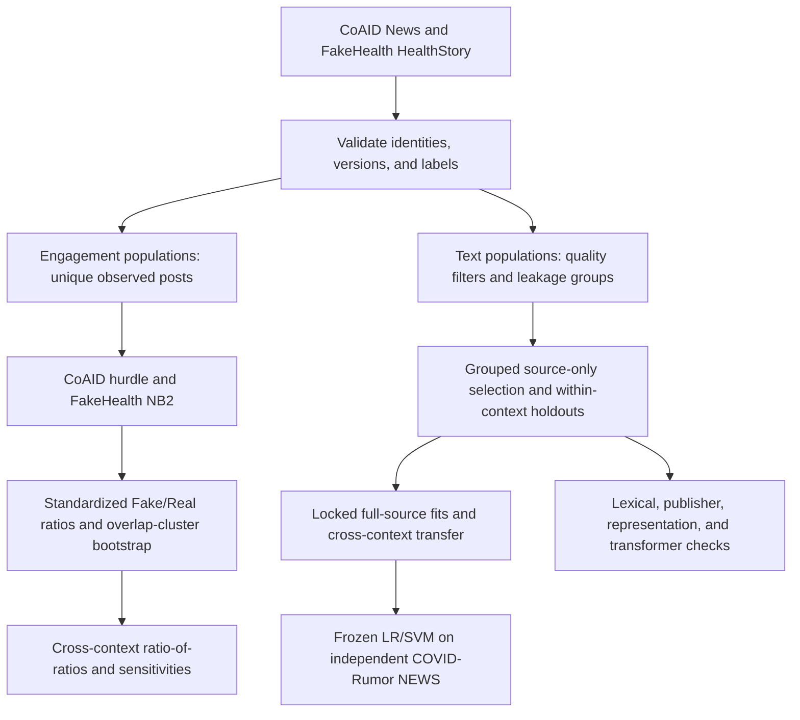

<!--
v3 DRAFT, 2026-10-12. Thesis-led rewrite of manuscript_mentor_revised.md (intermediate mentor revision).
Venue-neutral: unstructured abstract, separate Conclusion, existing citation style.
Numbers match the v2 manuscript and outputs/tables; extension-derived values (hurdle components, top words, encoding audit, FakeNewsNet text and engagement) come from outputs/extension_v1 and are registered in supplementary_material_v3.md, Section S8 and Tables S11–S17.
[Square brackets] mark checks or decisions needed before submission. Delete this comment before rendering.
References: v2 references.bib plus the two verified entries in references_v3_additions.bib (fakenewsnet, juul2021). Literature claims checked in reference_checks.md (2026-10-12).
-->

# What counts as health misinformation shapes its observed spread and its detectability: a comparison of CoAID and FakeHealth

## Abstract

Health misinformation datasets disagree about what misinformation is. FakeHealth labels mainstream health news by expert-rated reporting quality, whereas CoAID contrasts fact-checked COVID-19 claims with material from health agencies and health-information publishers. We asked whether such differences extend to how Fake and Real items circulate and how portable their textual signals are. We compared model-standardized Fake/Real ratios of unique observed social-media posts, including items with no observed posts, between CoAID News and FakeHealth HealthStory, and evaluated leakage-controlled text classifiers within each dataset, across datasets and on an independent COVID-Rumor target. Fake items drew fewer observed posts than Real items in both datasets, but the ratio was 0.253 in CoAID and 0.840 in FakeHealth (ratio-of-ratios 0.301; 95% interval 0.154–0.645). The CoAID gap lay entirely in whether an item was posted at all. In two non-health FakeNewsNet collections, Fake items drew more observed posts than Real ones in GossipCop (ratio 2.144), and the direction in PolitiFact depended on a single cluster of items, so neither the size nor the direction of the gap carried across datasets. Text showed a parallel split: Fake and Real were highly separable within CoAID (macro F1 0.926) and modestly separable within FakeHealth (0.675), classifiers transferred poorly in both directions, and the two datasets' word–label associations were essentially uncorrelated. CoAID-trained models ranked independent COVID rumors better than FakeHealth-trained models (ROC-AUC 0.700 vs 0.522). Because period, labels, sources and collection differ together, these are differences between dataset contexts, not effects of the pandemic. The distance between Fake and Real items, in language and in observed engagement, depends on how a dataset defines misinformation and where it finds it. Engagement studies and detection benchmarks should report both and test beyond a single dataset.

## 1. Introduction

### 1.1 Why the definition of misinformation matters

Health misinformation can change health decisions. In a randomized exposure experiment, COVID-19 vaccine misinformation reduced the share of respondents who said they would definitely accept vaccination by 6.2 percentage points in the UK and 6.4 points in the USA, relative to factual information. [Loomba et al. (2021)](#ref-loomba) Evidence like this has driven two research programs: one that measures how misinformation circulates on social media, and one that builds classifiers to detect it. Both depend on labeled datasets, and both tend to treat "misinformation" as a single category.

Benchmarks for health misinformation do not share a definition of it. In FakeHealth, a story is labeled Fake when expert reviewers rate its reporting as poor, for example because it fails to quantify benefits or harms, ignores costs, or misjudges the quality of the evidence. The stories come from major US media outlets [Dai et al. (2020)](#ref-fakehealth), and many publishers carry both labels (Supplementary Table S15). In CoAID, Fake items are claims flagged by fact-checking sites, while Real items come from health agencies and health-information publishers such as the CDC, WHO, NIH, Healthline and WebMD. [Cui and Lee (2020)](#ref-coaid) The first construct contrasts weaker and stronger reporting from the same kind of outlet; the second contrasts fact-checked claims with institutional health information. If Fake–Real differences in engagement or language depend on which construct a dataset encodes, then results from any single benchmark describe that construct as much as they describe misinformation in general.

### 1.2 Engagement: what is known and what is missing

The best-known diffusion result is that false news on Twitter traveled faster and reached more people than true news, in fact-checked rumor cascades from 2006 to 2017. [Vosoughi et al. (2018)](#ref-vosoughi) That analysis began from content that formed cascades. Counting every labeled item, including those with no observed posts, asks a prior question: whether an item is taken up at all. Juul and Ugander later showed that the reported structural differences between false and true cascades largely disappear once cascade size is matched, because false-news cascades were mainly larger. [Juul and Ugander (2021)](#ref-juul) COVID-era comparisons add that circulation differs across platforms: Cinelli and colleagues found platform differences in the volume and amplification of questionable sources, but no distinct spreading patterns for reliable and questionable sources within their data. [Cinelli et al. (2020)](#ref-cinelli) What has not been examined is whether the Fake–Real engagement gap itself changes with the misinformation construct a dataset encodes, measured on a common zero-inclusive scale.

Measuring that gap fairly requires two things that existing comparisons rarely address. Repeated captures of an updated web page must be resolved into content items before engagement is counted, and items that share the same posts must be treated as dependent when estimating uncertainty.

### 1.3 Detection: what is known about portability

A classifier can learn a dataset's labels without learning anything that holds elsewhere. Torabi Asr and Taboada found that models trained on source-reputation labels did not recover article-level veracity in other collections, with performance varying by topic. [Torabi Asr and Taboada (2018)](#ref-asr) Murayama and colleagues showed that period-specific proper names can become predictive in fake-news datasets and degrade out-of-period performance. [Murayama et al. (2021)](#ref-murayama) Leakage between training and test material inflates such results further. [Kapoor and Narayanan (2023)](#ref-kapoor) Within-dataset scores therefore say little about portability unless they are reported alongside transfer to other datasets, evaluated on the same target items.

### 1.4 This study

We compare CoAID News, a COVID-focused collection, with FakeHealth HealthStory, a non-COVID health-news collection. Both provide health-news content, Fake/Real labels and item-linked social posts, which lets us study engagement and text within the same pair of datasets. We ask three questions:

- **RQ1:** How does the model-standardized Fake/Real ratio of expected unique observed posts differ between CoAID News and FakeHealth HealthStory?
- **RQ2:** How well do learned Fake/Real textual associations generalize within and across the two datasets?
- **RQ3:** Do CoAID-trained and FakeHealth-trained classifiers differ in portability to the same independent COVID-Rumor NEWS target?

RQ1 contributes a zero-inclusive engagement comparison on a common standardized scale, with content versions resolved and shared-post dependence reflected in the uncertainty. RQ2 contributes a leakage-controlled measure of how far each dataset's textual signal travels. RQ3 tests whether the source ordering seen between the two datasets holds on a third collection that neither model was trained on. Two non-health collections from FakeNewsNet provide an out-of-domain check on both branches.

Because COVID timing, label construction, source populations and collection procedures all differ between the two datasets, this design cannot attribute differences to the pandemic itself. We therefore treat each dataset as an information context, defined jointly by what it labels as misinformation and how it was assembled, and ask how the distance between its Fake and Real items varies across contexts. Engagement is measured as captured posts, not exposure or complete cascades, and the text models predict labels; they do not model why items were shared.

## 2. Methods

### 2.1 Design overview

The study has two branches with separate populations and outcomes (Figure M1). The engagement branch models observed post counts per content item. The text branch predicts each dataset's Fake/Real labels from title and body text. Engagement measures never enter the text models. The primary protocols were CoAID reconstruction A for engagement and natural combined-text logistic regression for text; all other analyses are sensitivity or robustness checks.

*Figure M1. Analytical workflow. The engagement branch uses zero-inclusive observed-post populations; the text branch uses separately filtered text populations. Model selection uses source data only; target data are never used for fitting or tuning. COVID-Rumor serves only as an external text target.*

### 2.2 Datasets and labels

**CoAID News.** We used the News subset of the four official releases (`05-01-2020`, `07-01-2020`, `09-01-2020`, `11-01-2020`), with Fake/Real labels from the original News filenames. CoAID's Fake items were drawn from fact-checking sites and its Real items from nine health agencies and health-information publishers. [Cui and Lee (2020)](#ref-coaid) The primary engagement population (reconstruction A) contained 5,337 items: 922 Fake and 4,415 Real. Content records were linked to post mappings through the content ID and to reply mappings through the news ID, within release and file category, because release-local IDs are not globally unique.

**FakeHealth HealthStory.** Stories with an expert-review score below 3 were labeled Fake and those at 3 or above Real. [Dai et al. (2020)](#ref-fakehealth) Reviews, article content and engagement mappings were joined by news ID. The engagement population contained 1,690 items: 472 Fake and 1,218 Real. HealthRelease was not used. FakeHealth's retweet mappings were excluded from the common outcome because CoAID has no equivalent.

**COVID-Rumor NEWS.** For external text evaluation we used the NEWS subset, mapping True to Real and False to Fake and excluding Unverified items and the Twitter subset. [Cheng et al. (2021)](#ref-covidrumor) Annotations were inherited, not independently re-verified.

The analytical labels share an orientation (Fake = 1) but not a construct: FakeHealth labels reporting quality, while CoAID and COVID-Rumor labels derive from veracity judgments. This difference is the organizing variable of the study.

### 2.3 CoAID content identity

CoAID re-captures many of the same web pages across its four releases, sometimes after updates, so item identity had to be resolved before engagement could be counted. Identity relied on the specific URL or resource and on audited source lineage; shared domains, generic titles, branding and shared social posts never established identity. An early representation that merged on such cues produced one component joining 110 source records, which motivated this rule. [Confirm whether the over-merge example belongs in main text or Supplement S1.]

The primary reconstruction (A) merged captures with strong evidence of identical content or only minor updates, split material updates into separate versions, and kept captures with insufficient evidence as separate items. Reconstruction B additionally assumed stability for insufficient-evidence captures of the same validated resource; reconstruction C excluded uncertain-version and unresolved-identity captures. Version partitions used complete-link checks so that chains of pairwise matches could not join incompatible captures. Decision rules and audit records are in Supplementary Methods S1.

### 2.4 Engagement outcome and dependence

The primary outcome was the number of unique observed posts linked to each content item, including items with none. CoAID counts were the union of post IDs across an item's member captures; FakeHealth counts were unique tweet IDs. These are counts of captured posts. They do not measure exposure, complete cascades or network structure, and deleted, private or uncaptured activity is outside the measurement. Reply counts and occurrence summaries were secondary.

Distinct items can share the same posts, so items linked by shared post or reply IDs were resampled together. For each dataset and reconstruction we built a graph with items as nodes and shared IDs as edges; its connected components, including singletons, were the resampling clusters. CoAID A had 5,056 clusters, the largest containing 187 items; FakeHealth had 1,662, the largest containing four. The largest CoAID cluster was examined in a prespecified influence analysis.

### 2.5 Engagement models and estimand

CoAID counts were modeled with a hurdle model: a logistic component for any observed post and a zero-truncated negative binomial (NB2) component for positive counts, each with the Fake indicator and first-recorded-release fixed effects. Release describes capture provenance, not publication or exposure time. The hurdle was selected under a prespecified rule (AIC improvement over NB2 greater than 2, or NB2 instability). FakeHealth counts were modeled with NB2 and the Fake indicator. No exposure offset was used. Model families were fixed before resampling.

Because the two model families have incomparable coefficients, we compared standardized expected counts. Let m_d(a, X_i) be the fitted expected count for item i in dataset d with its Fake indicator set to a and other covariates unchanged. For each dataset,

$$
R_d = \frac{N_d^{-1}\sum_{i=1}^{N_d}m_d(1,X_i)}{N_d^{-1}\sum_{i=1}^{N_d}m_d(0,X_i)}.
$$

For the CoAID hurdle,

$$
m_d(a,X_i)=P(Y_i>0\mid a,X_i)\,E(Y_i\mid Y_i>0,a,X_i),
$$

with row-level products averaged before forming the ratio. Each dataset kept its own covariate distribution, including zero-count items. For CoAID we also report the two hurdle components, the standardized probability of any observed post and the standardized expected count given at least one post, with intervals from the same bootstrap draws. Because the estimand averages row-level products, the two component ratios do not multiply exactly to the overall ratio. FakeHealth has no equivalent split because it was modeled without an occurrence component. The cross-context estimand was C = R_CoAID / R_FakeHealth; values below 1 indicate a larger relative Fake–Real gap in CoAID.

Uncertainty came from an unstratified pairs bootstrap of resampling clusters: each draw sampled clusters with replacement, refitted the model and re-standardized, targeting 1,000 successful draws per dataset and reconstruction (seed 42). The cross-context interval combined all 1,000 × 1,000 pairs of independent CoAID and FakeHealth draws; these million values share marginal draws and are not independent replicates. Intervals are 95% percentile intervals. They assume independence between datasets and do not include uncertainty from entity resolution, missing links or model-family choice, which the B/C reconstructions and the cluster exclusion address separately.

### 2.6 Text cohorts and leakage control

Text was the title and body joined into one field, retaining case, punctuation and URLs; empty and artifact-dominated records were excluded by label-blind rules. Predictors excluded IDs, ratings, source and review metadata, engagement and split fields. The modeling cohorts contained 1,647 FakeHealth items (459 Fake, 1,188 Real) and 3,577 CoAID items (825 Fake, 2,752 Real).

Leakage groups joined items sharing a resource, source lineage, or exact or near-exact text, so that versions of the same resource never crossed a partition. A grouped stratified split reserved about 20% of each dataset as a holdout, chosen on class counts rather than performance (FakeHealth 1,317 training / 330 holdout; CoAID 2,875 / 702), and five grouped cross-validation folds were formed within the training pool. A masked text variant replaced known explicit source names using a label-blind dictionary; because that dictionary drew on evaluation metadata too, masking is a sensitivity check rather than a training-only procedure. Details are in Supplementary Methods S3.

### 2.7 Classical models and within-dataset evaluation

The primary classifier was word TF-IDF with L2-regularized logistic regression (LR); a linear support vector machine (SVM) tested robustness to classifier choice. Vocabularies and IDF weights were learned within each training fold only. Hyperparameters (n-gram range, minimum document frequency, regularization strength, class weighting; 24 LR and 32 SVM configurations) were chosen by mean grouped cross-validation macro F1 on the source training pool and locked before holdout prediction. LR classified Fake at probability ≥ 0.5 and SVM at decision score ≥ 0. We report macro F1 (the unweighted mean of class-wise F1), ROC-AUC and average precision with Fake as the positive class. Grids, tie rules and selected settings are in Supplementary Methods S4.

### 2.8 Cross-dataset transfer and lexical alignment

Transfer asks whether what a model learns in one dataset holds in another. Each source model was refitted on all eligible source items with its locked configuration and applied to the target without fitting, calibration or threshold changes, in both directions. Transfer and within-target models were compared on the identical target holdout items. Predictions were frozen before target labels were joined.

To compare what the two models learned, we intersected the unigram vocabularies of the within-dataset LR models (4,174 shared words) and summarized the agreement of their signed coefficients by Pearson and Spearman correlation and the share of sign reversals, overall and among the top-ranked words. Coefficients are conditional associations within differently fitted models, so the comparison concerns direction, not magnitude.

### 2.9 Robustness analyses

- **Title-only text.** LR tuned and evaluated on titles alone, with transfer compared on identical title-eligible target rows.
- **Unseen publishers (FakeHealth).** Three-fold outer evaluation holding out whole publisher families (49 families), with nested three-fold tuning inside each outer training set. CoAID could not support an equivalent design because its publishers are almost entirely single-label and unresolved publishers are concentrated among Fake items.
- **Transformer.** DistilRoBERTa (pinned revision), title plus body prefix up to 512 tokens, with a 256-token sensitivity; learning rate and epochs chosen on source cross-validation. At 512 tokens, 71.22% of FakeHealth texts and no CoAID texts were truncated. A three-seed follow-up (42, 123, 2026) compared the two token limits for FakeHealth-to-CoAID transfer.

Full protocols are in Supplementary Methods S5 and S6.

### 2.10 External COVID-Rumor evaluation

Of 3,700 NEWS items with True/False labels, 33 overlapping exactly with source texts or resources were excluded, leaving 3,667 (3,015 Fake, 652 Real; 82.22% Fake). The four full-source LR and SVM models were applied unchanged. Quality and overlap-screening rules are in Supplementary Methods S6.

### 2.11 Out-of-domain checks with FakeNewsNet

To see whether the patterns held outside health, we used FakeNewsNet's PolitiFact and GossipCop collections [Shu et al. (2020)](#ref-fakenewsnet) under protocols written before any outcome-dependent computation (Supplementary Methods S8). Labels were inherited. PolitiFact labels are fact-checker verdicts. In GossipCop, stories scored below 5 of 10 by the site were labeled fake, and real items are documented as articles from E! Online; the URLs in our local copy, however, point to a broad set of entertainment and news domains rather than to E! Online (Supplementary Table S17). Two PolitiFact items listed under both labels were excluded.

For engagement, the outcome was distinct tweet IDs per item, including zeros (PolitiFact 1,052 items: 430 Fake, 622 Real; GossipCop 22,140: 5,323 Fake, 16,817 Real). Tweets were collected by headline search, and no reply or retweet mapping exists. Model selection, estimand and cluster bootstrap followed Sections 2.4–2.5, with the Fake indicator as the only covariate; the selection rule chose the hurdle model in both collections. As for CoAID, we also refitted each collection without its largest cluster of items linked by shared tweets. For text, only titles were available locally, so items passing the COVID-Rumor quality and overlap rules (PolitiFact 429 Fake, 596 Real; GossipCop 5,315 Fake, 16,799 Real) were scored with the existing title-only LR models; no title-only SVM exists.

### 2.12 Statistical reporting and reproducibility

Engagement uncertainty is reported as bootstrap percentile intervals. Fold and seed standard deviations describe variability and are not confidence intervals. Text comparisons are descriptive; no significance tests were used to declare one model or source superior. Analyses used Python 3.14 with scikit-learn and statsmodels, and Python 3.12 with PyTorch and Transformers for the transformer; versions, seeds and provenance records are given in Supplementary Methods S7. [Data and code availability statement to be added per venue.]

## 3. Results

### 3.1 Fake items drew far fewer observed posts than Real items in CoAID, and nearly as many in FakeHealth

Fake items drew fewer observed posts than Real items in both datasets, but the gap was far larger in CoAID. The standardized Fake/Real ratio was 0.253 in CoAID (95% interval 0.132–0.522): a Fake item was expected to draw about a quarter as many observed posts as a Real one. In FakeHealth the ratio was 0.840 (0.714–0.997), close to parity. The ratio of the two ratios was 0.301 (0.154–0.645; Figure 1).

The direction held under each alternative reconstruction of CoAID items (ratio-of-ratios 0.286 for B and 0.343 for C; Table 1). Its magnitude depended on one cluster: excluding CoAID's largest group of items linked by shared posts moved the ratio-of-ratios to 0.489 (0.310–0.710), weaker but in the same direction. Because the exclusion changes the CoAID reference population, this is an influence check, not a replacement estimate.

Absolute levels differed by an order of magnitude. Standardized expected counts were 199.9 (Fake) and 237.9 (Real) posts per FakeHealth item, against 8.8 and 34.9 per CoAID item, which is why the comparison is made between within-dataset ratios.

The CoAID gap lay entirely in whether an item was posted at all. Standardized over the same population, a Fake item had an expected 11.7% chance of any observed post against 61.7% for a Real item (ratio 0.190; 95% interval 0.164–0.218). Among items with at least one post, Fake items drew somewhat more posts than Real ones (expected 51.4 vs 39.5; ratio 1.30, 0.73–2.55), an interval that includes parity (Supplementary Table S11). Nearly all FakeHealth items had observed posts, so its ratio reflects posting volume alone.

*Figure 1. Fake/Real observed-post ratios in CoAID and FakeHealth. Points are model-standardized ratios of expected unique observed posts, including items with no observed posts; bars are 95% cluster-bootstrap percentile intervals. Log scale; the dashed line marks parity. Ratio-of-ratios 0.301 (0.154–0.645).*

### 3.2 Outside health, the size, direction and source of the gap all changed

Two non-health collections show that neither the size nor the direction of the gap is fixed (Table 2; Supplementary Table S17). Under the same estimand, the Fake/Real ratio was 0.559 (0.439–1.868) for PolitiFact and 2.144 (1.212–3.290) for GossipCop.

Where the gap arose also differed. In CoAID, Fake items were far less likely than Real ones to have any observed post. In PolitiFact, which like CoAID labels items by fact-checker verdicts, this reversed: Fake items were more likely to have any observed post (0.907 vs 0.654). Its overall direction rested on one cluster of 84 items, 79 of them Real, linked by a chain of pairwise shared tweets and holding two-thirds of the collection's post links. Without that cluster the ratio rose to 1.446 (1.073–2.046), and posted Fake and Real items drew similar numbers of posts (ratio 0.96). Excluding the dominant cluster weakened CoAID's contrast but reversed PolitiFact's, so we claim no direction for PolitiFact.

In GossipCop, Fake items drew more expected posts than Real ones in both components. The ratio stayed above 1 without its largest cluster (1.374, 1.146–1.621) and when items with repeated titles were removed (1.767). Its ratio-of-ratios against FakeHealth was 2.552 (1.357–4.087), or 1.635 (1.277–2.057) without the cluster. The excess rests on a heavy Fake tail: the median item had 12 posts if Fake and 45 if Real.

These collections differ from the health pair in topic, period and collection procedure. They serve as an out-of-domain check, not as further primary contexts.

**Table 2. Fake/Real observed-post ratios and their components in four collections.**

| Collection | Fake label | Fake/Real ratio (95% interval) | Any observed post, Fake / Real | Posts given any, Fake/Real ratio (95% interval) |
| --- | --- | --- | --- | --- |
| CoAID News | Fact-checked claims (Real: health agencies and publishers) | 0.253 (0.132–0.522) | 0.117 / 0.617 | 1.30 (0.73–2.55) |
| FakeHealth HealthStory | Expert-rated poor reporting | 0.840 (0.714–0.997) | Near ceiling | Not separated (single-part model) |
| FakeNewsNet PolitiFact | Fact-checker verdicts | 0.559 (0.439–1.868) | 0.907 / 0.654 | 0.404 (0.336–1.255) |
| PolitiFact, largest cluster excluded | | 1.446 (1.073–2.046) | 0.906 / 0.604 | 0.964 (0.726–1.351) |
| FakeNewsNet GossipCop | Site score below 5 of 10 | 2.144 (1.212–3.290) | 0.965 / 0.937 | 2.083 (1.185–3.179) |
| GossipCop, largest cluster excluded | | 1.374 (1.146–1.621) | 0.960 / 0.937 | 1.340 (1.118–1.577) |

*Standardized expected unique observed posts, including items with none. CoAID and FakeHealth are the primary contexts; the FakeNewsNet rows are an out-of-domain check with title-search tweet collection and no release covariate. Probabilities are standardized (CoAID) or fitted class values (FakeNewsNet). Cluster-excluded rows change the reference population and are influence checks, not replacement estimates. Component ratios do not multiply exactly to the overall ratio because the estimand averages row-level products. Sources: Supplementary Tables S11 and S17.* [Add FakeHealth's observed any-post shares by class from the saved occurrence table if wanted.]

### 3.3 Fake and Real were highly separable by text in CoAID and modestly separable in FakeHealth

On reserved holdouts, logistic regression reached macro F1 0.926 and ROC-AUC 0.983 in CoAID, against 0.675 and 0.770 in FakeHealth (Figure 2). The linear SVM gave nearly identical results (CoAID 0.913 and 0.980; FakeHealth 0.670 and 0.770). Masking explicit source names barely changed either dataset (CoAID 0.926 to 0.928; FakeHealth 0.675 to 0.673).

The FakeHealth signal was not mainly a publisher signal. When whole publisher families were held out, macro F1 averaged 0.620 across folds (SD 0.021; range 0.603–0.643; mean ROC-AUC 0.700), compared with 0.660 under resource-grouped cross-validation. The two designs differ in grouping and tuning, so the comparison is descriptive, but most of the signal survived on publishers the model had never seen.

CoAID's separability did not rest on formatting artifacts, although its classes differ sharply in format (Supplementary Table S16). Character-encoding errors appeared in 25.9% of CoAID Fake texts and no Real texts, and year tokens and photo credits appeared in 49.0% and 24.8% of Real texts against 8.4% and 0.1% of Fake texts. In FakeHealth the same markers were spread evenly across classes (years 58.8% Fake vs 62.5% Real; credits 23.1% vs 17.9%). Repairing the encoding errors left CoAID holdout macro F1 at 0.928, and removing years, month names and credits as well gave 0.919.

### 3.4 What each model learned did not carry over to the other dataset

Transfer cut performance sharply in both directions, leaving ranking only modestly above chance (Figure 2). On the CoAID holdout, the FakeHealth-trained LR reached macro F1 0.429 and ROC-AUC 0.571, a macro-F1 drop of 0.497 from the CoAID-trained model on the same items. On the FakeHealth holdout, the CoAID-trained LR reached 0.451 and 0.619, a drop of 0.224. SVM reproduced both results (0.425 and 0.583; 0.449 and 0.631). The larger drop on CoAID reflects its higher within-dataset baseline.

The errors ran in opposite directions. FakeHealth-trained models labeled too many CoAID items Fake, while CoAID-trained models labeled too few FakeHealth items Fake.

The two datasets' word–label associations were essentially unrelated (Figure 3). Across the 4,174 words shared by the two LR models, coefficients correlated at r = −0.015 (Spearman ρ = −0.003), and 48.4% reversed direction between datasets. Among the 100 most strongly weighted shared words, 48.0% reversed, so the strongest cues were no more consistent than the rest.

The most heavily weighted words differed in kind as well as direction (Supplementary Table S12). CoAID's Fake-leaning words included dates ("2020", "april", "march") and image-credit fragments ("getty", "images", "medscape"), and its strongest Real-leaning word was "and". FakeHealth's weights were much smaller and centered on health-reporting vocabulary, with press-release terms ("release") leaning Fake and words such as "costs" and "says" leaning Real. Between 9 and 14 of each dataset's 25 most Fake- or Real-leaning words leaned the other way in the other model.

*Figure 2. Within-dataset and transferred text performance. Macro F1 (A) and ROC-AUC (B) for TF-IDF logistic regression and linear SVM. Filled circles: models trained in the target dataset; open squares: models transferred from the other dataset. Both are scored on the same target holdout items (CoAID N = 702; FakeHealth N = 330).*

*Figure 3. Word–label associations in the two datasets. Each point is one of 4,174 unigrams shared by the within-dataset logistic regression models; positive values point toward Fake. Crosses mark words whose association reverses sign between datasets (48.4%). Pearson r = −0.015; Spearman ρ = −0.003. Coefficient scales are model-specific, so the figure shows direction, not magnitude.*

### 3.5 CoAID-trained models ranked independent COVID rumors better

On the 3,667 COVID-Rumor NEWS items, CoAID-trained models ranked items considerably better than FakeHealth-trained models (Figure 4). ROC-AUC was 0.700 versus 0.522 for LR and 0.682 versus 0.525 for SVM; FakeHealth-trained models were close to chance. Macro F1 showed the same ordering with smaller differences (LR 0.558 vs 0.497; SVM 0.531 vs 0.497). The ordering held when approximate overlaps were also excluded and when all eligible items were retained.

The portable part of the signal was ranking, not classification. With fixed source thresholds, all four models labeled 89.6–94.4% of items Fake against a true rate of 82.2%, and balanced accuracy stayed between 0.50 and 0.55. Both source vocabularies covered most target words (89.5% of target word occurrences for CoAID, 81.9% for FakeHealth), and no target item lacked features.

A non-COVID target showed a weaker version of the same ordering. Scored with title-only LR, the CoAID-trained model ranked FakeNewsNet's fact-checked PolitiFact items better than the FakeHealth-trained model (ROC-AUC 0.608 vs 0.503) and GossipCop's entertainment items slightly better (0.532 vs 0.477). Both models were near chance on thresholded metrics, and the FakeHealth title model carried little signal even within FakeHealth (macro F1 0.513), so this comparison is weak evidence on its own (Supplementary Table S13).

*Figure 4. Transfer to independent COVID rumors. ROC-AUC (A) and macro F1 (B) on the same 3,667 COVID-Rumor NEWS items (82.22% Fake) for models trained on CoAID (solid) and FakeHealth (hatched). Source models and thresholds were applied unchanged. Dashed line in A marks ROC-AUC = 0.5.*

### 3.6 Robustness

The main patterns held across the robustness checks (Table 1). Title-only models gave small macro-F1 gains on transfer but lower ROC-AUC in both directions, so shortening the text did not restore portability. DistilRoBERTa matched the classical within-dataset pattern (macro F1 0.939 in CoAID, 0.621 in FakeHealth) but did not improve transfer: FakeHealth-to-CoAID ROC-AUC was 0.442 and CoAID-to-FakeHealth 0.437. Its transfer scores were also unstable. Across three seeds with identical settings, FakeHealth-to-CoAID macro F1 on the matched CoAID holdout at 512 tokens ranged from 0.287 to 0.510. Shortening inputs to 256 tokens raised macro F1 in all three seeds (mean change +0.101, SD 0.079) but improved ranking in only one.

**Table 1. Robustness and sensitivity checks.**

| Analysis | Result | Reading |
| --- | --- | --- |
| Engagement, reconstructions B and C | Ratio-of-ratios 0.286 (B), 0.343 (C) | Direction unchanged |
| Engagement, largest CoAID cluster excluded | Ratio-of-ratios 0.489 (0.310–0.710) vs 0.301 | Weaker, same direction; changes the reference population, so not a replacement estimate |
| Linear SVM | Within macro F1: CoAID 0.913, FakeHealth 0.670; transfer near chance | Replicates LR |
| Source-name masking | LR holdout macro F1: CoAID 0.926 → 0.928; FakeHealth 0.675 → 0.673 | Signal not carried by explicit names |
| CoAID encoding repair; plus years, months, credits removed | LR holdout macro F1 0.928; 0.919 (vs 0.926) | Signal not carried by formatting artifacts |
| FakeHealth unseen publishers | Mean macro F1 0.620 (SD 0.021) vs 0.660 resource-grouped | Most signal survives |
| Title-only transfer | Small macro-F1 gains; lower ROC-AUC in both directions | Does not restore transfer |
| DistilRoBERTa, 512 tokens | Transfer ROC-AUC 0.442 and 0.437 | No transfer gain |
| DistilRoBERTa, 256 vs 512 tokens, 3 seeds | Macro F1 +0.101 (SD 0.079); ranking better in 1 of 3 | Seed-sensitive |

*SD = standard deviation across folds or seeds, not a confidence interval.*

## 4. Discussion

### 4.1 One pattern across both branches

The two branches of this study point the same way. In FakeHealth, Fake and Real items sit close together on every axis we measured. They come from overlapping publishers, text separates them only modestly (macro F1 0.675, most of which survives evaluation on unseen publishers), and Fake items draw nearly as many observed posts as Real ones (ratio 0.840). In CoAID they sit far apart. Source and label are nearly the same variable (Cramér's V 0.971 against 0.352 in FakeHealth, in the text-modeling cohorts; Supplementary Table S14), text separates the classes almost perfectly (0.926), and Fake items draw about a quarter of the observed posts of Real ones (0.253). We read this as one pattern rather than two: what a dataset counts as misinformation, and where it finds it, sets how far its Fake items sit from its Real ones, in language and in audience alike. FakeHealth's Fake label marks weaker reporting from mainstream outlets that travels through the same channels as stronger reporting. CoAID's marks fact-checked claims, set against a Real category made up of health agencies and health-information publishers.

The near-zero alignment of word–label associations fits this reading. If the two Fake labels encode different constructs, a word that signals one need carry no information about the other, and neither model's lessons should transfer. That is what we observed, in both directions and with both classical models. The direction of the transfer errors is consistent with the same account: a model trained on CoAID, where Fake means a fringe claim, treats mainstream journalism as Real, and FakeHealth's Fake items are mainstream journalism. The words each model relied on fit the same account. FakeHealth's model leaned on vocabulary that echoes its reviewers' criteria, with press-release language toward Fake and discussion of costs toward Real, both of which are explicit review criteria [Dai et al. (2020)](#ref-fakehealth). CoAID's model leaned on dates, image credits and function words, which mark how its sources format pages and how the text was collected: nearly half of CoAID's Real texts carry a year and a quarter a photo credit, against almost none of its Fake texts.

The FakeNewsNet collections sharpen what this pattern can and cannot mean. PolitiFact shares CoAID's Fake construct, fact-checker verdicts, yet its Fake items were more likely, not less, to have any observed post, and without one dominant cluster they drew more posts overall. A fact-checked Fake label therefore does not by itself fix the direction or the source of the engagement gap. What the Fake items are compared against matters as much: CoAID sets fact-checked claims against institutional health information, which drew heavy attention in 2020, while PolitiFact sets them against political news. The description of CoAID's Fake items as claims that rarely gained traction describes CoAID, not fact-checked misinformation in general. What held across all four collections is that the Fake/Real ratio belongs to the dataset context: it ranged from about a quarter in CoAID to about two in GossipCop, with whether items were posted at all driving the gap in some collections and how much they were posted driving it in others.

### 4.2 Weighing the explanations

Three explanations could produce this pattern, and they are not equally supported. The first is label construct and source ecology: the datasets define Fake differently and draw Fake and Real items from differently separated sources. This explanation accounts for every text result, including the external one, since COVID-Rumor's labels, like CoAID's, derive from fact-checking. For engagement, PolitiFact shows that the label construct alone is not enough: it shares CoAID's construct but not its engagement pattern, which shifts weight toward source ecology and toward what the Real class consists of. The second is collection and measurement. Both CoAID and FakeHealth gathered tweets by searching for item titles, and FakeHealth also searched by keywords and URLs, so search itself is not what differs. [Dai et al. (2020)](#ref-fakehealth), [Cui and Lee (2020)](#ref-coaid) What differs is how queries were formed, when crawls ran, and, in CoAID, how posts were pooled across repeated captures. These differences could widen the engagement gap but would not explain the text results. The hurdle components make this explanation more pressing, not less: the whole CoAID gap lies in whether an item has any observed post, which is exactly where differences in capture would show. PolitiFact, also collected by headline search, showed no Fake occurrence deficit, so headline search does not produce one by itself. Whether CoAID's Fake items were harder to find is a question about those items: no publisher could be resolved for two-thirds of them (Supplementary Table S15), and some are social-media posts whose titles may make poor search queries. The third is the COVID context itself: a crisis may shift attention toward official sources and change the language of both true and false claims. This is consistent with CoAID-trained models transferring better to COVID rumors, but that result cannot separate shared topic from shared fact-check labeling. A non-COVID target offers a partial test. CoAID-trained title models also ranked fact-checked political claims from PolitiFact better than FakeHealth-trained ones, which modestly favors label construct over COVID topic, although the title-only comparison is too weak to settle it. The first explanation, with source ecology weighted as heavily as the label, fits the full pattern most economically. The second cannot be excluded for engagement. The third remains open and is the question a different design must answer.

### 4.3 Engagement in context

These estimates do not fit a simple rule that misinformation draws more engagement than accurate information. They need not conflict with Vosoughi and colleagues' finding either. [Vosoughi et al. (2018)](#ref-vosoughi) Their unit was the fact-checked rumor cascade, so every item had been shared at least once; ours includes items that never were, and counts captured posts rather than cascade depth, speed or reach. The hurdle components show why the two findings can coexist. In CoAID, fact-checked Fake items were about one-fifth as likely as Real items to have any observed post, but those that were posted drew a comparable number of posts (ratio 1.30, with an interval that includes parity). A study that begins from cascades sees only the second part of this picture. Juul and Ugander's finding that structural differences largely reflect cascade size [Juul and Ugander (2021)](#ref-juul) points the same way: comparisons that condition on circulation and comparisons that count every item answer different questions. The split is not general, however. In PolitiFact, Fake items were more often posted, and without its dominant cluster they drew as many posts once posted, which is closer to the pattern cascade studies report. Cinelli and colleagues likewise found no distinct spreading patterns for reliable and questionable sources in their data. [Cinelli et al. (2020)](#ref-cinelli)

The FakeHealth result deserves attention in its own right. Stories that expert reviewers judged poorly reported drew 84% of the observed posts of well-reported stories. Fabricated claims are the more visible form of health misinformation, but misleading coverage from mainstream outlets may be the more pervasive one, because it reaches audiences through the same channels as sound reporting.

The CoAID magnitude should be read with its sensitivity. Excluding a single large cluster of items linked by shared posts moved the contrast from 0.301 to 0.489. The direction is robust; the size depends on how a small number of heavily shared items is treated.

### 4.4 What this means for detection

High within-dataset accuracy is weak evidence of a general detector. CoAID's labels were easy to learn and hard to export: macro F1 of 0.926 within the dataset coexisted with near-chance transfer and word associations unrelated to FakeHealth's. This echoes Torabi Asr and Taboada's finding that source-reputation labels do not recover article veracity elsewhere [Torabi Asr and Taboada (2018)](#ref-asr), and Murayama and colleagues' evidence that period-specific names can become spurious cues. [Murayama et al. (2021)](#ref-murayama) Benchmarks should state which misinformation construct their labels encode, evaluate on grouped splits, and report transfer to at least one external target on the same items.

Threshold and ranking metrics need to be read together. Title-only models and shorter transformer inputs raised macro F1 without improving ranking, and on the external target the useful signal was entirely in ranking. A fixed threshold that suits one dataset's class balance will not suit another's.

More capable models did not solve the problem. DistilRoBERTa matched the classical models within datasets, did not improve transfer, and its transfer scores varied widely across seeds. This is evidence about the protocols tested here, not a ranking of model families, but it is consistent with the limit on portability lying in the labels rather than the representation. Work on joint learning across misinformation tasks [Lee et al. (2021)](#ref-lee) is a reasonable next step only if it is evaluated against fixed external targets with explicit label constructs.

### 4.5 Sharing, attention and crisis

Sharing is not a readout of accuracy. Pennycook and colleagues found that people discriminated true from false COVID headlines less well when deciding what to share than when judging accuracy [Pennycook et al. (2020)](#ref-pennycook), although a preregistered replication found a smaller effect for the accuracy-nudge intervention. [Roozenbeek et al. (2021)](#ref-roozenbeek) Observed engagement therefore reflects attention, source visibility and platform processes as well as content, and the text models here say nothing about why items were shared.

One crisis-specific hypothesis deserves testing. A crisis may reorganize which institutions, topics and rhetorical forms appear alongside verified and false information, and draw unusual attention to official sources. If so, part of a crisis-period Fake–Real gap would reflect elevated engagement with authoritative information, not only the behavior of misinformation. CoAID makes this concrete, because its Real category is health agencies and health-information publishers. The present data are consistent with this possibility but cannot test it.

### 4.6 Limitations

The most important limitation is that label construct, source composition, COVID timing and collection procedure vary together between the datasets. The study can describe how the Fake–Real distance differs between these contexts; it cannot attribute the difference to any one of them, and the external target does not remove this confounding.

Engagement is measured as captured posts. Deleted, private and uncaptured activity cannot be recovered, and if capture differed by class or dataset it could bias the ratios. The cluster bootstrap reflects dependence through shared posts only, assumes independence between datasets, and does not include uncertainty from entity resolution; the large influence of one CoAID cluster shows that magnitude estimates are fragile.

Text comparisons are bounded by the information each model received. CoAID stores short excerpts and FakeHealth full articles, most FakeHealth texts were truncated for the transformer, and the transformer follow-up covered three seeds in one direction. Publisher-held-out evaluation was possible only for FakeHealth. CoAID's Fake and Real texts also differ in format, including encoding errors confined to Fake texts. Removing these markers barely changed separability, but other collection traces may remain.

The external target consists of short statements with 82% Fake prevalence. Its results describe ranking portability to that genre and class balance, and conservative overlap screening cannot exclude every equivalent item. The FakeNewsNet checks are weaker still: text was limited to titles, engagement came from a different collection procedure and period, PolitiFact's direction depends on one cluster, and the local GossipCop Real items do not match their documented source.

### 4.7 Future work

The existing datasets cannot support a tighter comparison. Only two publisher families, ABC News and CNN, carry both labels in both datasets, retaining 11 CoAID items (5 Fake, 6 Real) and 97 FakeHealth items (28 Fake, 69 Real); no shared family has five items of each label in each dataset. Publisher identity is unresolved for most CoAID Fake items, so restricting to identified publishers would discard 66.81% of Fake support. CoAID records no topic field, and no common per-item observation window can be verified. (Supplementary Table S15) Restricting or matching the existing collections would yield a small, selected population and still leave differences in label construct and collection procedure.

Separating crisis context from label construct therefore requires new data: a fixed publisher panel with adequate Fake and Real support in both crisis and comparison periods; a common item-level veracity protocol, with reporting quality recorded as a separate construct; one platform outcome collected under identical query rules and a prespecified follow-up horizon; and retained timestamps and version lineage. Exposure and behavioral measures would be needed to explain why sharing differs. For detection, event-held-out and chronological evaluations with consistent label definitions would test whether the portability pattern recurs. A non-COVID fact-checked target with full article text, scored with both classical models, would give a firmer test of whether CoAID's portability follows its topic or its labels than the title-only check reported here.

## 5. Conclusion

Fake health items drew fewer observed posts than real ones in both health datasets we studied, but how many fewer depended on the dataset: about a quarter as many in COVID-focused CoAID, where the shortfall came from Fake items rarely being posted at all, and nearly as many in FakeHealth. Outside health, the gap was uncertain in PolitiFact and reversed in GossipCop. Text showed the same dependence on the dataset. CoAID's labels were easy to learn and hard to export, FakeHealth's were harder to learn, and neither dataset's lessons carried over to the other, although CoAID-trained models ranked independent COVID rumors better. The common thread is that the distance between misinformation and real news is set by how a dataset defines misinformation and where it finds it, and what a dataset counts as real matters as much as what it counts as fake. Fact-checked false claims, poorly reported health news and low-rated entertainment stories are different objects, with different distances from real news in language and in reach. Whether crisis periods themselves change that distance remains open. Answering it requires data that hold platform, labeling and observation windows fixed across crisis and non-crisis periods. Until then, engagement findings and detection scores should be reported alongside the definition of misinformation that produced them.

## References

[Carry over the v2 reference list and add the two verified entries from references_v3_additions.bib:]

Juul, J. L., & Ugander, J. (2021). [Comparing information diffusion mechanisms by matching on cascade size](https://doi.org/10.1073/pnas.2100786118). *Proceedings of the National Academy of Sciences*, 118(46), e2100786118.

Shu, K., Mahudeswaran, D., Wang, S., Lee, D., & Liu, H. (2020). [FakeNewsNet: A data repository with news content, social context, and spatiotemporal information for studying fake news on social media](https://doi.org/10.1089/big.2020.0062). *Big Data*, 8(3), 171–188.
